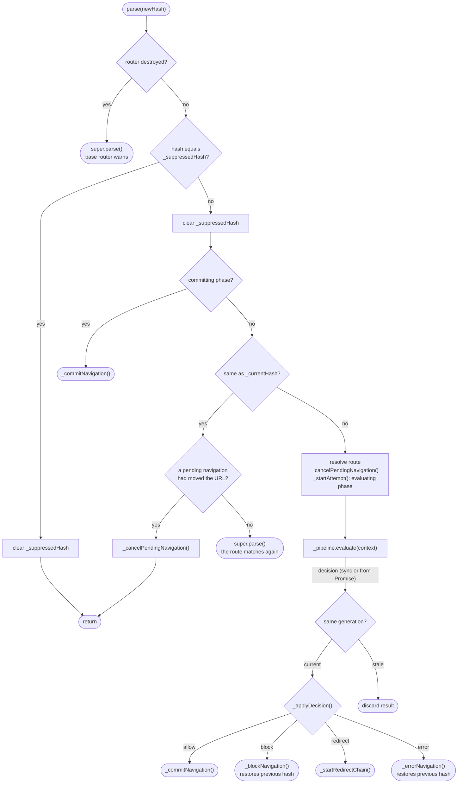
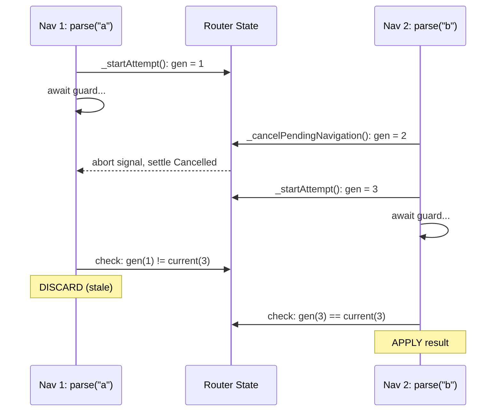
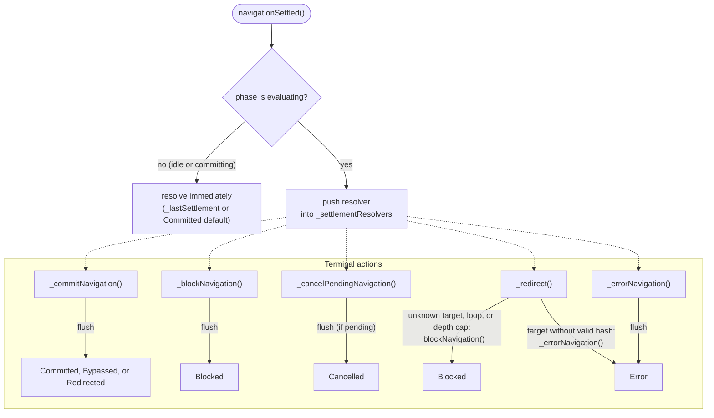

# Architecture

## Repository Structure

```
ui5-lib-guard-router/
|-- package.json                    npm workspaces root
|-- tsconfig.base.json              shared TypeScript config (strict mode)
|-- .oxlintrc.json                  linter config
|
|-- packages/
    |-- lib/                        the core library
    |   |-- ui5.yaml                OpenUI5 1.144.0, specVersion 4.0
    |   |-- src/
    |   |   |-- manifest.json       library manifest (minUI5Version 1.144.0)
    |   |   |-- library.ts          Lib.init() entry point
    |   |   |-- Router.ts           extended Router (core implementation)
    |   |   |-- GuardPipeline.ts    guard storage and leave -> enter evaluation
    |   |   |-- GuardConfig.ts      parses the guardRouter block (options, routeMeta, guards)
    |   |   |-- GuardModules.ts     guard module export shapes and names, block and lazy loading
    |   |   |-- PatternTree.ts      route pattern ancestry and pattern-tree guard expansion
    |   |   |-- RouteMeta.ts        route metadata store with inheritance and caching
    |   |   |-- NavigationOutcome.ts  enum for settlement outcomes
    |   |   |-- types.ts            all public type definitions
    |   |-- test/
    |       |-- qunit/              QUnit tests (unit)
    |       |-- wdio-qunit.conf.ts  runs QUnit in headless Chrome
    |       |-- wdio-qunit.stryker.conf.ts  QUnit run per Stryker mutant
    |
    |-- demo-app/                   demo application
        |-- ui5.yaml                serves lib + app with transpile (OpenUI5)
        |-- ui5-flp.yaml            FLP preview config (SAPUI5, sap.ushell)
        |-- webapp/
        |   |-- Component.ts        guard registration example
        |   |-- manifest.json       routerClass: "ui5.guard.router.Router"
        |   |-- controller/         App, Home, Protected, Blocked, Forbidden, Admin, Employee, Employees, NotFound (+ BaseController)
        |   |-- view/               XML views + SettlementPanel fragment
        |   |-- i18n/               text bundle of the root component
        |   |-- guards.ts           guard factories (runtime and reference-only)
        |   |-- guards/             declarative guard modules (blockedGuard, forbiddenGuard, retiredPageGuard, dirtyFormGuard, navigationLogger)
        |   |-- demo/               RuntimeCoordinator, ScenarioRunner
        |   |-- flp/                ContainerAdapter (ushell dirty-state provider)
        |   |-- model/              auth.json, runtime model factory
        |   |-- routing/            hashNavigation helpers
        |   |-- reporting/          nested component with its own guard router (manifest, controller/, view/, guards/, i18n/, model/reports.json)
        |-- test/
            |-- e2e/                wdi5 e2e tests (standalone)
            |-- flp/                wdi5 FLP preview tests
            |-- shared/             control references (view ID + control ID), model and nested-component helpers for both suites
            |-- wdio.conf.ts        standalone e2e config
            |-- wdio-flp.conf.ts    FLP preview e2e config
```

## High-Level Overview

The library provides a drop-in replacement for `sap.m.routing.Router` that adds async
navigation guards. Guards intercept every navigation path (programmatic `navTo`, browser
back/forward, direct URL changes) and can allow, block, or redirect before any route
matching, target loading, or event firing occurs.

```
+----------------------------------------------------------------------+
|                        Application (Component)                       |
|                                                                      |
|   router.addGuard(globalGuardFn)                                     |
|   router.addRouteGuard("protected", routeGuardFn)                    |
|   router.addLeaveGuard("editOrder", leaveGuardFn)                    |
|   router.initialize()                                                |
+----------------------------------------------------------------------+
         |                                                    ^
         | manifest: routerClass = "ui5.guard.router.Router"   | navTo()
         v                                                    |
+----------------------------------------------------------------------+
|                     ui5.guard.router.Router                            |
|                                                                      |
|   extends sap.m.routing.Router                                       |
|   overrides navTo() + parse() to intercept all navigation            |
|                                                                      |
|   +----------------------------+    +-------------------------------+  |
|   | Guard Management           |    | Navigation Interception       |  |
|   |                            |    |                               |  |
|   | addGuard()                 |    | navTo() override              |  |
|   | removeGuard()              |    | parse() override              |  |
|   | addRouteGuard()            |    | _applyPreflightDecision()     |  |
|   | removeRouteGuard()         |    | _applyDecision()              |  |
|   | addLeaveGuard()            |    | _cancelPendingNavigation()    |  |
|   | removeLeaveGuard()         |    | _commitNavigation()           |  |
|   | navigationSettled()        |    | _redirect()                   |  |
|   | attachNavigationSettled()  |    | _applyRedirectDecision()      |  |
|   | detachNavigationSettled()  |    | _blockNavigation()            |  |
|   +----------------------------+    | _errorNavigation()            |  |
|                                     | _flushSettlement()            |  |
|                                     | _restoreHash()                |  |
|                                     +-------------------------------+  |
|                                                                        |
|   +------------------------------------------------------------------+ |
|   | _pipeline: GuardPipeline                                         | |
|   |                                                                  | |
|   | evaluate(context)  — leave → global enter → route enter          | |
|   | addGlobalGuard / removeGlobalGuard                               | |
|   | addEnterGuard / removeEnterGuard                                 | |
|   | addLeaveGuard / removeLeaveGuard                                 | |
|   | clear()                                                          | |
|   +------------------------------------------------------------------+ |
+----------------------------------------------------------------------+
         |
         | super.parse(hash)
         v
+----------------------------------------------------------------------+
|                      sap.m.routing.Router                            |
|                                                                      |
|   Route matching, Target loading, View creation, Event firing        |
+----------------------------------------------------------------------+
```

## Type System

All types are defined in `types.ts` and exported for consumer use.

```
GuardFn      = (context: GuardContext) => GuardResult | PromiseLike<GuardResult>
LeaveGuardFn = (context: GuardContext) => boolean | PromiseLike<boolean>

GuardContext                        GuardResult
+----------------+                 +---------------------------+
| toRoute        |  string         | true    -> allow          |
| toHash         |  string         | false   -> block          |
| toArguments    |  RouteInfo["arguments"] | string  -> redirect  |
| fromRoute      |  string         | GuardRedirect -> redirect |
| fromHash       |  string         |   with params & targets   |
| signal         |  AbortSignal    +---------------------------+
| bag            |  Map<string, unknown>
| toMeta         |  Readonly<Record<string, unknown>>
| fromMeta       |  Readonly<Record<string, unknown>>
| ownerComponent |  UIComponent | undefined
+----------------+

NavigationOutcome (UI5 enum)        NavigationResult
+----------------+                  +----------------------------+
| Committed      |  "committed"    | status: NavigationOutcome   |
| Bypassed       |  "bypassed"     | route:  string              |
| Blocked        |  "blocked"      | hash:   string              |
| Redirected     |  "redirected"   | error?: unknown             |
| Cancelled      |  "cancelled"    +----------------------------+
| Error          |  "error"
+----------------+

GuardRouter (public interface)      Router (ES6 class)
  extends sap.m.routing.Router        extends sap.m.routing.Router
  + 6 guard methods                   implements GuardRouter
  + 2 metadata methods                + internal state fields
  + 1 query + 2 event methods         + private _cancelPendingNavigation()
    addGuard / removeGuard             + private _flushSettlement()
    addRouteGuard / removeRouteGuard   + override initialize(), addRoute(),
    addLeaveGuard / removeLeaveGuard     navTo(), parse(), stop(), destroy(),
                                         attachRouteMatched()
    getRouteMeta / setRouteMeta
    navigationSettled()
    attachNavigationSettled()
    detachNavigationSettled()
    navTo() overloads (GuardNavToOptions)

  addRouteGuard / removeRouteGuard accept both:
    - GuardFn (enter guard)
    - { beforeEnter?, beforeLeave? } (object form)
```

Only strict `true` allows navigation. A non-empty string or a `GuardRedirect` object
redirects; every other value (numbers, other objects, `null`, `undefined`, the empty string)
blocks with a warning. This prevents accidental allow from coercion.

`NavigationOutcome` is registered as a UI5 enum in `library.ts` via `DataType.registerEnum`.
The manifest dependency chain guarantees `library.ts` executes before `Router.ts` is loaded,
so `Router.ts` does not need to import `library.ts`. See [Library Loading Order Research](../research/library-loading-order.md)
for the full analysis of the Component bootstrap sequence.

The Router is an ES6 class that extends `sap.m.routing.Router` and implements the
`GuardRouter` interface. Application code casts `getRouter()` to `GuardRouter` for
type-safe access to the guard management methods. Internal state and methods live
directly on the class as typed fields; no separate internal interface is needed.

## parse() Override - Fallback for Browser-Initiated Navigation

Browser-initiated navigation (back/forward, URL bar, direct hash changes) flows through
`parse()`. The override intercepts it to run guards before the parent router processes
the hash. With the default `navToPreflight: "guard"`, programmatic `navTo()` calls run the
guards in the preflight path (see below); the hash change they cause re-enters `parse()` in
the committing phase, which commits without running the guards again.



**Sync vs Async:** Guards run synchronously until one returns a Promise. The pipeline then
awaits that Promise and calls the remaining guards of the same phase one at a time with
`await`, checking the abort signal before each. Later phases run inside the same Promise
chain after another abort-signal check, so they are async as well; they just don't add an
`await` per guard unless one of their guards returns a Promise. `evaluate()` returns a
Promise, so the navigation as a whole is async. Async-ness is per navigation: the next
navigation starts synchronously again.
When the decision arrives, `parse()`, `navTo()` and redirect hops discard it if
`_parseGeneration` changed. Everything that ends an evaluating phase from outside the attempt
goes through `_cancelPendingNavigation()`, which bumps the counter, and every attempt takes a
generation of its own in `_startAttempt()`. The sync path checks the generation too
(`_applyPreflightDecision()`, `_applyDecision()`, `_applyRedirectDecision()`): a guard that
calls `navTo()` itself supersedes the navigation it guards, and whatever it returns afterwards
is dropped. The navigation it started is the one that settles.

The same-hash branch handles the committed hash reaching `parse()` again. If a pending
navigation had moved the URL away (`NavigationAttempt.restoreHash`), the user went back while
its guards were pending, and the branch cancels it. Otherwise the route matches again through
`super.parse()`, without guards, as it does natively: UI5 reports the hash of a navigation with
component targets once it has written it, reports the hash again after it reset the hash
changer for a target displayed without a route, or application code called `parse()` directly.
A pending `navTo()` that has not touched the URL stays, so a late hash change of component
targets does not cancel a `navTo()` that started in between.

`_cancelPendingNavigation()` fires the `Cancelled` settlement, and a `navigationSettled`
handler may navigate from it. If that navigation committed, the URL has moved on and `parse()`
drops the hash change it was called for.

A lazily loaded guard module that is not in the module cache yet returns a Promise while it
loads, so it makes its navigation async from that guard on. Once loaded, its guards run
synchronously again, unless they return Promises themselves.

**Critical design decisions:**

1. **`parse()` is intentionally NOT async.** UI5 calls it from the `hashChanged` event
   handler without awaiting. If it returned a Promise, routing would be deferred to a
   microtask, and test tools like wdi5's `waitForUI5` would see an idle event loop before
   navigation completes. When all guards are synchronous (the common case), the entire
   guard-check + route-activation happens in the same tick.

2. **`replaceHash` fires `hashChanged` synchronously.** The `_suppressedHash` mechanism
   depends on this: `_restoreHash()` stores the hash to suppress, calls `replaceHash`,
   and the resulting synchronous `parse()` sees the stored hash and returns immediately,
   so a restore is never taken for a navigation. A restore to the committed hash would also
   stop at the same-hash check. The suppression is needed when nothing has committed yet
   (`_currentHash` is `null`) and the blocked target is the empty hash itself: a `navTo()` to
   the empty-pattern route supersedes the pending first hash change and is blocked. Restoring
   the URL to `""` would otherwise be parsed as a new navigation and run the guard that just
   blocked it a second time. If UI5 ever changes `replaceHash` to fire `hashChanged`
   asynchronously, the stored hash would be cleared before `parse()` can check it, with that
   effect. A QUnit test covers this ("a blocked navTo() to the empty hash that superseded the
   first hash change does not evaluate that hash again").

3. **Redirect targets are evaluated by the guard pipeline with loop detection.**
   When a guard redirects from route A to route B, the router evaluates route B's
   guards (skipping leave guards via `skipLeaveGuards`) before committing. If route B
   also redirects, the chain continues recursively. A visited-set tracks hashes
   already evaluated in the current chain: revisiting a hash triggers loop detection
   and blocks the navigation. A `MAX_REDIRECT_DEPTH` cap of 10 hops guards against
   unbounded chains with unique hashes. Both safeguards log an error and settle the
   navigation as `Blocked`.

## Two-Entry-Point Model: navTo() Preflight + parse() Fallback

The router intercepts navigation through two complementary entry points that feed the
same shared guard pipeline (`_pipeline.evaluate()`).

```
Programmatic navigation:
  navTo(route, params)
    → _pipeline.evaluate(context)
        → allow  → enter committing/preflight phase, call super.navTo()
        → block  → _blockNavigation(hash, attempt.restoreHash), flush Blocked settlement
        → redirect → _startRedirectChain() → _redirect(target): evaluates the target's guards,
                     then on allow enters committing/redirect phase and calls this.navTo(target, replace=true)
        → error  → _errorNavigation(error, hash, attempt.restoreHash), flush Error settlement

Browser-initiated navigation (back/forward, URL bar, direct hash change):
  parse(newHash)
    → committing phase? → _commitNavigation() (transitions to idle)
    → otherwise → _pipeline.evaluate(context)
        → allow  → _commitNavigation()
        → block  → _blockNavigation() + _restoreHash()
        → redirect → _startRedirectChain() → _redirect() → navTo(replace=true)
        → error  → _errorNavigation() + _restoreHash()
```

### The preflight handshake

When `navTo()` runs guards and they allow navigation, the router enters the
committing/preflight phase (which records the approved route) before calling
`super.navTo()`. The parent router triggers a hash change, which re-enters through
`parse()`. On entry, `parse()` sees the committing phase and calls `_commitNavigation()`
with the incoming hash, which transitions to idle and commits without re-running guards.
This avoids double evaluation while keeping `parse()` as the authoritative commit path.

If `parse()` is not called inside `super.navTo()`, `_commitAfterNavTo()` commits the
navigation and settles it. There are two cases:

- The hash changer already shows the target hash, so no hash change comes. The router calls
  `super.parse()` itself and the route matches.
- UI5 writes the hash later. That is the case with `componentTargetInfo`: UI5 first loads
  the nested components, collects their hashes and then writes one combined hash. The router
  commits and settles at once but does not call `super.parse()`. The route matches when
  `parse()` receives that hash, which is the committed hash by then (same-hash branch), as it
  does natively. Matched earlier, the route would display the nested component, and fire its
  own `routeMatched`, before UI5 has set the hash of that component.
- Neither: the hash changer refused the hash change. The Fiori launchpad does that while it
  asks the user about unsaved data and the user cancels. Nothing changed, so the navigation
  settles as `Blocked`.

A `navTo()` to the hash that is committed changes no route of this router, so no guard runs.
It cancels a pending navigation and then calls `super.navTo()`, because UI5 may still have
work to do: it sets the hashes of nested components (`componentTargetInfo`), or resets them
when none are given. If UI5 has reset the hash of the router's hash changer, which it does
after a target was displayed without a route (`Targets#display()`), UI5 reports the hash
again and the route matches again in the same-hash branch of `parse()`. The call is skipped when a
`navigationSettled` handler of the cancelled navigation has moved the hash on.

`skipGuards: true` and `navToPreflight: "bypass"` take the same path without evaluating
guards. Both go through `_navigateAllowed()`. If `super.navTo()` throws there, the phase is
reset to idle, so the next hash change runs its guards instead of being committed as
already approved. With `navToPreflight: "off"`, `navTo()` calls `super.navTo()` in the idle
phase and `parse()` evaluates the guards.

The preflight needs a router that listens to hash changes. While `isInitialized()` is false,
`navTo()` only calls `super.navTo()` (behavior: library README, [Lifecycle](../../packages/lib/README.md#lifecycle)):
the manifest guards may not be registered yet, and the router would not see the hash change.

### stop() and initialize()

`stop()` cancels a pending navigation (it settles as `Cancelled`), clears the current route,
hash and last settlement, and remembers the route that was current (`_stoppedRoute`). Every
start goes through `_start()`, which calls `super.initialize()`:

- `initialize()` parses the current hash through the guards, as the native router parses it
  and fires `routeMatched`.
- `initialize(true)` parses nothing and resumes the remembered route, on the hash the URL
  shows now, as the native router keeps its current route. Its leave guards run on the next
  navigation, and a blocked hash change returns to it.

The Fiori launchpad relies on the second form. It stops the router of the current app on every
cross-app hash change and restarts it with `initialize(true)` when it puts the app's hash back
(see [FLP Integration](#flp-integration)). With `sap-keep-alive` it stops the router of an app
it hides and calls `initialize(true)` when the app is shown again. A router that has not
committed a navigation before `stop()` remembers no route.

A redirect commits the same way: `_applyRedirectDecision()` enters the committing/redirect
phase and calls `navTo(target, replace=true)`. The route it commits is the one that matches
the target's hash (`_matchRoute()`), as for `navTo()` and as in the guard context of the hop.
With overlapping patterns that is the first route that matches, the one UI5 displays, which
can differ from the route the guard named. A target whose hash the hash changer already
shows is not written again, unless it passes `componentTargetInfo`: the write would change
nothing, except that a nested router adds its prefix for an empty hash (`shell` would become
`shell&/child/`, as for `_restoreHash()` below). If `parse()` is not reached, because the hash
already is the target or because component targets change it later, `_commitAfterNavTo()`
commits the target as described above. The navigation settles once, as `Redirected`, and the target's guards do not run
again when the hash change arrives.

A redirect target whose hash cannot be built (`Route#getURL()` throws for a missing
mandatory parameter) is a failure of the guard that returned it, not of the caller:
`_redirect()` logs it and calls `_errorNavigation()`, so the navigation settles as `Error`
and a changed hash is restored. This is the same in sync and async chains and on both entry
points; nothing is thrown to the caller of `navTo()` or into the `hashChanged` event.

A hop's guard can also end the chain by navigating itself. `_applyRedirectDecision()`
therefore checks the generation before it applies a hop's decision, sync or async.

### Errors while a decision is applied

The pipeline turns a throwing or rejecting guard into an `error` decision, so its Promise
does not reject. What can still throw is applying the decision: `super.navTo()`, or
`super.parse()` when a `beforeRouteMatched` handler throws after the navigation settled as
`Committed`. In the sync path such an error reaches the caller. In the async path
`_applyWhenDecided()` catches it and logs it. It then settles the navigation as `Error` only
if no settlement happened while the decision was applied (`_lastSettlement` is unchanged), so
a committed navigation is not reported a second time as failed.

### navTo() superseding a pending hash change

A hash change whose guards are still pending has already moved the URL. A `navTo()` that
supersedes it takes over the duty to put the URL back (`NavigationAttempt.restoreHash`,
`false` for a `navTo()` that superseded nothing):

- Blocked, failed, or blocked in its redirect chain: the hash is restored to `_currentHash`,
  as on the `parse()` path.
- `navTo()` to the current route or to an unknown route: `_cancelPendingNavigation(true)`
  restores the hash right away, because no navigation follows.
- Allowed or redirected: the navigation moves the URL itself and nothing is restored. The
  superseded hash stays in the browser history, as with the base router.

### Why parse() remains authoritative

`navTo()` only covers programmatic navigation. Browser back/forward, URL bar entry,
and direct hash changes bypass `navTo()` entirely; they arrive through `hashChanged`
→ `parse()`. The `parse()` override remains the authoritative fallback that catches
all navigation paths the `navTo()` preflight cannot reach.

## Guard Execution Pipeline

Guards run in three phases, in the order given in the library README,
[Execution order](../../packages/lib/README.md#execution-order). Evaluation stays synchronous until a guard returns a
Promise, then switches to async for the rest of the navigation, including all later
phases.


Short-circuit: the first non-`true` result stops evaluation. Remaining guards are skipped.
A guard that throws or rejects ends evaluation in any phase; see error handling below.

Error handling: if a guard throws or its Promise rejects, the error is logged and
re-thrown to `evaluate()`, which returns `{ action: "error", error }`. The Router
settles the navigation as `NavigationOutcome.Error` with the thrown value on
`result.error`. If the abort signal is already aborted, the error is swallowed and
navigation is blocked instead (the navigation was cancelled, the error is expected).

## Guard Result Handling

After guards complete, the result is applied inline:

| Result                      | Action                                                                  |
| --------------------------- | ----------------------------------------------------------------------- |
| `true`                      | `_commitNavigation()` → update state, call parent `parse()`             |
| `false`                     | `_blockNavigation()` → restore previous hash (if the URL was moved)     |
| `string` or `GuardRedirect` | `_startRedirectChain()` → `_redirect()` → `navTo()` with `replace=true` |

Redirects evaluate the full guard pipeline on the target route before committing.
Redirect chain hops pass `skipLeaveGuards: true` to `GuardPipeline.evaluate()` so
that leave guards run only on the first hop (the initial navigation), not on each
redirect target. Loop detection (visited-set + depth cap of 10 hops) prevents
infinite chains.

## Manifest Guards and Route Metadata

`Router.ts` keeps the navigation logic and hands the rest to helper modules:

| Step                         | Router code                                               | Helper                                                                                                 |
| ---------------------------- | --------------------------------------------------------- | ------------------------------------------------------------------------------------------------------ |
| Read the `guardRouter` block | constructor                                               | `parseGuardRouterConfig()` (`GuardConfig.ts`): options with defaults, `routeMeta`, guard descriptors   |
| Lazy-mode preload hint       | constructor                                               | `sap.ui.require(paths)` with an empty error callback, fire-and-forget                                  |
| Pattern-tree expansion       | `initialize()`, `addRoute()`                              | `expandToDescendants()`, `expandForNewRoute()` (`PatternTree.ts`)                                      |
| `guardLoading: "block"`      | `initialize()`                                            | `loadGuardModules()` (`GuardModules.ts`), then `super.initialize()`                                    |
| `guardLoading: "lazy"`       | `initialize()` / `addRoute()` → `_registerLazyGuards()`   | `createLazyGuards()` (`GuardModules.ts`); its wrappers run a module's guards with `runGuardsInOrder()` |
| Export shapes and names      | -                                                         | `resolveModuleExports()` (`GuardModules.ts`)                                                           |
| Guard names in log messages  | -                                                         | `nameGuard()` / `describeGuard()` (`GuardPipeline.ts`)                                                 |
| Route metadata               | `_meta`, `getRouteMeta()`, `setRouteMeta()`, `addRoute()` | `RouteMetaStore` (`RouteMeta.ts`)                                                                      |

Option defaults: `unknownRouteRegistration: "warn"`, `navToPreflight: "guard"`,
`guardLoading: "lazy"`, `inheritance: "none"`. An invalid value logs
`guardRouter.<key> has invalid value, using default`.

Every manifest guard is registered through `_registerManifestGuard()`. With `unknownRouteRegistration: "throw"`, imperative
calls (`addRouteGuard`, `addLeaveGuard`, `setRouteMeta`) throw for an unknown route. A
manifest guard on an unknown route has no caller that could catch the error, so
`_registerManifestGuard()` logs `guardRouter.guards: failed to register "<modulePath>"`
and skips that guard; the router still starts.

Manifest guards get a name from their module (`moduleName`, `moduleName#index`, or the
export key). Pipeline log messages show it, for example
`Enter guard [0] "checks#0" on route "admin" threw, navigation failed`. Imperatively
registered guards have no name and log as `Enter guard [0]`.

## Async Concurrency Control

The `_parseGeneration` counter handles overlapping async navigations:



Every `parse()` or `navTo()` that enters the guard pipeline first calls
`_cancelPendingNavigation()`, which bumps the generation and aborts the pending
navigation's `AbortSignal`, and then `_startAttempt()`, which gives the new attempt a
generation of its own. Inside the pipeline, the aborted signal stops the remaining
guards between awaits. The generation is checked once, when the async decision settles:
if a newer navigation started in the meantime, the stale result is discarded with a
debug log. This ensures only the latest navigation wins.

The generation is also bumped on same-hash dedup, invalidating any pending async guard
that was running when the user navigated back to the original hash.

The own generation matters when a `navigationSettled` handler navigates on the `Cancelled`
settlement. The handler runs inside `_cancelPendingNavigation()`, before the superseding
navigation has started its attempt. If the handler's navigation is still pending when the
superseding navigation continues, `_startAttempt()` aborts its signal and replaces it; its
result is stale and it does not settle. Firing `Cancelled` for it would call the handler
again, which would navigate again.

## Settlement Signal

`navigationSettled()` returns a Promise that resolves when the guard pipeline finishes. The
result carries a `NavigationOutcome` enum value indicating how the navigation resolved.



Each terminal action in the guard pipeline (`_commitNavigation`, `_blockNavigation`,
`_errorNavigation`, `_cancelPendingNavigation`) calls `_flushSettlement()`, which drains all queued resolvers
with the same `NavigationResult` and fires the `navigationSettled` event via
`EventProvider.fireEvent()`. `_redirect()` calls `_blockNavigation()` when the redirect target
route does not exist, because the observable outcome is that the user stays on the current
route. An allowed redirect always ends in `_commitNavigation()`, through `parse()` or
directly (redirect to the hash the URL already shows, component targets), and settles as
`Redirected`. This ensures:

- Multiple callers of `navigationSettled()` for the same navigation all receive the same result
- Each terminal action flushes the queued settlement resolvers with one shared `NavigationResult`
- `_commitNavigation` uses the phase origin (committing/redirect vs. other) and matched-route result to distinguish `Committed`, `Bypassed`, and `Redirected`
- `_cancelPendingNavigation` only flushes when the router is in the evaluating phase, avoiding
  spurious settlement signals during initialization or when no navigation is in flight
- A navigation that did not commit (`Blocked`, `Error`, `Cancelled` with a restore) goes through
  `_settleUncommitted()`, which restores the hash before it flushes. Handlers run on the final
  URL, and a hash that a handler sets is not overwritten by the restore. A hash that the hash
  changer already shows is not written again (`_restoreHash()`): a blocked first navigation on
  the empty hash never moved it, and for a nested router UI5 would add the router's prefix to
  the browser hash for the write (`shell` would become `shell&/child/`). The one exception is
  a first navigation (`_currentHash` is `null`) that is blocked on a non-empty hash: the
  settlement fires first, then the empty hash is restored and parsed as a navigation of its
  own, so the order stays `Blocked`, then the default route's settlement
- Every terminal action leaves the evaluating phase before it flushes, so a handler that calls
  `navTo()` starts a regular navigation and `navigationSettled()` called from a handler
  resolves with the settlement that is being fired
- `_commitNavigation` flushes before `super.parse()`, so the settlements of navigations that
  `beforeRouteMatched` or `routeMatched` handlers start come after it. If a settlement handler
  itself navigated on and committed, `_currentHash` is no longer the committed hash and
  `super.parse()` is skipped: the route that was left again is not displayed over the newer one
- `_lastSettlement` caches the most recent result so that `navigationSettled()` called
  after a synchronous navigation still returns the correct outcome. This handles the
  common case where sync guards settle within the same tick as `navTo()`, leaving
  the router in the idle phase before any caller has a chance to register a resolver.
  The cache is reset on `stop()` and `destroy()`

## FLP Integration

When the router runs inside a Fiori Launchpad (FLP), two independent dirty-state
mechanisms coexist:

| Mechanism                    | Scope             | UX                            |
| ---------------------------- | ----------------- | ----------------------------- |
| Router leave guard           | In-app navigation | Silent block + hash restore   |
| `registerDirtyStateProvider` | Cross-app (FLP)   | Native FLP confirmation popup |

The two handle different scopes and do not need to coordinate in application code.
The application-side setup is in the library README, [Combining leave guards with FLP
dirty-state protection](../../packages/lib/README.md#combining-leave-guards-with-flp-dirty-state-protection).

The launchpad replaces the global `HashChanger` with its `ShellNavigationHashChanger`. The root
router of every app component gets the one `RouterHashChanger` that this hash changer creates
and caches, so all apps, including those kept alive in the background, share it. The shell
keeps the routers of inactive apps from reacting by stopping them.

Every hash change, in-app or cross-app, first runs the shell's navigation filters
(`ShellNavigationHashChanger#treatHashChanged`). A filter that takes over the navigation ends
it there: no `hashChanged` event reaches the app router. Otherwise an in-app change fires
`hashChanged` with the app part of the hash, and a cross-app change fires `shellHashChanged`,
which updates the app router's hash changer without firing `hashChanged`, so `parse()` never
sees a cross-app hash. In SAPUI5 1.144.0 and 1.149.0 (`sap/ushell/renderer/Shell.controller.js`):

- `_disableSourceAppRouter` calls `stop()` on the router of the current app for every
  cross-app hash change, before the data-loss check.
- `_handleDataLoss` asks the dirty flag and the dirty-state providers (in-app changes
  included; a provider tells them apart by `isCrossAppNavigation`). If the app is dirty, it
  puts the previous hash back, restarts the app router with `initialize(true)`, which resumes
  the current route (see [stop() and initialize()](#stop-and-initialize)), and then shows the
  browser's `confirm()` dialog. If the user confirms, the shell sets the target hash again. If
  the user cancels, the app stays on its route with its router running.
- The same `initialize(true)` restart runs when a navigation fails and the shell goes back to
  the previous app, and when the target app opens in a new window.

A hash change that the shell takes over never reaches `parse()`. A `navTo()` whose hash write
is taken over settles as `Blocked`, because the hash changer still shows the old hash. This
happens to an in-app `navTo()` while the dirty check is true for in-app navigation
(`setDirtyFlag(true)`, or a provider that does not return `false` for
`isCrossAppNavigation: false`), and to the first hash change after the shell has put a hash
back, until the browser reports that change. While the `confirm()` dialog is open, no
application code runs.

Keep-alive (`sap/ushell/appIntegration/contracts/EmbeddedUI5Handler.js`): when the shell hides
an app it calls `stop()` on its router, and `initialize(true)` when it shows the app again
(`initialize()` for an app that uses the legacy restore flow). Before it creates a new app
component, it stops the routers of all cached apps. A component that implements
`isKeepAliveSupported()` gets `deactivate()` and `activate()` instead. Its router is still
stopped by `_disableSourceAppRouter`, but the shell does not restart it: `activate()` has to.

Observed in the FLP sandbox (SAPUI5 1.144.0, `?sap-keep-alive=true`, a second app with a native
router):

- A hidden app's router does not react to the other app's hash changes, although both routers
  share the root `RouterHashChanger`: it is stopped.
- Returning through an intent without an inner route resumes the route on the hash `""`. A
  `navTo()` to the route whose pattern is `""` then changes nothing, because that hash is
  already shown. The native router behaves the same.
- Returning from the launchpad home through a hash with an inner route (browser back, bookmark)
  destroys the kept component and creates a new one, which starts with `initialize()`.
- On the legacy restore flow, `initialize()` parses the hash with an empty `fromRoute`, so the
  leave guards of the route that was current before `stop()` do not run.
- A component with `isKeepAliveSupported()` whose `activate()` does not call
  `initialize(true)` stays stopped: `navTo()` and hash changes do nothing.

The source locations are in the [FLP evidence table](./upstream-parity.md#fiori-launchpad-sapushell).
The FLP spec files of the demo app are listed in the [demo README](../../packages/demo-app/README.md#e2e-tests).

## UI5 Internals the Router Relies On

The router overrides and calls public and protected API of `sap.m.routing.Router`, with two
exceptions. Both concern a component that is displayed as a routing target
(`"type": "Component"`) of a parent router, and no public contract covers either of them:

1. The private member `_bMatchingProcessStarted` of `sap.ui.core.routing.Router`, by which a
   router tells UI5 that a route match is in progress.
2. The way a component target waits for the router of a nested component: it subscribes the
   bare resolve function of a Promise to `routeMatched`. The router recognizes that function by
   its shape.

No other private UI5 member is read or written.

### `_bMatchingProcessStarted`: a route match in progress

**What UI5 uses it for.** The native router sets the member to `true` inside `parse()`, as soon
as a route matches, and back to `false` once the targets of that route are displayed, right
before it fires `routeMatched`. Three places read it:

| Reader                                                 | Effect while the member is `true`                                                                                                                                                                 |
| ------------------------------------------------------ | ------------------------------------------------------------------------------------------------------------------------------------------------------------------------------------------------- |
| `Target#waitForComponentTarget`                        | Nested component readiness: a routing target of type `Component` counts as displayed only after the next `routeMatched` of the nested router. The same holds while that router is not initialized |
| `display` handler attached by the `Router` constructor | A target displayed outside of a route match does not reset the router's hash changer (`resetHash`), which otherwise lets the route that matched before match again                                |
| `Router#fireTitleChanged`                              | A `titleChanged` event is fired after the next `routeMatched` instead of immediately                                                                                                              |

The only writer is `Route#_routeMatched`. Routers with `async: false` use
`sap/ui/core/routing/sync/Route.js`, which sets and clears the member within `parse()`. The
source locations for each supported UI5 version are listed in
[upstream-parity.md](./upstream-parity.md#ui5-source-locations).

**Why the guard router is involved.** The router postpones `super.parse()` while guards are
async. That is the normal case for the first navigation in lazy mode, because the guard module
is still loading. During that time the native member would stay `false`. A parent route that
displays the component through a component target would count it as displayed, and fire its
own `routeMatched`, before the first route of the nested component matched.

**What the router does.** The constructor replaces the member with an accessor on the instance
(`_mirrorMatchingProcess()`). The router never writes the member. The accessor stores the value
UI5 writes in `_nativeMatching`, and reads `true`

- while the value UI5 wrote is `true`, and
- from the moment a navigation starts to wait for async guards until that navigation settles.
  This covers the initial hash, hash changes, the `navTo()` preflight and redirect hops. The
  evaluating phase carries `postponed: true` for that time.

A navigation that commits calls `super.parse()` in the call that settles it. UI5 then sets the
member and clears it before `routeMatched`, as it does natively. No asynchronous step lies
between the pending guard and that `super.parse()`. A navigation that is blocked, fails,
is cancelled or superseded, or ends with `stop()` or `destroy()`, reads `false` from its
settlement on. Guards that decide synchronously never make the member read `true`: the native
router has not matched a route at that point either.

**Effect on `titleChanged` and `resetHash`.** The other two readers see the same value. While a
navigation waits for async guards, UI5 defers a `titleChanged` event to the next `routeMatched`
and skips `resetHash`, as it does during a native match. If the navigation does not commit, a
deferred `titleChanged` is fired with the `routeMatched` of a later navigation.

### The component target's wait for a nested router

**What UI5 does.** `Target#waitForComponentTarget` returns a Promise that the parent route
awaits before it fires the target's `display` event and its own `routeMatched`. For a component
with a router, the target waits for the next `routeMatched` of that router if all of this holds:

- the parent route did not ask to ignore the initial hash,
- the nested router is not initialized, or `_bMatchingProcessStarted` reads `true`,
- a route with targets matches the current hash of the nested router.

It waits with `oRouter.attachRouteMatched(resolve)`: the listener is the resolve function of the
Promise itself, with no data and no listener object. The Promise is never rejected, and only the
target holds it. Nothing but a `routeMatched` of the nested router releases it. UI5 states the
reason in a comment above the condition: when a match is in progress, "we are sure that there
will be a "routeMatched" event fired". If the nested router is stopped, the target initializes
it right after.

When the parent leaves the route, `Target#suspend` stops the nested router.

In `sap.m.routing.Router`, target placements are chained (`TargetHandler#_chainNavigation`,
called from `sap/m/routing/Target.js`). A placement that waits forever holds back every later
placement of the parent router.

**Why the guard router is involved.** A navigation that guards block or fail, or that is
cancelled, never fires `routeMatched`. A component target that waits for it would wait forever:
the parent route would never fire its own `routeMatched`, and later navigations of the parent
would queue behind it. This is not limited to the mirrored member. UI5 also waits because the
nested router is not initialized. In these two cases a blocked navigation left the parent
waiting before the router handled it, with or without the mirrored member:

- A parent route displays the component again. UI5 stopped the nested router when the parent
  left the route, and starts it again right after it subscribed.
- Guard modules load in block mode (`guardLoading: "block"`). The router is not initialized
  until they are loaded, and its first navigation starts only then.

**What the router does.** It overrides `attachRouteMatched()`. A listener that is subscribed
while UI5 would wait (the router is not initialized, or the member reads `true`) and that is a
Promise resolve function is remembered in `_matchWaiters`. The listener is subscribed as usual
in any case. After every settlement, `_settleMatchWaiters()` runs in a microtask:

- A navigation waits for async guards: the remembered Promises keep waiting for its settlement.
- UI5 is matching a route: they are forgotten, because the `routeMatched` of that match
  resolves them.
- Otherwise no match is coming, and they are resolved.

The microtask lets a commit reach `super.parse()` and a superseding navigation start before the
check.

**How the resolve function is recognized.** UI5 passes nothing that identifies the component
target, so the router tells the listener by its shape (`isPromiseResolver()` in
`GuardPipeline.ts`). A listener is a Promise resolve function if it is a function and

- its `name` is `""`,
- its `length` is `1`,
- `Function.prototype.toString` prints it exactly as the engine prints the resolve function of
  a Promise. The router reads that text from a real Promise when the module loads. In Chrome
  it is `function () { [native code] }`.

A function written in JavaScript never matches, because its source text is its own code. Bound
functions and named built-ins such as `Math.max` differ in the name, `Function.prototype` in
the length.

**False positives.** The router cannot see who subscribes. Other anonymous built-in functions
with one parameter have the same shape, above all the reject function of a Promise. Application
code that subscribes such a function with `attachRouteMatched()` under the same condition is
treated like the component target: the function is called without an event when a navigation
ends without a route match, so its Promise settles early. No handler function is ever called
this way. Handler functions are only called by the `routeMatched` event.

**Supersession.** A navigation that supersedes the pending one takes over the remembered
Promises if it has started when the microtask runs. That holds for a navigation that cancels
the pending one itself and for one started in a `navigationSettled` event handler. A navigation
that starts later, for example after `await router.navigationSettled()`, is not waited for: the
Promises are resolved at the settlement before it, and the parent route is displayed before the
route of that later navigation matches.

**What stays as in UI5.** A remembered Promise that is left to a match in UI5 waits forever if
UI5 never fires `routeMatched` for that match, for example because the display of a target
fails. The native router behaves the same. A resolved Promise stays subscribed, as in UI5, and
is called again by later `routeMatched` events without effect.

**Result for a nested component.** If a guard blocks the navigation of the nested router, on
first display or on a later one, the nested router settles as `Blocked`, none of its routes
matches and it displays no view. The parent route still displays the component container and
fires `routeMatched`, and the browser hash stays as the parent set it. If the guard redirects
instead, the parent route waits for the route that the redirect ends on.

### Tests that pin both dependencies

Both dependencies are pinned by tests on both UI5 lanes. The tests, what fails when UI5 changes,
and the upgrade procedure are in [Private UI5 Coupling](./upstream-parity.md#private-ui5-coupling).

## Internal State

| Field                      | Type                                   | Purpose                                                                                                                                          |
| -------------------------- | -------------------------------------- | ------------------------------------------------------------------------------------------------------------------------------------------------ |
| `_options`                 | `ResolvedGuardRouterOptions`           | Resolved manifest options with defaults applied                                                                                                  |
| `_pipeline`                | `GuardPipeline`                        | Owns guard storage and evaluation logic (see `GuardPipeline.ts`)                                                                                 |
| `_currentRoute`            | `string`                               | Name of the currently active route                                                                                                               |
| `_currentHash`             | `string \| null`                       | Hash of the active route, `null` before first                                                                                                    |
| `_phase`                   | `RouterPhase`                          | Discriminated union tracking the router's lifecycle phase (see below)                                                                            |
| `_parseGeneration`         | `number`                               | Monotonic counter for async invalidation                                                                                                         |
| `_suppressedHash`          | `string \| null`                       | Hash to suppress in the next `parse()` call                                                                                                      |
| `_stoppedRoute`            | `string`                               | Route that was current when `stop()` ran; `initialize(true)` resumes it                                                                          |
| `_settlementResolvers`     | `((r: NavigationResult) => void)[]`    | Pending `navigationSettled()` callbacks                                                                                                          |
| `_lastSettlement`          | `NavigationResult \| null`             | Most recent settlement result (for post-hoc queries)                                                                                             |
| `_pendingGuardDescriptors` | `GuardDescriptor[]`                    | Parsed manifest guard descriptors, registered and cleared by `initialize()`                                                                      |
| `_sourceDescriptors`       | `GuardDescriptor[]`                    | Original manifest descriptors (for inheritance expansion on addRoute)                                                                            |
| `_destroyed`               | `boolean`                              | Set by `destroy()`; stops block-mode loading from registering guards and calling `super.initialize()`; makes a second `destroy()` a no-op        |
| `_nativeMatching`          | `boolean`                              | The value UI5 wrote to `_bMatchingProcessStarted` (see [UI5 Internals the Router Relies On](#ui5-internals-the-router-relies-on))                |
| `_matchWaiters`            | `(() => void)[]`                       | Promise resolve functions that wait for a `routeMatched`, resolved when a navigation ends without a route match                                  |
| `_blockLoad`               | `{ start, ignoreInitialHash } \| null` | Set while block-mode modules load; `start` is cleared by `stop()` and set by `initialize()`, which also stores its `bIgnoreInitialHash` argument |
| `_meta`                    | `RouteMetaStore`                       | Manifest and runtime route metadata, resolved and cached (see `RouteMeta.ts`)                                                                    |
| `_routeNames`              | `string[]`                             | Route names as UI5 registers them (`name`, else the key of an object map), for inheritance lookups                                               |
| `_ownerComponent`          | `UIComponent \| undefined`             | Owner component from the constructor, exposed as `GuardContext.ownerComponent`                                                                   |

`RouterPhase` is a discriminated union with three variants:

| Phase        | Shape                                                                                 | Description                                                                                                                                                 |
| ------------ | ------------------------------------------------------------------------------------- | ----------------------------------------------------------------------------------------------------------------------------------------------------------- |
| `idle`       | `{ kind: "idle" }`                                                                    | No navigation in progress                                                                                                                                   |
| `evaluating` | `{ kind: "evaluating", attempt: NavigationAttempt, postponed?: true }`                | Guards are running; attempt carries hash, route, AbortController, generation, `restoreHash`; `postponed` is set while the navigation waits for async guards |
| `committing` | `{ kind: "committing", route: string, origin: "preflight" \| "redirect" \| "parse" }` | Navigation is being committed; `origin` distinguishes the entry path                                                                                        |

## Monorepo Tooling

```
                    npm workspaces
                         |
           +-------------+-------------+
           |                           |
     packages/lib               packages/demo-app
           |                           |
   ui5 serve (default 8080)    ui5 serve (default 8080)
   ui5-tooling-transpile       ui5-tooling-transpile
   (TS -> JS on the fly)       + transpileDependencies: true
                               + ui5-middleware-livereload
```

- **TypeScript**: strict mode, ES2023 target, composite builds enabled
- **Build**: `ui5-tooling-transpile` compiles TS during `ui5 serve` and `ui5 build`
- **Lint**: `oxlint` with correctness (error), suspicious/perf (warn); typescript, oxc, unicorn, import plugins
- **Type check**: `tsc --noEmit` against the source and test tsconfigs of both packages
- **Test isolation**: root test scripts assign dedicated ports per lane so standalone, compatibility, and FLP suites can run concurrently without port conflicts

## Test Architecture

```
                          npm test
                             |
              +--------------+--------------+
              |                             |
         test:qunit                    test:e2e
              |                             |
  wdio-qunit-service              wdio + wdi5 service
  headless Chrome                  headless Chrome
              |                             |
  packages/lib/test/qunit/    packages/demo-app/test/e2e/

  Additional lanes (in test:full, not in npm test):

  test:e2e:flp                    test:qunit:compat:120
       |                               |
  packages/demo-app/test/flp/    packages/lib/test/qunit/
  (demo app in the FLP preview,  (same suite, OpenUI5 1.120.0)
   SAPUI5 with sap.ushell)

  CI also runs:
  - node24-pack-smoke: build + pack + consumer type smoke on Node 24 (oldest supported)
  - windows-smoke: QUnit smoke on windows-latest

  Local only:
  - test:mutation: Stryker mutates packages/lib/src one file at a time
    and runs the QUnit suite once per mutant (report: reports/mutation/)
```

The QUnit suites are registered in `packages/lib/test/qunit/testsuite.qunit.ts`. They run
against the library in isolation, with programmatic Router instances and fixture components:
guard lifecycle, sync and async pipelines, redirects, settlement, options, manifest guards,
the helper modules, and parity with the native router (`NativeRouterCompat`,
`NestedRouterParity` and the vendored `UpstreamParity` lane, see
[upstream-parity.md](./upstream-parity.md)).

E2E tests run against the demo app served by `ui5 serve`, exercising real browser navigation,
hash changes, and the full UI5 component lifecycle. FLP preview tests run the demo app under
`ui5 serve --config ui5-flp.yaml` (SAPUI5) and verify the ushell integration, the dirty-state
provider, leave guard coexistence and the nested component inside the shell. The spec files are
listed in the [demo README](../../packages/demo-app/README.md#e2e-tests).

## Demo App Integration

The demo app shows the minimal integration pattern:

1. **manifest.json** - set `routerClass` to `"ui5.guard.router.Router"` and add
   `"ui5.guard.router": {}` to library dependencies
2. **Component.ts** - cast `getRouter()` to `GuardRouter`, register guards, call
   `initialize()`

```
  manifest.json                        Component.ts
  +--------------------------------+     +----------------------------------+
  | routing.config.routerClass     |---->| router = getRouter() as          |
  | = "ui5.guard.router.Router"    |     |            GuardRouter           |
  |                                |     |                                  |
  | guardRouter:                   |     | router.addRouteGuard("admin",    |
  |   inheritance: "pattern-tree"  |     |   adminGuard)                    |
  |   guards:                      |     |                                  |
  |     "*": [navigationLogger]    |     | router.addRouteGuard("protected",|
  |     blocked: [blockedGuard]    |     |   createAsyncPermissionGuard(    |
  |     forbidden: [forbiddenGuard]|     |     authModel))                  |
  |     team: [retiredPageGuard]   |     |                                  |
  |     protected: {leave: [...]}  |     | router.initialize()              |
  |   routeMeta: employees,        |     +----------------------------------+
  |              employee          |
  |                                |
  | routes:                        |
  |   home      -> ""              |
  |   protected -> "protected"     |
  |   blocked   -> "blocked"       |
  |   forbidden -> "forbidden"     |
  |   admin     -> "admin"         |
  |   employees -> "employees"     |
  |   staff     -> "employees"     |
  |   team      -> "team"          |
  |   employee  -> "employees/{id}"|
  |   reports   -> "reports"       |
  |     (Component target:         |
  |      demo.app.reporting)       |
  +--------------------------------+
```

The `IAsyncContentCreation` interface on the Component eliminates the need for
`async: true` in the manifest routing config.
