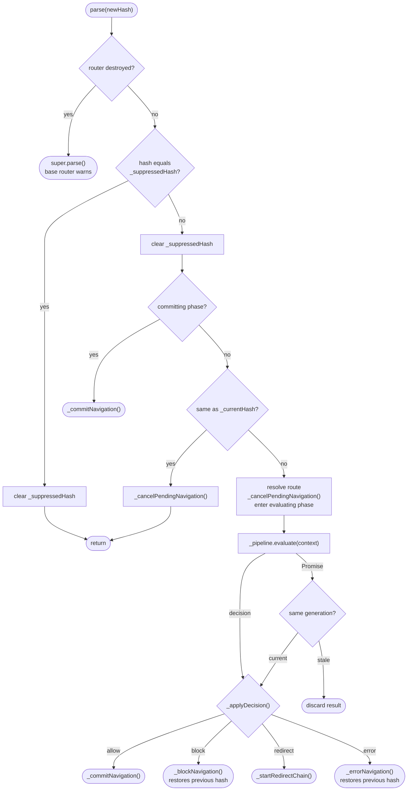
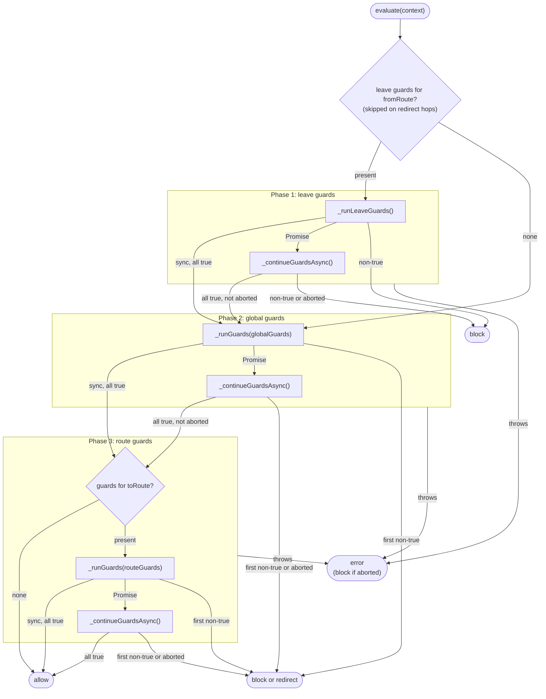
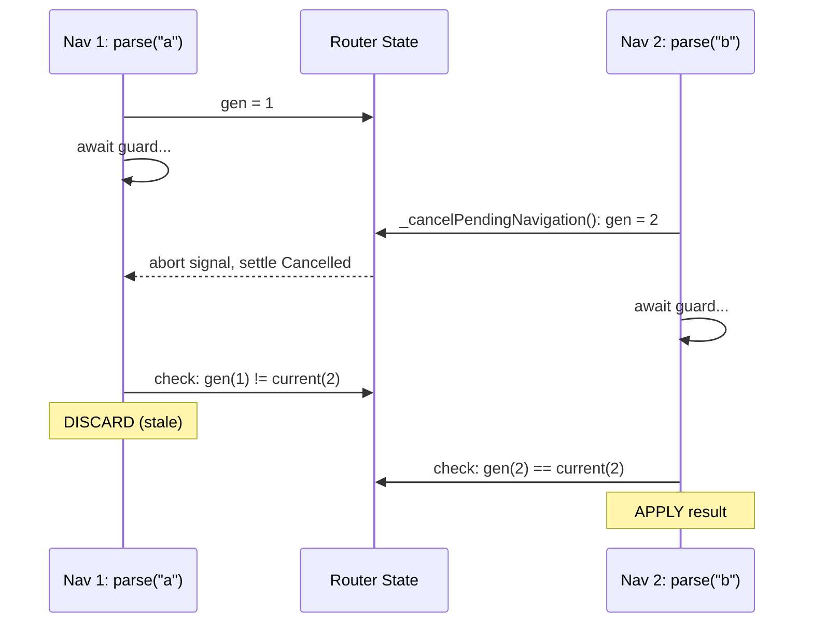
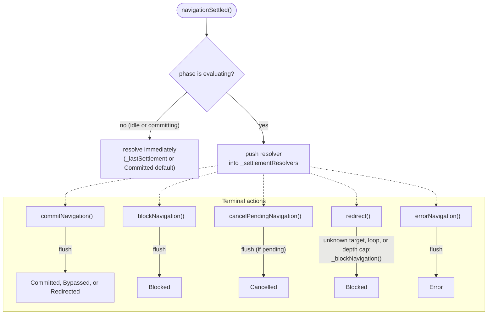

# Architecture

## Repository Structure

```
ui5-lib-guard-router/
|-- package.json                    npm workspaces root
|-- tsconfig.base.json              shared TypeScript config (strict mode)
|-- .oxlintrc.json                  linter config
|
|-- packages/
    |-- lib/                        the core library
    |   |-- ui5.yaml                OpenUI5 1.144.0, specVersion 4.0
    |   |-- src/
    |   |   |-- manifest.json       library manifest (minUI5Version 1.144.0)
    |   |   |-- library.ts          Lib.init() entry point
    |   |   |-- Router.ts           extended Router (core implementation)
    |   |   |-- GuardPipeline.ts    guard storage and leave -> enter evaluation
    |   |   |-- GuardConfig.ts      parses the guardRouter block (options, routeMeta, guards)
    |   |   |-- GuardModules.ts     guard module export shapes and names, block and lazy loading
    |   |   |-- PatternTree.ts      route pattern ancestry and pattern-tree guard expansion
    |   |   |-- RouteMeta.ts        route metadata store with inheritance and caching
    |   |   |-- NavigationOutcome.ts  enum for settlement outcomes
    |   |   |-- types.ts            all public type definitions
    |   |-- test/
    |       |-- qunit/              QUnit tests (unit)
    |       |-- wdio-qunit.conf.ts  runs QUnit in headless Chrome
    |       |-- wdio-qunit.stryker.conf.ts  QUnit run per Stryker mutant
    |
    |-- demo-app/                   demo application
        |-- ui5.yaml                serves lib + app with transpile (OpenUI5)
        |-- ui5-flp.yaml            FLP preview config (SAPUI5, sap.ushell)
        |-- webapp/
        |   |-- Component.ts        guard registration example
        |   |-- manifest.json       routerClass: "ui5.guard.router.Router"
        |   |-- controller/         App, Home, Protected, Blocked, Forbidden, Admin, Employee, Employees, NotFound (+ BaseController)
        |   |-- view/               XML views + SettlementPanel fragment
        |   |-- guards.ts           guard factories (auth, dirty form, blocked, forbidden)
        |   |-- guards/             declarative guard modules (blockedGuard, forbiddenGuard, dirtyFormGuard, navigationLogger)
        |   |-- demo/               RuntimeCoordinator, ScenarioRunner
        |   |-- flp/                ContainerAdapter (ushell dirty-state provider)
        |   |-- model/              runtime model factory
        |   |-- routing/            hashNavigation helpers
        |-- test/
            |-- e2e/                wdi5 e2e tests (standalone)
            |-- flp/                wdi5 FLP preview smoke tests
            |-- shared/controls.ts  control references (view ID + control ID) for both suites
            |-- wdio.conf.ts        standalone e2e config
            |-- wdio-flp.conf.ts    FLP preview e2e config
```

## High-Level Overview

The library provides a drop-in replacement for `sap.m.routing.Router` that adds async
navigation guards. Guards intercept every navigation path (programmatic `navTo`, browser
back/forward, direct URL changes) and can allow, block, or redirect before any route
matching, target loading, or event firing occurs.

```
+----------------------------------------------------------------------+
|                        Application (Component)                       |
|                                                                      |
|   router.addGuard(globalGuardFn)                                     |
|   router.addRouteGuard("protected", routeGuardFn)                    |
|   router.addLeaveGuard("editOrder", leaveGuardFn)                    |
|   router.initialize()                                                |
+----------------------------------------------------------------------+
         |                                                    ^
         | manifest: routerClass = "ui5.guard.router.Router"   | navTo()
         v                                                    |
+----------------------------------------------------------------------+
|                     ui5.guard.router.Router                            |
|                                                                      |
|   extends sap.m.routing.Router                                       |
|   overrides navTo() + parse() to intercept all navigation            |
|                                                                      |
|   +----------------------------+    +-------------------------------+  |
|   | Guard Management           |    | Navigation Interception       |  |
|   |                            |    |                               |  |
|   | addGuard()                 |    | navTo() override              |  |
|   | removeGuard()              |    | parse() override              |  |
|   | addRouteGuard()            |    | _applyPreflightDecision()     |  |
|   | removeRouteGuard()         |    | _applyDecision()              |  |
|   | addLeaveGuard()            |    | _cancelPendingNavigation()    |  |
|   | removeLeaveGuard()         |    | _commitNavigation()           |  |
|   | navigationSettled()        |    | _redirect()                   |  |
|   | attachNavigationSettled()  |    | _applyRedirectDecision()      |  |
|   | detachNavigationSettled()  |    | _blockNavigation()            |  |
|   +----------------------------+    | _errorNavigation()            |  |
|                                     | _flushSettlement()            |  |
|                                     | _restoreHash()                |  |
|                                     +-------------------------------+  |
|                                                                        |
|   +------------------------------------------------------------------+ |
|   | _pipeline: GuardPipeline                                         | |
|   |                                                                  | |
|   | evaluate(context)  — leave → global enter → route enter          | |
|   | addGlobalGuard / removeGlobalGuard                               | |
|   | addEnterGuard / removeEnterGuard                                 | |
|   | addLeaveGuard / removeLeaveGuard                                 | |
|   | clear()                                                          | |
|   +------------------------------------------------------------------+ |
+----------------------------------------------------------------------+
         |
         | super.parse(hash)
         v
+----------------------------------------------------------------------+
|                      sap.m.routing.Router                            |
|                                                                      |
|   Route matching, Target loading, View creation, Event firing        |
+----------------------------------------------------------------------+
```

## Type System

All types are defined in `types.ts` and exported for consumer use.

```
GuardFn      = (context: GuardContext) => GuardResult | PromiseLike<GuardResult>
LeaveGuardFn = (context: GuardContext) => boolean | PromiseLike<boolean>

GuardContext                        GuardResult
+----------------+                 +---------------------------+
| toRoute        |  string         | true    -> allow          |
| toHash         |  string         | false   -> block          |
| toArguments    |  RouteInfo["arguments"] | string  -> redirect  |
| fromRoute      |  string         | GuardRedirect -> redirect |
| fromHash       |  string         |   with params & targets   |
| signal         |  AbortSignal    +---------------------------+
| bag            |  Map<string, unknown>
| toMeta         |  Readonly<Record<string, unknown>>
| fromMeta       |  Readonly<Record<string, unknown>>
| ownerComponent |  UIComponent | undefined
+----------------+

NavigationOutcome (UI5 enum)        NavigationResult
+----------------+                  +----------------------------+
| Committed      |  "committed"    | status: NavigationOutcome   |
| Bypassed       |  "bypassed"     | route:  string              |
| Blocked        |  "blocked"      | hash:   string              |
| Redirected     |  "redirected"   | error?: unknown             |
| Cancelled      |  "cancelled"    +----------------------------+
| Error          |  "error"
+----------------+

GuardRouter (public interface)      Router (ES6 class)
  extends sap.m.routing.Router        extends sap.m.routing.Router
  + 6 guard methods                   implements GuardRouter
  + 2 metadata methods                + internal state fields
  + 1 query + 2 event methods         + private _cancelPendingNavigation()
    addGuard / removeGuard             + private _flushSettlement()
    addRouteGuard / removeRouteGuard   + override initialize(), addRoute(),
    addLeaveGuard / removeLeaveGuard     navTo(), parse(), stop(), destroy()
    getRouteMeta / setRouteMeta
    navigationSettled()
    attachNavigationSettled()
    detachNavigationSettled()
    navTo() overloads (GuardNavToOptions)

  addRouteGuard / removeRouteGuard accept both:
    - GuardFn (enter guard)
    - { beforeEnter?, beforeLeave? } (object form)
```

Only strict `true` allows navigation. Truthy non-boolean values (numbers, objects, etc.)
are treated as blocks. This prevents accidental allow from coercion.

`NavigationOutcome` is registered as a UI5 enum in `library.ts` via `DataType.registerEnum`.
The manifest dependency chain guarantees `library.ts` executes before `Router.ts` is loaded,
so `Router.ts` does not need to import `library.ts`. See [Library Loading Order Research](../research/library-loading-order.md)
for the full analysis of the Component bootstrap sequence.

The Router is an ES6 class that extends `sap.m.routing.Router` and implements the
`GuardRouter` interface. Application code casts `getRouter()` to `GuardRouter` for
type-safe access to the guard management methods. Internal state and methods live
directly on the class as typed fields; no separate internal interface is needed.

## parse() Override - Fallback for Browser-Initiated Navigation

Browser-initiated navigation (back/forward, URL bar, direct hash changes) flows through
`parse()`. The override intercepts it to run guards before the parent router processes
the hash. With the default `navToPreflight: "guard"`, programmatic `navTo()` calls run the
guards in the preflight path (see below); the hash change they cause re-enters `parse()` in
the committing phase, which commits without running the guards again.



**Sync vs Async:** Guards run synchronously until one returns a Promise. The pipeline then
awaits that Promise and calls the remaining guards of the same phase one at a time with
`await`, checking the abort signal before each. Later phases run inside the same Promise
chain after another abort-signal check, so they are async as well; they just don't add an
`await` per guard unless one of their guards returns a Promise. `evaluate()` returns a
Promise, so the navigation as a whole is async. Async-ness is per navigation: the next
navigation starts synchronously again.
When the decision arrives, `parse()`, `navTo()` and redirect hops discard it if
`_parseGeneration` changed. Everything that ends an evaluating phase from outside the attempt
goes through `_cancelPendingNavigation()`, which bumps the counter.

A lazily loaded guard module that is not in the module cache yet returns a Promise while it
loads, so it makes its navigation async from that guard on. Once loaded, its guards run
synchronously again, unless they return Promises themselves.

**Critical design decisions:**

1. **`parse()` is intentionally NOT async.** UI5 calls it from the `hashChanged` event
   handler without awaiting. If it returned a Promise, routing would be deferred to a
   microtask, and test tools like wdi5's `waitForUI5` would see an idle event loop before
   navigation completes. When all guards are synchronous (the common case), the entire
   guard-check + route-activation happens in the same tick.

2. **`replaceHash` fires `hashChanged` synchronously.** The `_suppressedHash` mechanism
   depends on this: `_restoreHash()` stores the hash to suppress, calls `replaceHash`,
   and the resulting synchronous `parse()` sees the stored hash and returns immediately.
   Without the suppression the restore would reach the same-hash check, which cancels the
   pending navigation: a navigation that a `navigationSettled` listener started for the
   Blocked or Error settlement, before the restore, would be lost. If UI5 ever changes
   `replaceHash` to fire `hashChanged` asynchronously, the stored hash would be cleared
   before `parse()` can check it, with the same effect. A QUnit test covers this
   ("Async navTo started from a Blocked settlement handler survives the hash restore").

3. **Redirect targets are evaluated by the guard pipeline with loop detection.**
   When a guard redirects from route A to route B, the router evaluates route B's
   guards (skipping leave guards via `skipLeaveGuards`) before committing. If route B
   also redirects, the chain continues recursively. A visited-set tracks hashes
   already evaluated in the current chain: revisiting a hash triggers loop detection
   and blocks the navigation. A `MAX_REDIRECT_DEPTH` cap of 10 hops guards against
   unbounded chains with unique hashes. Both safeguards log an error and settle the
   navigation as `Blocked`.

## Two-Entry-Point Model: navTo() Preflight + parse() Fallback

The router intercepts navigation through two complementary entry points that feed the
same shared guard pipeline (`_pipeline.evaluate()`).

```
Programmatic navigation:
  navTo(route, params)
    → _pipeline.evaluate(context)
        → allow  → enter committing/preflight phase, call super.navTo()
        → block  → _blockNavigation(hash, attempt.restoreHash), flush Blocked settlement
        → redirect → _startRedirectChain() → _redirect(target): evaluates the target's guards,
                     then on allow enters committing/redirect phase and calls this.navTo(target, replace=true)
        → error  → _errorNavigation(error, hash, attempt.restoreHash), flush Error settlement

Browser-initiated navigation (back/forward, URL bar, direct hash change):
  parse(newHash)
    → committing phase? → _commitNavigation() (transitions to idle)
    → otherwise → _pipeline.evaluate(context)
        → allow  → _commitNavigation()
        → block  → _blockNavigation() + _restoreHash()
        → redirect → _startRedirectChain() → _redirect() → navTo(replace=true)
        → error  → _errorNavigation() + _restoreHash()
```

### The preflight handshake

When `navTo()` runs guards and they allow navigation, the router enters the
committing/preflight phase (which records the approved route) before calling
`super.navTo()`. The parent router triggers a hash change, which re-enters through
`parse()`. On entry, `parse()` sees the committing phase and calls `_commitNavigation()`
with the incoming hash, which transitions to idle and commits without re-running guards.
If `super.navTo()` does not change the hash, `parse()` is not called and `navTo()` commits
directly. This avoids double evaluation while keeping `parse()` as the authoritative
commit path.

A redirect commits the same way: `_applyRedirectDecision()` enters the committing/redirect
phase and calls `navTo(target, replace=true)`. If `parse()` is not reached, because the hash
already is the target or because component targets change it later, it commits the target
directly. The navigation settles once, as `Redirected`, and the target's guards do not run
again when the hash change arrives.

### navTo() superseding a pending hash change

A hash change whose guards are still pending has already moved the URL. A `navTo()` that
supersedes it takes over the duty to put the URL back (`NavigationAttempt.restoreHash`,
`false` for a `navTo()` that superseded nothing):

- Blocked, failed, or blocked in its redirect chain: the hash is restored to `_currentHash`,
  as on the `parse()` path.
- `navTo()` to the current route or to an unknown route: `_cancelPendingNavigation(true)`
  restores the hash right away, because no navigation follows.
- Allowed or redirected: the navigation moves the URL itself and nothing is restored. The
  superseded hash stays in the browser history, as with the base router.

### Why parse() remains authoritative

`navTo()` only covers programmatic navigation. Browser back/forward, URL bar entry,
and direct hash changes bypass `navTo()` entirely; they arrive through `hashChanged`
→ `parse()`. The `parse()` override remains the authoritative fallback that catches
all navigation paths the `navTo()` preflight cannot reach.

## Guard Execution Pipeline

Guards run in three phases: leave guards first, then global enter guards, then
route-specific enter guards. Evaluation stays synchronous until a guard returns a
Promise, then switches to async for the rest of the navigation, including all later
phases.



Short-circuit: the first non-`true` result stops evaluation. Remaining guards are skipped.
A guard that throws or rejects ends evaluation in any phase; see error handling below.

Error handling: if a guard throws or its Promise rejects, the error is logged and
re-thrown to `evaluate()`, which returns `{ action: "error", error }`. The Router
settles the navigation as `NavigationOutcome.Error` with the thrown value on
`result.error`. If the abort signal is already aborted, the error is swallowed and
navigation is blocked instead (the navigation was cancelled, the error is expected).

## Guard Result Handling

After guards complete, the result is applied inline:

| Result                      | Action                                                                  |
| --------------------------- | ----------------------------------------------------------------------- |
| `true`                      | `_commitNavigation()` → update state, call parent `parse()`             |
| `false`                     | `_blockNavigation()` → restore previous hash (if the URL was moved)     |
| `string` or `GuardRedirect` | `_startRedirectChain()` → `_redirect()` → `navTo()` with `replace=true` |

Redirects evaluate the full guard pipeline on the target route before committing.
Redirect chain hops pass `skipLeaveGuards: true` to `GuardPipeline.evaluate()` so
that leave guards run only on the first hop (the initial navigation), not on each
redirect target. Loop detection (visited-set + depth cap of 10 hops) prevents
infinite chains.

## Manifest Guards and Route Metadata

`Router.ts` keeps the navigation logic and hands the rest to helper modules:

| Step                         | Router code                                               | Helper                                                                                                 |
| ---------------------------- | --------------------------------------------------------- | ------------------------------------------------------------------------------------------------------ |
| Read the `guardRouter` block | constructor                                               | `parseGuardRouterConfig()` (`GuardConfig.ts`): options with defaults, `routeMeta`, guard descriptors   |
| Lazy-mode preload hint       | constructor                                               | `sap.ui.require(paths)` with an empty error callback, fire-and-forget                                  |
| Pattern-tree expansion       | `initialize()`, `addRoute()`                              | `expandToDescendants()`, `expandForNewRoute()` (`PatternTree.ts`)                                      |
| `guardLoading: "block"`      | `initialize()`                                            | `loadGuardModules()` (`GuardModules.ts`), then `super.initialize()`                                    |
| `guardLoading: "lazy"`       | `initialize()` / `addRoute()` → `_registerLazyGuards()`   | `createLazyGuards()` (`GuardModules.ts`); its wrappers run a module's guards with `runGuardsInOrder()` |
| Export shapes and names      | -                                                         | `resolveModuleExports()` (`GuardModules.ts`)                                                           |
| Guard names in log messages  | -                                                         | `nameGuard()` / `describeGuard()` (`GuardPipeline.ts`)                                                 |
| Route metadata               | `_meta`, `getRouteMeta()`, `setRouteMeta()`, `addRoute()` | `RouteMetaStore` (`RouteMeta.ts`)                                                                      |

Option defaults: `unknownRouteRegistration: "warn"`, `navToPreflight: "guard"`,
`guardLoading: "lazy"`, `inheritance: "none"`. An invalid value logs
`guardRouter.<key> has invalid value, using default`.

Every manifest guard is registered through `_registerManifestGuard()`, which calls
`_registerGuardFromDescriptor()`. With `unknownRouteRegistration: "throw"`, imperative
calls (`addRouteGuard`, `addLeaveGuard`, `setRouteMeta`) throw for an unknown route. A
manifest guard on an unknown route has no caller that could catch the error, so
`_registerManifestGuard()` logs `guardRouter.guards: failed to register "<modulePath>"`
and skips that guard; the router still starts.

Manifest guards get a name from their module (`moduleName`, `moduleName#index`, or the
export key). Pipeline log messages show it, for example
`Enter guard [0] "checks#0" on route "admin" threw, navigation failed`. Imperatively
registered guards have no name and log as `Enter guard [0]`.

## Async Concurrency Control

The `_parseGeneration` counter handles overlapping async navigations:



Every `parse()` or `navTo()` that enters the guard pipeline first calls
`_cancelPendingNavigation()`, which bumps the generation and aborts the pending
navigation's `AbortSignal`. Inside the pipeline, the aborted signal stops the remaining
guards between awaits. The generation is checked once, when the async decision settles:
if a newer navigation started in the meantime, the stale result is discarded with a
debug log. This ensures only the latest navigation wins.

The generation is also bumped on same-hash dedup, invalidating any pending async guard
that was running when the user navigated back to the original hash.

## Settlement Signal

`navigationSettled()` returns a Promise that resolves when the guard pipeline finishes. The
result carries a `NavigationOutcome` enum value indicating how the navigation resolved.



Each terminal action in the guard pipeline (`_commitNavigation`, `_blockNavigation`,
`_errorNavigation`, `_cancelPendingNavigation`) calls `_flushSettlement()`, which drains all queued resolvers
with the same `NavigationResult` and fires the `navigationSettled` event via
`EventProvider.fireEvent()`. `_redirect()` calls `_blockNavigation()` when the redirect target
route does not exist, because the observable outcome is that the user stays on the current
route. An allowed redirect always ends in `_commitNavigation()`, through `parse()` or
directly (redirect to the hash the URL already shows, component targets), and settles as
`Redirected`. This ensures:

- Multiple callers of `navigationSettled()` for the same navigation all receive the same result
- Each terminal action flushes the queued settlement resolvers with one shared `NavigationResult`
- `_commitNavigation` uses the phase origin (committing/redirect vs. other) and matched-route result to distinguish `Committed`, `Bypassed`, and `Redirected`
- `_cancelPendingNavigation` only flushes when the router is in the evaluating phase, avoiding
  spurious settlement signals during initialization or when no navigation is in flight
- `_lastSettlement` caches the most recent result so that `navigationSettled()` called
  after a synchronous navigation still returns the correct outcome. This handles the
  common case where sync guards settle within the same tick as `navTo()`, leaving
  the router in the idle phase before any caller has a chance to register a resolver.
  The cache is reset on `stop()` and `destroy()`

## FLP Integration

When the router runs inside a Fiori Launchpad (FLP), two independent dirty-state
mechanisms coexist:

| Mechanism                    | Scope             | UX                            |
| ---------------------------- | ----------------- | ----------------------------- |
| Router leave guard           | In-app navigation | Silent block + hash restore   |
| `registerDirtyStateProvider` | Cross-app (FLP)   | Native FLP confirmation popup |

**Key design rule:** the leave guard and the dirty-state provider handle
different scopes and do not need to coordinate in application code.

### Production FLP

In production, `ShellNavigationHashChanger` intercepts cross-app navigation
**before** it reaches the app router. The leave guard's `parse()` is never
called for cross-app hashes, so no conflict arises. The dirty-state provider
handles cross-app dirty UX, the leave guard handles in-app dirty UX, and
the two never overlap:

```ts
// Leave guard: blocks in-app navigation when dirty
const leaveGuard: LeaveGuardFn = (context) => {
	return !formModel.getProperty("/isDirty");
};

// Dirty-state provider: tells FLP about unsaved changes for cross-app
const dirtyProvider = (navigationContext) => {
	if (navigationContext?.isCrossAppNavigation === false) return false;
	return formModel.getProperty("/isDirty") === true;
};
sap.ushell.Container.registerDirtyStateProvider(dirtyProvider);
```

No `toRoute` check, no flags, no FLP detection -- just a simple dirty check.

### FLP sandbox/preview (development only)

The `fiori-tools-preview` middleware creates a simplified FLP sandbox for local
development. Cross-app navigation via `toExternal()` operates at the shell level
in both sandbox and production: the leave guard does not interfere because the
navigation bypasses the app router's `parse()`. The dirty-state provider fires
and the FLP shows its own confirm dialog. If the user confirms, the shell
completes the navigation. If the user cancels, the hash stays unchanged.

The demo app's FLP E2E tests pin this behavior in three spec files:
`flp-preview.e2e.ts` covers FLP runtime detection, in-app navigation inside the
sandbox, dirty cross-app cancel flow, in-app dirty blocking, and browser
history behavior under guards; `flp-cross-app.e2e.ts` covers the dirty
cross-app confirm path (dirty + `confirm()` returns `true`, navigation
completes to Shell-home) in an isolated browser session; and
`flp-clean-cross-app.e2e.ts` covers the clean cross-app path (no dirty prompt,
navigation proceeds directly to Shell-home) in its own isolated session.

## Internal State

| Field                      | Type                                | Purpose                                                                                                                                   |
| -------------------------- | ----------------------------------- | ----------------------------------------------------------------------------------------------------------------------------------------- |
| `_options`                 | `ResolvedGuardRouterOptions`        | Resolved manifest options with defaults applied                                                                                           |
| `_pipeline`                | `GuardPipeline`                     | Owns guard storage and evaluation logic (see `GuardPipeline.ts`)                                                                          |
| `_currentRoute`            | `string`                            | Name of the currently active route                                                                                                        |
| `_currentHash`             | `string \| null`                    | Hash of the active route, `null` before first                                                                                             |
| `_phase`                   | `RouterPhase`                       | Discriminated union tracking the router's lifecycle phase (see below)                                                                     |
| `_parseGeneration`         | `number`                            | Monotonic counter for async invalidation                                                                                                  |
| `_suppressedHash`          | `string \| null`                    | Hash to suppress in the next `parse()` call                                                                                               |
| `_settlementResolvers`     | `((r: NavigationResult) => void)[]` | Pending `navigationSettled()` callbacks                                                                                                   |
| `_lastSettlement`          | `NavigationResult \| null`          | Most recent settlement result (for post-hoc queries)                                                                                      |
| `_pendingGuardDescriptors` | `GuardDescriptor[]`                 | Parsed manifest guard descriptors, registered and cleared by `initialize()`                                                               |
| `_sourceDescriptors`       | `GuardDescriptor[]`                 | Original manifest descriptors (for inheritance expansion on addRoute)                                                                     |
| `_destroyed`               | `boolean`                           | Set by `destroy()`; stops block-mode loading from registering guards and calling `super.initialize()`; makes a second `destroy()` a no-op |
| `_blockLoad`               | `{ start: boolean } \| null`        | Set while block-mode modules load; `start` is cleared by `stop()` and set by `initialize()`                                               |
| `_meta`                    | `RouteMetaStore`                    | Manifest and runtime route metadata, resolved and cached (see `RouteMeta.ts`)                                                             |
| `_routeNames`              | `string[]`                          | Known route names, collected for inheritance lookups                                                                                      |
| `_ownerComponent`          | `UIComponent \| undefined`          | Owner component from the constructor, exposed as `GuardContext.ownerComponent`                                                            |

`RouterPhase` is a discriminated union with three variants:

| Phase        | Shape                                                                                 | Description                                                                              |
| ------------ | ------------------------------------------------------------------------------------- | ---------------------------------------------------------------------------------------- |
| `idle`       | `{ kind: "idle" }`                                                                    | No navigation in progress                                                                |
| `evaluating` | `{ kind: "evaluating", attempt: NavigationAttempt }`                                  | Guards are running; attempt carries hash, route, AbortController, and generation counter |
| `committing` | `{ kind: "committing", route: string, origin: "preflight" \| "redirect" \| "parse" }` | Navigation is being committed; `origin` distinguishes the entry path                     |

## Monorepo Tooling

```
                    npm workspaces
                         |
           +-------------+-------------+
           |                           |
     packages/lib               packages/demo-app
           |                           |
   ui5 serve (default 8080)    ui5 serve (default 8080)
   ui5-tooling-transpile       ui5-tooling-transpile
   (TS -> JS on the fly)       + transpileDependencies: true
                               + ui5-middleware-livereload
```

- **TypeScript**: strict mode, ES2022 target, composite builds enabled
- **Build**: `ui5-tooling-transpile` compiles TS during `ui5 serve` and `ui5 build`
- **Lint**: `oxlint` with correctness (error), suspicious/perf (warn); typescript, oxc, unicorn, import plugins
- **Type check**: `tsc --noEmit` against both package tsconfigs
- **Test isolation**: root test scripts assign dedicated ports per lane so standalone, compatibility, and FLP suites can run concurrently without port conflicts

## Test Architecture

```
                          npm test
                             |
              +--------------+--------------+
              |                             |
         test:qunit                    test:e2e
              |                             |
  wdio-qunit-service              wdio + wdi5 service
  headless Chrome                  headless Chrome
              |                             |
  packages/lib/test/qunit/    packages/demo-app/test/e2e/
              |                             |
  +-------------------------------+   +----------------------------+
  | Router.qunit.ts               |   | routing-basic.e2e.ts       |
  | RouterGuards.qunit.ts         |   | guard-allow.e2e.ts         |
  | RouterAsync.qunit.ts          |   | guard-block.e2e.ts         |
  | RouterNavigation.qunit.ts     |   | guard-redirect-auth.e2e.ts |
  | RouterSettlement.qunit.ts     |   | guard-redirect.e2e.ts      |
  | RouterOptions.qunit.ts        |   | browser-back.e2e.ts        |
  | RouterManifestGuards.qunit.ts |   | direct-url.e2e.ts          |
  | RouterRouteMeta.qunit.ts      |   | multi-route.e2e.ts         |
  | GuardPipeline.qunit.ts        |   | nav-button.e2e.ts          |
  | GuardConfig.qunit.ts          |   | leave-guard.e2e.ts         |
  | GuardModules.qunit.ts         |   | navto-preflight.e2e.ts     |
  | PatternTree.qunit.ts          |   | redirect-chain.e2e.ts      |
  | RouteMeta.qunit.ts            |   | route-metadata.e2e.ts      |
  | NativeRouterCompat.qunit.ts   |   +----------------------------+
  | UpstreamParity.qunit.ts       |
  +-------------------------------+

  Unit tests verify:            E2e tests verify:
  - Guard lifecycle             - Full browser navigation
  - Sync/async pipelines        - Hash bar behavior
  - Redirect mechanics          - Back/forward buttons
  - Generation counter          - Guard block + redirect
  - Error handling              - Rapid hash changes
  - API parity with native      - Multi-step user flows
  - Leave guard pipeline        - Leave guard dirty form
  - Settlement outcomes         - Settlement-based wait
  - Router options + config     - navTo preflight modes
  - Guard pipeline isolation    - Redirect chains
  - Manifest guard loading      - Route metadata in guards
  - Config parsing, pattern
    tree, route metadata

  Additional CI lanes (not part of `npm test`):

  test:e2e:flp                    test:qunit:compat:120
       |                               |
  packages/demo-app/test/flp/    packages/lib/test/qunit/
       |                          (same suite, OpenUI5 1.120.0)
  +------------------------------+   Verifies the core library's
  | flp-preview.e2e.ts           |   guard pipeline works on
  |   FLP runtime detection      |   the older UI5 runtime.
  |   In-app nav inside FLP      |
  |   Dirty cancel path          |
  |   Browser history in FLP     |
  | flp-cross-app.e2e.ts         |
  |   Dirty confirm path         |
  |   Isolated Shell-home exit   |
  | flp-clean-cross-app.e2e.ts   |
  |   Clean cross-app exit       |
  |   No dirty prompt            |
  +------------------------------+

  CI also runs:
  - node24-pack-smoke: build + pack + consumer type smoke on Node 24 (oldest supported)
  - windows-smoke: QUnit smoke on windows-latest

  Local only:
  - test:mutation: Stryker mutates packages/lib/src one file at a time
    and runs the QUnit suite once per mutant; results are kept per file,
    so a rerun only tests missing or changed files (report: reports/mutation/)
```

QUnit tests run against the library in isolation using programmatic Router instances.
E2e tests run against the demo-app served by `ui5 serve`, exercising real browser
navigation, hash changes, and the full UI5 component lifecycle.
FLP preview tests run the demo-app under `ui5 serve --config ui5-flp.yaml` (SAPUI5),
verifying that the ushell integration, dirty-state provider, and leave guard coexistence work.

## Demo App Integration

The demo app shows the minimal integration pattern:

1. **manifest.json** - set `routerClass` to `"ui5.guard.router.Router"` and add
   `"ui5.guard.router": {}` to library dependencies
2. **Component.ts** - cast `getRouter()` to `GuardRouter`, register guards, call
   `initialize()`

```
  manifest.json                        Component.ts
  +--------------------------------+     +----------------------------------+
  | routing.config.routerClass     |---->| router = getRouter() as          |
  | = "ui5.guard.router.Router"    |     |            GuardRouter           |
  |                                |     |                                  |
  | guardRouter:                   |     | router.addRouteGuard("admin",    |
  |   inheritance: "pattern-tree"  |     |   adminGuard)                    |
  |   guards:                      |     |                                  |
  |     "*": [navigationLogger]    |     | router.addRouteGuard("protected",|
  |     blocked: [blockedGuard]    |     |   createAsyncPermissionGuard(    |
  |     forbidden: [forbiddenGuard]|     |     authModel))                  |
  |     protected: {leave: [...]}  |     |                                  |
  |   routeMeta: employees,        |     | router.initialize()              |
  |              employee          |     +----------------------------------+
  |                                |
  | routes:                        |
  |   home      -> ""              |
  |   protected -> "protected"     |
  |   blocked   -> "blocked"       |
  |   forbidden -> "forbidden"     |
  |   admin     -> "admin"         |
  |   employees -> "employees"     |
  |   employee  -> "employees/{id}"|
  +--------------------------------+
```

The `IAsyncContentCreation` interface on the Component eliminates the need for
`async: true` in the manifest routing config.
