# Architecture

## Repository Structure

```
ui5-lib-guard-router/
|-- package.json                    npm workspaces root
|-- tsconfig.base.json              shared TypeScript config (strict mode)
|-- tsconfig.json                   lists every project, so that editors and oxlint find the tsconfig of a file
|-- tsconfig.node.json              Node code checked with checkJs: scripts/, tools/, stryker.config.mjs, the wdio configs and testsuite of the library
|-- .oxlintrc.json                  linter config
|-- scripts/                        check-*, vendoring, pack smoke, with *.test.mjs beside them
|-- tools/                          the oxlint JS plugins with their *.test.mjs, and the wdio Chrome profile
|
|-- packages/
    |-- lib/                        the core library
    |   |-- ui5.yaml                OpenUI5 1.144.0, specVersion 4.0
    |   |-- src/
    |   |   |-- manifest.json       library manifest (minUI5Version 1.136.0)
    |   |   |-- library.ts          Lib.init() entry point
    |   |   |-- Router.ts           extended Router (core implementation)
    |   |   |-- GuardPipeline.ts    guard storage and leave -> enter evaluation
    |   |   |-- GuardConfig.ts      parses the guardRouter block (options, routeMeta, guards)
    |   |   |-- GuardModules.ts     guard module export shapes and names, block and lazy loading
    |   |   |-- PatternTree.ts      route pattern ancestry and pattern-tree guard expansion
    |   |   |-- RouteMeta.ts        route metadata store with inheritance and caching
    |   |   |-- NavigationOutcome.ts  enum for settlement outcomes
    |   |   |-- types.ts            all public type definitions
    |   |-- test/
    |       |-- qunit/              QUnit tests, one folder per test page (see Test Architecture)
    |       |-- wdio-qunit.conf.ts  runs QUnit in headless Chrome
    |       |-- wdio-qunit.stryker.conf.ts  QUnit run per Stryker mutant
    |
    |-- demo-app/                   demo application
        |-- ui5.yaml                serves lib + app with transpile (OpenUI5)
        |-- ui5-flp.yaml            FLP preview config (SAPUI5, sap.ushell)
        |-- ui5-test.yaml, ui5-flp-test.yaml  the same without livereload, for the test servers
        |-- webapp/
        |   |-- Component.ts        guard registration example
        |   |-- manifest.json       routerClass: "ui5.guard.router.Router"
        |   |-- controller/         App, Home, Protected, Blocked, Forbidden, Admin, Employee, Employees, NotFound (+ BaseController)
        |   |-- view/               XML views + SettlementPanel fragment
        |   |-- i18n/               text bundle of the root component
        |   |-- guards.ts           guard factories that Component.ts and Home.controller.ts register
        |   |-- guards/             declarative guard modules (blockedGuard, forbiddenGuard, retiredPageGuard, dirtyFormGuard, navigationLogger)
        |   |-- demo/               RuntimeCoordinator, ScenarioRunner
        |   |-- flp/                ContainerAdapter (ushell dirty-state provider)
        |   |-- model/              auth.json, runtime model factory
        |   |-- routing/            hashNavigation helpers
        |   |-- reporting/          nested component with its own guard router (manifest, controller/, view/, guards/, i18n/, model/reports.json)
        |-- test/
            |-- e2e/                wdi5 e2e tests (standalone)
            |-- flp/                wdi5 FLP preview tests
            |-- shared/             control references (view ID + control ID), model and nested-component helpers for both suites
            |-- browser-modules.ts  types of the UI5 modules read in browser.execute()
            |-- wdio.conf.ts        standalone e2e config
            |-- wdio-flp.conf.ts    FLP preview e2e config
```

## High-Level Overview

The router replaces `sap.m.routing.Router` and adds navigation guards. They run for every
navigation path (programmatic `navTo`, browser back/forward, direct URL changes) and allow,
block or redirect before any route matches, target loads or event fires.

```
+----------------------------------------------------------------------+
|                        Application (Component)                       |
|                                                                      |
|   router.addGuard(globalGuardFn)                                     |
|   router.addRouteGuard("protected", routeGuardFn)                    |
|   router.addLeaveGuard("editOrder", leaveGuardFn)                    |
|   router.initialize()                                                |
+----------------------------------------------------------------------+
         |                                                    ^
         | manifest: routerClass = "ui5.guard.router.Router"   | navTo()
         v                                                    |
+----------------------------------------------------------------------+
|                     ui5.guard.router.Router                            |
|                                                                      |
|   extends sap.m.routing.Router                                       |
|   overrides navTo() + parse() to intercept all navigation            |
|                                                                      |
|   +----------------------------+    +-------------------------------+  |
|   | Guard Management           |    | Navigation Interception       |  |
|   |                            |    |                               |  |
|   | addGuard()                 |    | navTo() override              |  |
|   | removeGuard()              |    | parse() override              |  |
|   | addRouteGuard()            |    | _applyPreflightDecision()     |  |
|   | removeRouteGuard()         |    | _applyDecision()              |  |
|   | addLeaveGuard()            |    | _cancelPendingNavigation()    |  |
|   | removeLeaveGuard()         |    | _commitNavigation()           |  |
|   | navigationSettled()        |    | _redirect()                   |  |
|   | attachNavigationSettled()  |    | _applyRedirectDecision()      |  |
|   | detachNavigationSettled()  |    | _blockNavigation()            |  |
|   +----------------------------+    | _errorNavigation()            |  |
|                                     | _flushSettlement()            |  |
|                                     | _restoreHash()                |  |
|                                     | _undoHashChange()             |  |
|                                     +-------------------------------+  |
|                                                                        |
|   +------------------------------------------------------------------+ |
|   | _pipeline: GuardPipeline                                         | |
|   |                                                                  | |
|   | evaluate(context): leave → global enter → route enter            | |
|   | addGlobalGuard / removeGlobalGuard                               | |
|   | addEnterGuard / removeEnterGuard                                 | |
|   | addLeaveGuard / removeLeaveGuard                                 | |
|   | clear()                                                          | |
|   +------------------------------------------------------------------+ |
+----------------------------------------------------------------------+
         |
         | super.parse(hash)
         v
+----------------------------------------------------------------------+
|                      sap.m.routing.Router                            |
|                                                                      |
|   Route matching, Target loading, View creation, Event firing        |
+----------------------------------------------------------------------+
```

## Type System

All types are defined in `types.ts` and exported for consumer use.

```
GuardFn      = (context: GuardContext) => GuardResult | PromiseLike<GuardResult>
LeaveGuardFn = (context: GuardContext) => boolean | PromiseLike<boolean>

GuardContext                        GuardResult
+----------------+                 +---------------------------+
| toRoute        |  string         | true    -> allow          |
| toHash         |  string         | false   -> block          |
| toArguments    |  RouteInfo["arguments"] | string  -> redirect  |
| fromRoute      |  string         | GuardRedirect -> redirect |
| fromHash       |  string         |   with params & targets   |
| signal         |  AbortSignal    +---------------------------+
| bag            |  Map<string, unknown>
| toMeta         |  Readonly<Record<string, unknown>>
| fromMeta       |  Readonly<Record<string, unknown>>
| ownerComponent |  UIComponent | undefined
+----------------+

NavigationOutcome (UI5 enum)        NavigationResult
+----------------+                  +----------------------------+
| Committed      |  "committed"    | status: NavigationOutcome   |
| Bypassed       |  "bypassed"     | route:  string              |
| Blocked        |  "blocked"      | hash:   string              |
| Redirected     |  "redirected"   | error?: unknown             |
| Cancelled      |  "cancelled"    +----------------------------+
| Error          |  "error"
+----------------+

GuardRouter (public interface)      Router (ES6 class)
  extends sap.m.routing.Router        extends sap.m.routing.Router
  + 6 guard methods                   implements GuardRouter
  + 2 metadata methods                + internal state fields
  + 1 query + 2 event methods         + private _cancelPendingNavigation()
    addGuard / removeGuard             + private _flushSettlement()
    addRouteGuard / removeRouteGuard   + override initialize(), addRoute(),
    addLeaveGuard / removeLeaveGuard     navTo(), parse(), stop(), destroy(),
                                         attachRouteMatched()
    getRouteMeta / setRouteMeta
    navigationSettled()
    attachNavigationSettled()
    detachNavigationSettled()
    navTo() overloads (GuardNavToOptions)

  addRouteGuard / removeRouteGuard accept both:
    - GuardFn (enter guard)
    - { beforeEnter?, beforeLeave? } (object form)
```

Only strict `true` allows navigation. A non-empty string or a `GuardRedirect` object
redirects; every other value (numbers, other objects, `null`, `undefined`, the empty string)
blocks with a warning, so no value allows by coercion.

`NavigationOutcome` is registered as a UI5 enum in `library.ts` via `DataType.registerEnum`.
The manifest dependency chain loads `library.ts` before `Router.ts`, so `Router.ts` does not
import it ([Library Loading Order Research](../research/library-loading-order.md)).

Application code casts `getRouter()` to `GuardRouter` to reach the guard methods.

## parse() Override - Fallback for Browser-Initiated Navigation

Browser-initiated navigation (back/forward, URL bar, direct hash changes) flows through
`parse()`. The override intercepts it to run guards before the parent router processes
the hash. With the default `navToPreflight: "guard"`, programmatic `navTo()` calls run the
guards in the preflight path (see below); the hash change they cause re-enters `parse()` in
the committing phase, which commits without running the guards again.

`parse()` checks the hash in this order, and the first case that applies ends the call:

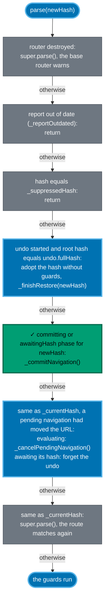

Blue is the library, grey is native UI5 or no action, and light blue is a decision. The outcomes carry a symbol: ✓ commit (green), ↪ redirect (yellow), ✕ block (orange) and ⚠ error (dark purple, dashed border) ([diagram style](../../CONTRIBUTING.md#diagram-style)).

Every other hash runs the guards:

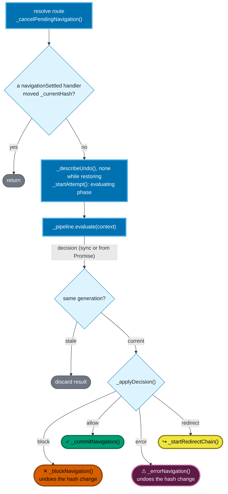

Blue is the library, grey is native UI5 or no action, and light blue is a decision. The outcomes carry a symbol: ✓ commit (green), ↪ redirect (yellow), ✕ block (orange) and ⚠ error (dark purple, dashed border) ([diagram style](../../CONTRIBUTING.md#diagram-style)).

**Sync vs Async:** Guards run synchronously until one returns a Promise. The pipeline then
awaits that Promise and calls the remaining guards of the same phase one at a time with
`await`, checking the abort signal before each. Later phases run inside the same Promise
chain after another abort-signal check, so they are async as well; they do not add an
`await` per guard unless one of their guards returns a Promise. `evaluate()` returns a
Promise, so the navigation as a whole is async. The next navigation starts synchronously
again. A decision that arrives after a newer navigation started is discarded
([Async Concurrency Control](#async-concurrency-control)).

The checks before the phase check end a call without starting a navigation: a report that is
out of date ([Routers that share a hash changer](#routers-that-share-a-hash-changer)), the hash
that `_restoreHash()` is writing, and the hash change that puts the URL back after an undo
([Undoing a hash change](#undoing-a-hash-change)), which becomes the current hash without guards.

The same-hash branch handles the committed hash reaching `parse()` again. If a pending
navigation had moved the URL away (`NavigationAttempt.restoreHash`), the user went back while
it was pending, and no route matches again: the route of the committed hash was never left. The
branch cancels a navigation whose guards are pending. One that waits for UI5 to write its hash
(`awaitingHash`) goes on, and only its undo is dropped: the hash change that it describes is
undone already, and kept, it would be taken back once more with the next hash change that does
not commit (two steps through the browser history instead of one, which leaves the app;
`awaiting-hash.e2e.ts`). Otherwise the route matches again through
`super.parse()`, without guards, as it does natively: UI5 reports the hash of a navigation with
component targets once it has written it, reports the hash again after it reset the hash
changer for a target displayed without a route, or application code called `parse()` directly.
A pending `navTo()` that has not touched the URL stays, so a late hash change of component
targets does not cancel a `navTo()` that started in between.

`_cancelPendingNavigation()` fires the `Cancelled` settlement, and a `navigationSettled`
handler may navigate from it. If that navigation committed, the URL has moved on and `parse()`
drops the hash change it was called for.

A lazily loaded guard module that is not in the module cache yet returns a Promise while it
loads, so it makes its navigation async from that guard on. Once loaded, its guards run
synchronously again, unless they return Promises themselves.

**Design decisions:**

1. **`parse()` is not async.** UI5 calls it from the `hashChanged` event handler without
   awaiting. A Promise would defer routing to a microtask, and wdi5's `waitForUI5` would see
   an idle event loop before the navigation completes. With synchronous guards, the guard
   check and the route match happen in the same tick.

2. **`replaceHash` fires `hashChanged` synchronously.** `_restoreHash()` stores the hash in
   `_suppressedHash` and calls `replaceHash`; the synchronous `parse()` that follows sees the
   stored hash and returns, so a restore is never taken for a navigation. A restore to the committed hash would also
   stop at the same-hash check. The suppression is needed when nothing has committed yet
   (`_currentHash` is `null`) and the blocked target is the empty hash itself: a `navTo()` to
   the empty-pattern route supersedes the pending first hash change and is blocked. Restoring
   the URL to `""` would otherwise be parsed as a new navigation and run the guard that just
   blocked it a second time. If UI5 ever changes `replaceHash` to fire `hashChanged`
   asynchronously, the stored hash would be cleared before `parse()` can check it, with that
   effect. A QUnit test covers this ("a blocked navTo() to the empty hash that superseded the
   first hash change does not evaluate that hash again").

3. **Redirect targets run their guards, with loop detection.** When a guard redirects from
   route A to route B, the router evaluates B's guards before committing, without leave
   guards (`skipLeaveGuards`): leave guards run only on the first hop. If B redirects too,
   the chain continues. A visited set of the hashes of the chain blocks a hash that comes
   again, and `MAX_REDIRECT_DEPTH` (10 hops) blocks a chain of unique hashes. Both log an
   error and settle the navigation as `Blocked`.

## Two-Entry-Point Model: navTo() Preflight + parse() Fallback

The router intercepts navigation through two entry points that feed the same guard pipeline
(`_pipeline.evaluate()`). `parse()` stays authoritative: browser back/forward, the address
bar and direct hash changes never pass `navTo()` and arrive through `hashChanged` →
`parse()`.

```
Programmatic navigation:
  navTo(route, params)
    → _pipeline.evaluate(context)
        → allow  → enter committing/preflight phase, call super.navTo()
        → block  → _blockNavigation(hash, attempt.restoreHash), flush Blocked settlement
        → redirect → _startRedirectChain() → _redirect(target): evaluates the target's guards,
                     then on allow enters committing/redirect phase and calls this.navTo(target, bReplace of the call)
        → error  → _errorNavigation(error, hash, attempt.restoreHash), flush Error settlement

Browser-initiated navigation (back/forward, URL bar, direct hash change):
  parse(newHash)
    → committing or awaitingHash phase for newHash? → _commitNavigation() (transitions to idle)
    → otherwise → _pipeline.evaluate(context)
        → allow  → _commitNavigation()
        → block  → _blockNavigation() → _undoHashChange()
        → redirect → _startRedirectChain() → _redirect() → navTo(target, replace=true)
        → error  → _errorNavigation() → _undoHashChange()
```

### The preflight handshake

When `navTo()` runs guards and they allow navigation, the router enters the
committing/preflight phase (which records the approved route) before calling
`super.navTo()`. The parent router triggers a hash change, which re-enters through
`parse()`. On entry, `parse()` finds the committing phase for the incoming hash and calls
`_commitNavigation()`. A different hash is guarded as a navigation of its own.
This avoids double evaluation while keeping `parse()` as the authoritative commit path.

If `parse()` is not called inside `super.navTo()`, `_commitAfterNavTo()` commits the
navigation and settles it, or reports that the caller must block it. There are three cases:

- The hash changer already shows the target hash, so no hash change comes. The router calls
  `super.parse()` itself and the route matches.
- UI5 writes the hash later. That is the case with `componentTargetInfo`: UI5 first loads
  the nested components, collects their hashes and then writes one combined hash. The
  navigation waits in the `awaitingHash` phase. It commits and settles when `parse()` receives
  that hash, and the route matches then, as it does natively. Committed earlier, the router
  would be on a route that UI5 does not display if the hash is never written: UI5 writes none
  when a nested component fails to load, and none on a router that is not async. Such a
  navigation stays pending until the next navigation, `stop()` or `destroy()` settles it as
  `Cancelled`. A navigation that supersedes the pending one does the same; the hash that UI5
  then still writes is a hash change like any other, guarded in `parse()`.
- Neither: the hash changer refused the hash change. The Fiori launchpad does that while it
  asks the user about unsaved data and the user cancels. Nothing changed, so the navigation
  settles as `Blocked`.

A `navTo()` to the hash that is committed changes no route of this router, so no guard runs.
It cancels a pending navigation and then calls `super.navTo()`, because UI5 may still have
work to do: it sets the hashes of nested components (`componentTargetInfo`), or resets them
when none are given. If UI5 has reset the hash of the router's hash changer, which it does
after a target was displayed without a route (`Targets#display()`), UI5 reports the hash
again and the route matches again in the same-hash branch of `parse()`. The call is skipped when a
`navigationSettled` handler of the cancelled navigation has moved the hash on.

`skipGuards: true` and `navToPreflight: "bypass"` take the same path without evaluating
guards. Both go through `_navigateAllowed()`. If `super.navTo()` throws there, the phase is
reset to idle, so the next hash change runs its guards instead of being committed as
already approved. With `navToPreflight: "off"`, `navTo()` calls `super.navTo()` without
touching the phase and `parse()` evaluates the guards: a pending navigation is superseded
there, by the hash change, so that a block undoes both hash changes.

The preflight needs a router that listens to hash changes. While `isInitialized()` is false,
`navTo()` only calls `super.navTo()` (behavior: library README, [Lifecycle](../../packages/lib/README.md#lifecycle)):
the manifest guards may not be registered yet, and the router would not see the hash change.

### stop() and initialize()

`stop()` cancels a pending navigation (it settles as `Cancelled`), drops a pending undo,
clears the current route, hash and last settlement, remembers the route that was current
(`_stoppedRoute`) and detaches the two hash listeners. Every start goes through `_start()`,
which attaches them again and calls `super.initialize()`:

- `initialize()` parses the current hash through the guards, as the native router parses it
  and fires `routeMatched`.
- `initialize(true)` parses nothing and resumes the remembered route, on the hash the URL
  shows now, as the native router keeps its current route. Its leave guards run on the next
  navigation, and a blocked hash change returns to it.

The Fiori launchpad uses both forms, see [FLP Integration](#flp-integration). A router that
has not committed a navigation before `stop()` remembers no route.

A redirect commits the same way: `_applyRedirectDecision()` enters the committing/redirect
phase and calls `navTo()` with the target and `RedirectChainContext.replace`. That is the
`bReplace` of the `navTo()` that started the chain, so a redirected `navTo()` writes its
final target as the call asked, and `true` for a hash change, whose entry the target takes
(`_applyDecision()`). The route it commits is the one that matches the target's hash
(`_matchRoute()`), as for `navTo()` and as in the guard context of the hop. With overlapping
patterns that is the first route that matches, the one UI5 displays, which can differ from
the route the guard named. A target whose hash the hash changer already shows is not written
again, unless it passes `componentTargetInfo`: the write would change nothing, except that a
nested router adds its prefix for an empty hash (`shell` would become `shell&/child/`, as for
`_restoreHash()` below). If `parse()` is not reached, because the hash already is the target
or because component targets change it later, `_commitAfterNavTo()` commits the target as
described above. The navigation settles once, as `Redirected`, and the target's guards do
not run again when the hash change arrives.

A redirect whose target is the committed hash (`_currentHash`) commits nothing: the route is
displayed already, so it does not match again, as for a `navTo()` to the committed hash. The
navigation settles as `Redirected` through `_settleUncommitted()`, which undoes a hash change
the navigation arrived with ([Undoing a hash change](#undoing-a-hash-change)). If the target
has `componentTargetInfo`, the router calls `super.navTo()` once the navigation has settled and
the URL is back, so that UI5 sets the hashes of the nested components (`whenBack` of
`_settleUncommitted()` and of the `restoring` phase). It skips the call if a settlement handler
has moved the hash on.

A redirect target whose hash cannot be built (`Route#getURL()` throws for a missing
mandatory parameter) is a failure of the guard that returned it, not of the caller:
`_redirect()` logs it and calls `_errorNavigation()`, so the navigation settles as `Error`
and a changed hash is restored. This is the same in sync and async chains and on both entry
points; nothing is thrown to the caller of `navTo()` or into the `hashChanged` event.

A hop's guard can also end the chain by navigating itself. `_applyRedirectDecision()`
therefore checks the generation before it applies a hop's decision, sync or async.

### Errors while a decision is applied

The pipeline turns a throwing or rejecting guard into an `error` decision, so its Promise
does not reject. What can still throw is applying the decision: `super.navTo()`, or
`super.parse()` when a `beforeRouteMatched` handler throws after the navigation settled as
`Committed`. In the sync path such an error reaches the caller. In the async path
`_applyWhenDecided()` catches it and logs it. It then settles the navigation as `Error` only
if no settlement happened while the decision was applied (`_lastSettlement` is unchanged), so
a committed navigation is not reported a second time as failed.

### navTo() superseding a pending hash change

A hash change whose guards are still pending has already moved the URL. A `navTo()` that
supersedes it takes over the duty to put the URL back (`NavigationAttempt.restoreHash`,
`false` for a `navTo()` that superseded nothing):

- Blocked, failed, or blocked in its redirect chain: the hash change is undone as on the
  `parse()` path. `parse()` has passed the undo of the superseded navigation to
  `_describeUndo()`, so a later hash change that supersedes it undoes both changes together.
- `navTo()` to the current route or to an unknown route: `_cancelPendingNavigation(true)`
  restores the hash right away, because no navigation follows.
- Allowed or redirected: the navigation moves the URL itself and nothing is restored. The
  superseded hash stays in the browser history, as with the base router.

### Undoing a hash change

A navigation that arrived with a hash change and does not commit (`Blocked`, `Error`, a
`Redirected` to the committed hash) puts the URL back in `_undoHashChange()`. The behavior
is described in the library README, [Browser history](../../packages/lib/README.md#browser-history).

**What is recorded.** When `parse()` starts an attempt for a hash that its hash changer
reported, `_describeUndo()` stores a `HashChangeUndo` in `_undo`:

- `first`: the root hash after the change.
- `fullHash`: the root hash before the change, the hashes of nested routers included. It is
  unknown at first. `_onRootHashChanged()` takes it from the `oldHash` of the root hash
  changer's `hashChanged` event whose `newHash` is `first` (`""` for the first report of the
  page, which has none). That listener runs after UI5 has reported the change to every router:
  `_start()` attaches it behind the listener of UI5 that informs the routers. If the global
  hash changer is replaced while the router runs (`HashChanger.replaceHashChanger()`, as the
  shell of the Fiori launchpad does before it creates an app), UI5 moves the listeners of the
  old one to the new one, in front of the new one's own listener. `_onRootHashChanged()` then
  runs before the routers are informed. It notices the new hash changer (`_rootHashChanger`),
  attaches itself behind again, and handles that one event in a microtask, once the routers
  have been informed.
- `shown`: the root hash when the attempt starts.
- `step`: the step through the history that the change was, if it was one.
- `started`: whether the router has begun to put the URL back.

The previous hash comes from the event, not from a snapshot of the URL: the URL also changes
without an event, as when the Fiori launchpad puts it back after a cancelled cross-app
navigation ([FLP Integration](#flp-integration)).

If the attempt supersedes one that had moved the URL as well, the new undo keeps `first` and
`fullHash` of the older one and adds the offsets of both steps; a step that comes to `0` or
a change that was no step leaves `step` empty. A `parse()` call that its hash changer did not
report comes with no hash change and records nothing.

Three rules keep one undo from causing the next:

- A hash that `parse()` receives while the router puts the URL back (`restoring` phase) gets
  no undo: if it is refused, only the hash of this router is restored.
- A commit and `stop()` drop a pending undo.
- Before the first commit (`_currentHash` is `null`) nothing is undone as a whole: the URL
  before the change showed no route of this router either.

**How a step is known.** A listener for `currententrychange` of the browser's Navigation API
(`window.navigation`), registered once when the module loads, records the last step in the
module variable `lastStep`: for a `traverse` it stores the index delta and the URL it arrived
at. Any other entry change clears it, unless only the state of the entry was replaced, which
UI5's `History` does after a step. UI5's `History` cannot be used for this: it infers the
direction from the state of the entries and misreads it once an entry lacks that state.
Without the Navigation API `lastStep` stays `null`.

**How it is undone.** `_undoHashChange()` decides:

| Situation                                                                                                    | Action                                                                                           |
| ------------------------------------------------------------------------------------------------------------ | ------------------------------------------------------------------------------------------------ |
| No undo, nothing committed, the root hash has moved on since (`shown` differs), or it shows `fullHash` again | `_restoreHash()`: replace the hash of this router's own hash changer, settle at once             |
| Another router is taking the same step back (`undoneHref` is the current URL)                                | Enter `restoring` and wait                                                                       |
| The change was a step                                                                                        | Enter `restoring`, set `undoneHref`, call `history.go(-offset)`                                  |
| `fullHash` is still unknown: UI5 is still reporting the change to other routers                              | Enter `restoring` with `awaitsReport`; `_onRootHashChanged()` writes `fullHash` once it is known |
| Otherwise                                                                                                    | Enter `restoring`, replace the root hash with `fullHash` (`HistoryDirection.Unknown`)            |

Each `restoring` case sets `undo.started`. The root hash changer writes the whole hash, so a
hash change that the parent refuses brings the nested component's part back as well. The
nested router has already received its part of the refused hash by then and receives its
previous one next.

**The `restoring` phase.** `PhaseRestoring` holds the `NavigationResult` to settle with. The
hash change that puts the URL back is recognized by the root hash: when `parse()` receives a
hash while `undo.started` is set and the root hash changer shows `fullHash`, the router takes
that hash as its current hash without running guards and settles (`_finishRestore()`). This
covers the hash the browser steps back to and the hash that `replaceHash()` writes.
`_replaceFullHash()` also settles after its synchronous `replaceHash()`, in case the write
reports no change to this router. The settlement of a step is asynchronous.
`navigationSettled()` queues its resolver while the phase is `restoring`. A navigation that
starts in the meantime (`navTo()`, another hash change) calls `_cancelPendingNavigation()`,
which settles the waiting navigation with its own result first; the step that is still under
way then has no entry to return to if the new navigation pushed one.

`undoneHref` (module scope, shared by all routers on the page) holds the URL that a router is
taking back until the browser reports the next URL change. A nested router whose guard refuses
the same step finds it set and waits instead of stepping a second time.

A hash change that is no step and is blocked by a synchronous guard:

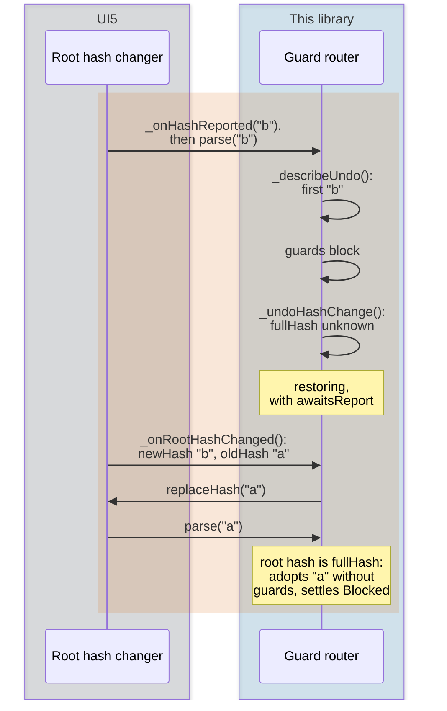

### Routers that share a hash changer

UI5 gives a component's router a `RouterHashChanger` of its own only when the component is
displayed by a routing target of type `Component`. Every other component with routing (one in
a `ComponentContainer`, one created with `Component.create()` outside of routing) gets the
cached child of the root hash changer (`HashChanger#createRouterHashChanger`), as the router of
the app does. In the Fiori launchpad the root routers of all apps share it.

UI5 informs the routers on that hash changer one after the other. If the first one redirects,
UI5 reports the target to every router, and only then the redirected hash to the routers after
the first. A native router parses that stale hash and displays its route, although the URL
shows another one.

A guard router recognizes such a report. `_start()` attaches `_onHashReported()` to its own
hash changer before `super.initialize()` attaches UI5's listener that calls `parse()`. The
listener stores the reported hash (`_reportedHash`) and marks the report as out of date
(`_reportOutdated`) when the hash changer shows a different hash that it reported before
(`_lastReport`): the router has parsed the later hash already. `parse()` drops such a report.
`_reportedHash` also tells `parse()` whether a call comes from a hash change at all.

A hash that the first router blocks is not stale: the second router parses it and then the
hash that puts the URL back, as the URL shows them.

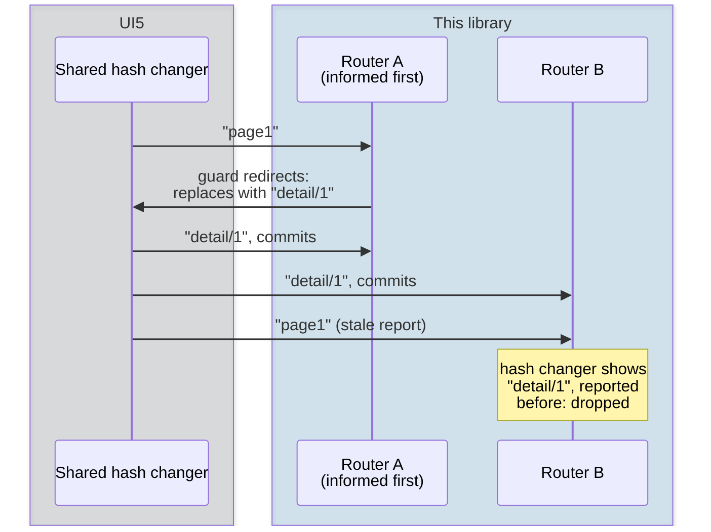

## Guard Execution Pipeline

Guards run in three phases, in the order given in the library README,
[Execution order](../../packages/lib/README.md#execution-order). The sync and async paths are
described [above](#parse-override---fallback-for-browser-initiated-navigation).

Greedy routes: `Router._evaluateGuards()` passes `alsoLeaving` (greedy routes other than
`fromRoute` that match `fromHash`) and `alsoEntering` (greedy routes other than `toRoute`
that match `toHash`), found with `Route#match()` over `_greedyRouteNames` in definition
order. `evaluate()` runs the leave guards of `fromRoute` and then of `alsoLeaving`, and the
route guards of `toRoute` and then of `alsoEntering`, each list through `_runForEach()`,
which stops at the first non-`true` result and checks the abort signal after an async
route. All of them get the one context of the navigation. On a redirect hop
`skipLeaveGuards` drops all leave guards, those of `alsoLeaving` included.

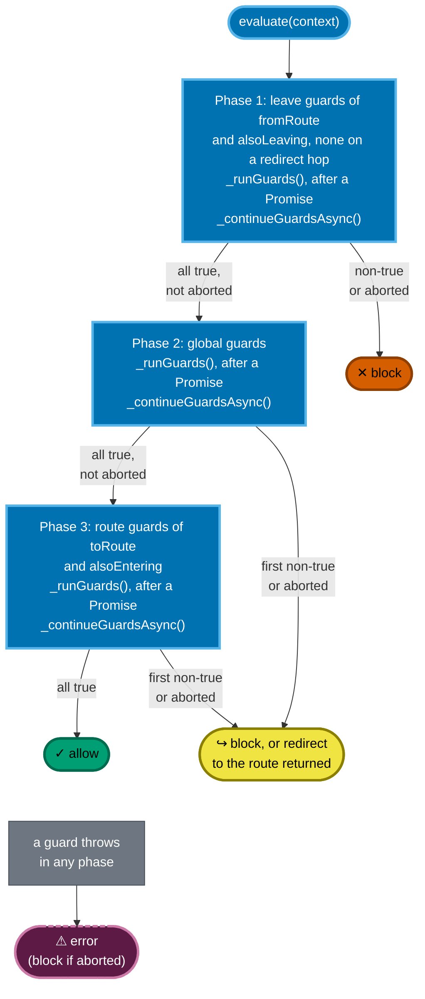

Blue is the library, grey is native UI5 or no action, and light blue is a decision. The outcomes carry a symbol: ✓ commit (green), ↪ redirect (yellow), ✕ block (orange) and ⚠ error (dark purple, dashed border) ([diagram style](../../CONTRIBUTING.md#diagram-style)).

The first non-`true` result stops evaluation, and the remaining guards are skipped.

If a guard throws or its Promise rejects, the error is logged and `evaluate()` returns
`{ action: "error", error }`. The router settles the navigation as `Error` with the thrown
value on `result.error`. If the abort signal is already aborted, the navigation was cancelled:
the error is swallowed and the decision is a block.

## Manifest Guards and Route Metadata

`Router.ts` keeps the navigation logic and hands the rest to helper modules:

| Step                         | Router code                                                                                    | Helper                                                                                                 |
| ---------------------------- | ---------------------------------------------------------------------------------------------- | ------------------------------------------------------------------------------------------------------ |
| Read the `guardRouter` block | constructor                                                                                    | `parseGuardRouterConfig()` (`GuardConfig.ts`): options with defaults, `routeMeta`, guard descriptors   |
| Lazy-mode preload hint       | constructor                                                                                    | `sap.ui.require(paths)` with an empty error callback, fire-and-forget                                  |
| Pattern-tree expansion       | `initialize()`, `addRoute()`                                                                   | `expandToDescendants()`, `expandForNewRoute()` (`PatternTree.ts`)                                      |
| `guardLoading: "block"`      | `initialize()`                                                                                 | `loadGuardModules()` (`GuardModules.ts`), then `super.initialize()`                                    |
| `guardLoading: "lazy"`       | `initialize()` → `_registerLazyGuards()`; `addRoute()` → `_registerManifestGuard(..., before)` | `createLazyGuards()` (`GuardModules.ts`); its wrappers run a module's guards with `runGuardsInOrder()` |
| Export shapes and names      | -                                                                                              | `resolveModuleExports()` (`GuardModules.ts`)                                                           |
| Guard names in log messages  | -                                                                                              | `nameGuard()` / `describeGuard()` (`GuardPipeline.ts`)                                                 |
| Route metadata               | `_meta`, `getRouteMeta()`, `setRouteMeta()`, `addRoute()`                                      | `RouteMetaStore` (`RouteMeta.ts`)                                                                      |

Option defaults: `unknownRouteRegistration: "warn"`, `navToPreflight: "guard"`,
`guardLoading: "lazy"`, `inheritance: "none"`. An invalid value logs
`guardRouter.<key> has invalid value, using default`.

Every manifest guard is registered through `_registerManifestGuard()`. With `unknownRouteRegistration: "throw"`, imperative
calls (`addRouteGuard`, `addLeaveGuard`, `setRouteMeta`) throw for an unknown route. A
manifest guard on an unknown route has no caller that could catch the error, so
`_registerManifestGuard()` logs `guardRouter.guards: failed to register "<modulePath>"`
and skips that guard; the router still starts.

Manifest guards get a name from their module (`moduleName`, `moduleName#index`, or the
export key). Pipeline log messages show it, for example
`Enter guard [0] "checks#0" on route "admin" threw, navigation failed`. Imperatively
registered guards have no name and log as `Enter guard [0]`.

## Async Concurrency Control

The `_parseGeneration` counter handles overlapping async navigations:

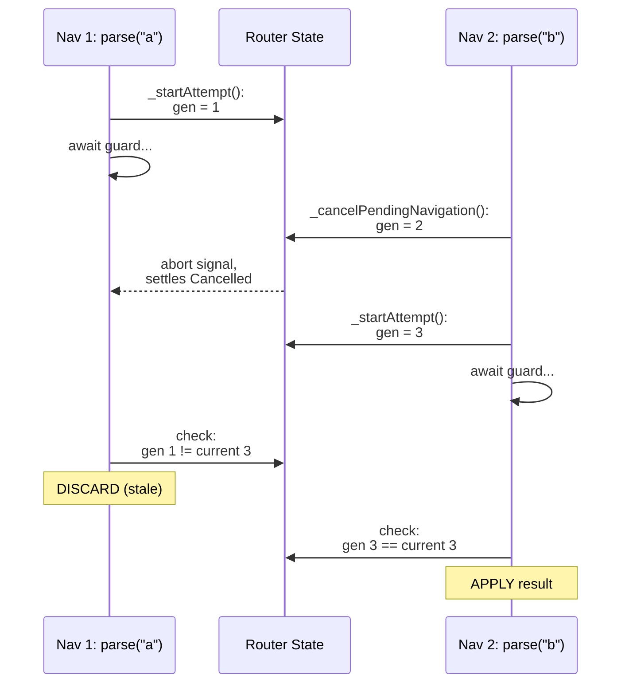

Every `parse()` or `navTo()` that enters the guard pipeline first calls
`_cancelPendingNavigation()`, which bumps the generation and aborts the pending
navigation's `AbortSignal`, and then `_startAttempt()`, which gives the new attempt a
generation of its own. Everything else that ends an evaluating phase from outside the
attempt (`stop()`, `destroy()`, the same-hash branch of `parse()` when the URL comes back to
the committed hash) also goes through `_cancelPendingNavigation()`. Inside the pipeline, the
aborted signal stops the remaining guards between awaits. When the decision arrives,
`parse()`, `navTo()` and redirect hops discard it with a debug log if the generation changed.

The sync path checks the generation too (`_applyPreflightDecision()`, `_applyDecision()`,
`_applyRedirectDecision()`): a guard that calls `navTo()` itself supersedes the navigation it
guards, and whatever it returns afterwards is dropped. The navigation it started is the one
that settles.

The own generation matters when a `navigationSettled` handler navigates on the `Cancelled`
settlement. The handler runs inside `_cancelPendingNavigation()`, before the superseding
navigation has started its attempt. If the handler's navigation is still pending when the
superseding navigation continues, `_startAttempt()` aborts its signal and replaces it; its
result is stale and it does not settle. Firing `Cancelled` for it would call the handler
again, which would navigate again.

## Settlement Signal

`navigationSettled()` returns a Promise that resolves with a `NavigationResult` when the
pending navigation settles.

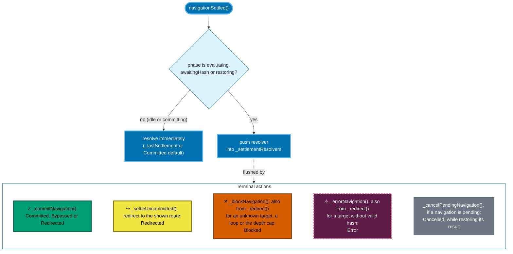

Blue is the library, grey is native UI5 or no action, and light blue is a decision. The outcomes carry a symbol: ✓ commit (green), ↪ redirect (yellow), ✕ block (orange) and ⚠ error (dark purple, dashed border) ([diagram style](../../CONTRIBUTING.md#diagram-style)).

Each terminal action (`_commitNavigation`, `_blockNavigation`, `_errorNavigation`,
`_cancelPendingNavigation`) calls `_flushSettlement()`, which resolves all queued resolvers
with one `NavigationResult` and fires the `navigationSettled` event. `_redirect()` calls
`_blockNavigation()` for an unknown target route: the user stays on the current route. An
allowed redirect ends in `_commitNavigation()`, through `parse()` or directly (redirect to the
hash the URL already shows, component targets), and settles as `Redirected`; a redirect to the
committed hash settles as `Redirected` without a commit. Further rules:

- `_commitNavigation` tells `Committed`, `Bypassed` and `Redirected` apart by the phase origin (committing/redirect or other) and the matched route
- `_cancelPendingNavigation` flushes only when the router is evaluating or awaiting a hash
  (`Cancelled`), or restoring (the result that phase stored), avoiding spurious settlement
  signals during initialization or when no navigation is in flight
- A navigation that did not commit (`Blocked`, `Error`, `Cancelled` with a restore, a
  `Redirected` to the committed hash) goes through `_settleUncommitted()`, which restores the
  hash before it flushes. Handlers run on the final URL, and a hash that a handler sets is not
  overwritten by the restore. When the restore has to wait (a step back, see
  [Undoing a hash change](#undoing-a-hash-change)), the router enters the `restoring` phase and
  flushes when the URL is back; `_cancelPendingNavigation()` flushes it earlier if another
  navigation starts. A hash that the hash
  changer already shows is not written again (`_restoreHash()`): a blocked first navigation on
  the empty hash never moved it, and for a nested router UI5 would add the router's prefix to
  the browser hash for the write (`shell` would become `shell&/child/`). The one exception is
  a first navigation (`_currentHash` is `null`) that is blocked on a non-empty hash: the
  settlement fires first, then the empty hash is restored and parsed as a navigation of its
  own, so the order stays `Blocked`, then the default route's settlement
- Every terminal action leaves the evaluating phase before it flushes, so a handler that calls
  `navTo()` starts a regular navigation and `navigationSettled()` called from a handler
  resolves with the settlement that is being fired
- `_commitNavigation` flushes before `super.parse()`, so the settlements of navigations that
  `beforeRouteMatched` or `routeMatched` handlers start come after it. If a settlement handler
  itself navigated on and committed, `_currentHash` is no longer the committed hash and
  `super.parse()` is skipped: the route that was left again is not displayed over the newer one
- `_lastSettlement` caches the most recent result: synchronous guards settle within the
  `navTo()` call, before a caller can register a resolver, and `navigationSettled()` called
  afterwards returns that result. `stop()` and `destroy()` reset it

## FLP Integration

When the router runs inside a Fiori Launchpad (FLP), two independent dirty-state
mechanisms coexist:

| Mechanism                    | Scope             | UX                            |
| ---------------------------- | ----------------- | ----------------------------- |
| Router leave guard           | In-app navigation | Silent block + hash restore   |
| `registerDirtyStateProvider` | Cross-app (FLP)   | Native FLP confirmation popup |

The two handle different scopes and do not need to coordinate in application code.
The application-side setup is in the library README, [Combining leave guards with FLP
dirty-state protection](../../packages/lib/README.md#combining-leave-guards-with-flp-dirty-state-protection).

The launchpad replaces the global `HashChanger` with its `ShellNavigationHashChanger`. The root
routers of all app components share the one `RouterHashChanger` that this hash changer creates
and caches ([Routers that share a hash changer](#routers-that-share-a-hash-changer)). The shell
keeps the routers of inactive apps from reacting by stopping them.

Every hash change, in-app or cross-app, first runs the shell's navigation filters
(`ShellNavigationHashChanger#treatHashChanged`). A filter that takes over the navigation ends
it there: no `hashChanged` event reaches the app router. Otherwise an in-app change fires
`hashChanged` with the app part of the hash, and a cross-app change fires `shellHashChanged`,
which updates the app router's hash changer without firing `hashChanged`, so `parse()` never
sees a cross-app hash. In SAPUI5 1.144.0 and 1.149.0 (`sap/ushell/renderer/Shell.controller.js`):

- `_disableSourceAppRouter` calls `stop()` on the router of the current app for every
  cross-app hash change, before the data-loss check.
- `_handleDataLoss` asks the dirty flag and the dirty-state providers (in-app changes
  included; a provider tells them apart by `isCrossAppNavigation`). If the app is dirty, it
  restarts the app router with `initialize(true)` while the URL still shows the target, starts
  to put the previous hash back, and then shows the browser's `confirm()` dialog. If the user
  confirms, the shell sets the target hash again. If the user cancels, the app stays on its
  route with its router running.
- The same `initialize(true)` restart runs when a navigation fails and the shell goes back to
  the previous app, and when the target app opens in a new window.

The hash change that puts the app's hash back reaches the router as no `hashChanged` event.
After the cancel, UI5 does not report a hash change to the app's own hash `""` either. The router
therefore takes the hash to undo from the `oldHash` of the next root `hashChanged` event
([Undoing a hash change](#undoing-a-hash-change)):

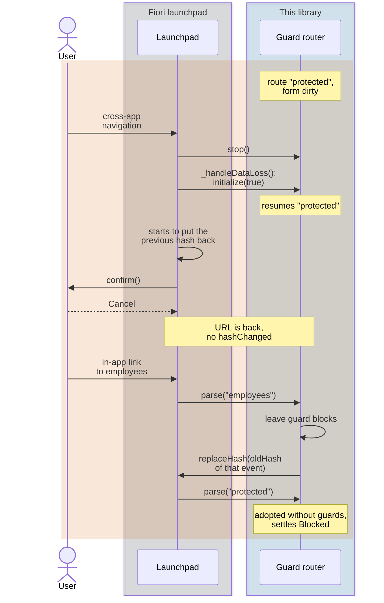

A hash change that the shell takes over never reaches `parse()`. A `navTo()` whose hash write
is taken over settles as `Blocked`, because the hash changer still shows the old hash. This
happens to an in-app `navTo()` while the dirty check is true for in-app navigation
(`setDirtyFlag(true)`, or a provider that does not return `false` for
`isCrossAppNavigation: false`), and to the first hash change after the shell has put a hash
back, until the browser reports that change. While the `confirm()` dialog is open, no
application code runs.

### Keep-alive

With `sap-keep-alive=true` the shell keeps an app it leaves for another app and hides it.
With `sap-keep-alive=restricted` it keeps it the same way between apps, but destroys it when
the user reaches the launchpad home. Before the shell creates a new app component, it stops the
routers of all kept apps. Embedded apps (`appIntegration/contracts/EmbeddedUI5Handler.js`):

| The component                                                      | Hide                                            | Show                                                                                        |
| ------------------------------------------------------------------ | ----------------------------------------------- | ------------------------------------------------------------------------------------------- |
| supports keep-alive (manifest `sap.ui5/keepAlive/supported: true`) | `deactivate()`: `stop()`, then `onDeactivate()` | `activate()`: `initialize()`, which parses the hash through the guards, then `onActivate()` |
| does not                                                           | `stop()`                                        | `initialize(true)`, which resumes the route; `initialize()` on the legacy restore flow      |

`Component#deactivate()` and `Component#activate()` are UI5 core (`sap/ui/core/Component.js`);
`isKeepAliveSupported()` reads the manifest entry. Apps in an iframe are hidden and shown by
the app runtime the same way, see [Keep-alive in an iframe](#keep-alive-in-an-iframe).

The component supports keep-alive:

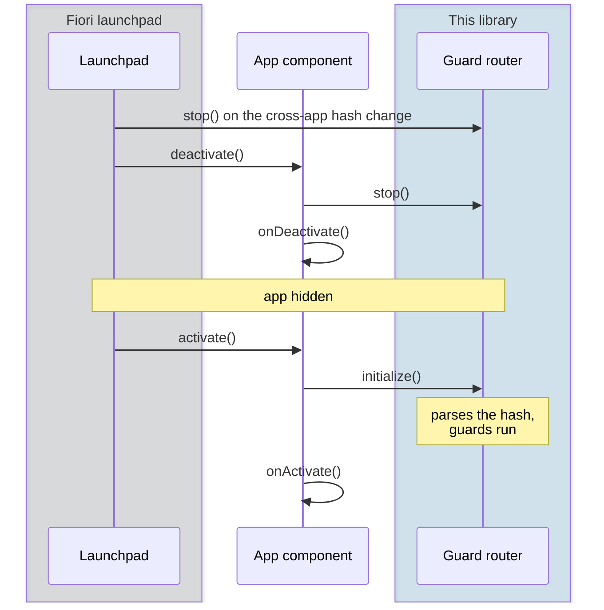

It does not:

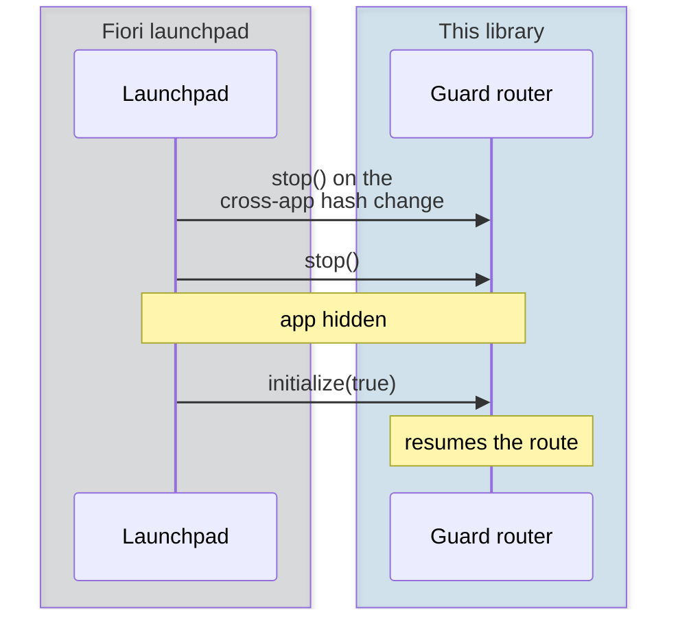

The dirty-state providers of a hidden embedded app stay registered: the shell asks them on
every navigation until the app deregisters them. The application side is in the library README,
[Keep-alive apps](../../packages/lib/README.md#keep-alive-apps).

Observed in the FLP sandbox (SAPUI5 1.144.0, `?sap-keep-alive=true`, embedded apps; demo
spec `flp-keep-alive.e2e.ts`):

- A hidden app's router does not react to the other app's hash changes, although both routers
  share the root `RouterHashChanger`: it is stopped.
- An app that supports keep-alive and is shown again through an intent without an inner route
  starts on the hash `""`, its default route: `initialize()` parses it with an empty
  `fromRoute`, so no leave guard runs.
- An app without the declaration resumes its route on the hash `""`. A `navTo()` to the route
  whose pattern is `""` then changes nothing, because that hash is already shown. The native
  router behaves the same.
- Returning from the launchpad home through a hash with an inner route (browser back, bookmark)
  destroys the kept component and creates a new one, which starts with `initialize()`.

### Keep-alive in an iframe

An app that the launchpad runs in an iframe is started by the UI5 app runtime
(`appRuntime/ui5/`) inside the iframe. To hide and show it, the shell sends the messages
`sap.ushell.services.appLifeCycle.store` and `sap.ushell.services.appLifeCycle.restore`
(`appIntegration/contracts/StatefulContainerV2Handler.js`), and the app runtime
(`appRuntime/ui5/services/AppLifeCycleAgent.js`) calls the component as the shell calls an
embedded one:

| The component       | Hide (`store`)                             | Show (`restore`)                                                                                               |
| ------------------- | ------------------------------------------ | -------------------------------------------------------------------------------------------------------------- |
| supports keep-alive | `deactivate()`                             | The hash of the iframe is replaced with the intent, then `activate()`                                          |
| does not            | `suspend()` if it has one, `Router#stop()` | The hash is replaced, `restore()` if it has one, `initialize(true)`; `initialize()` on the legacy restore flow |

Observed with SAPUI5 1.144.0 and 1.149.0: the demo app in an iframe, a second app embedded in
the launchpad page, `?sap-keep-alive=true`. Both versions behave the same, except for the last
point.

- Hide and show run as in the table. The router is stopped while the app is hidden. Shown again
  through an intent without an inner route, an app that supports keep-alive starts on the hash
  `""` with `initialize()` and settles `Committed` on its default route; an app without the
  declaration resumes its route on the hash `""` with `initialize(true)` and matches no route.
  That is the behavior of an embedded app.
- The iframe has its own URL, so the hidden app sees no hash change of the other app. The app
  runtime reports each hash change of the app to the shell (`sap.ushell.appRuntime.hashChange`),
  which shows it in the URL of the launchpad.
- Browser back from the second app shows the kept app again, the same component; the second app
  is destroyed.
- A dirty-state provider that the app registers stays in the iframe. The app runtime keeps the
  providers itself and does not report them to the shell, so the shell does not ask them:
    - A cross-app navigation that starts in the shell (its `Navigation` service, a new hash in the
      URL of the launchpad) hides an app with unsaved data without a question. The data stays with
      the kept app.
    - The app runtime asks before every hash write in the iframe (`hasher.setHash()`,
      `hasher.replaceHash()`) and before a cross-app navigation that the app starts through the
      `Navigation` service of the app runtime. If its dirty flag is set or a provider answers
      `true`, it shows `window.confirm()` in the iframe. On cancel nothing is written: a `navTo()`
      settles as `Blocked`, as after any hash write that the launchpad takes over. On confirm the
      navigation goes on: the hash is written, or the shell hides the app.
    - The provider is asked with the navigation context of the iframe. After the app is shown
      again, that context is cross-app until the next hash change in the app, because the app
      runtime has replaced the hash with the intent. A provider that answers only for a
      cross-app navigation (`isCrossAppNavigation !== false`) therefore answers for the first
      in-app `navTo()` after an app with unsaved data is shown again, and the user is asked.
      After the first hash change in the app the context is in-app, also for a cross-app
      navigation that the app starts: such a provider answers `false`, and the app is hidden
      with its unsaved data without a question. The app runtime of 1.144.0 to 1.154.0 reads the
      context from its own `ShellNavigationInternal`, not from the target.
- 1.144.0 only: on `store` the app runtime saves the list of providers and empties it, before it
  calls `deactivate()`; on `restore` it puts the list back, before it calls `activate()`. An app
  that deregisters its provider in `onDeactivate()` and registers it in `onActivate()` has it in
  the list once more after each hide and show (four times after three rounds). All entries are
  the same function, so the answers do not change. 1.149.0 no longer touches the providers on
  `store` and `restore` (read from the source).

The FLP sandbox of `sap.ushell`, which the demo's preview middleware (`fiori-tools-preview`)
starts, cannot declare an app in an iframe: it writes every tile as a component embedded in the
launchpad page (`"sap.ui": { "technology": "UI5" }` in `sap/ushell/sandbox/ConfigurationProvider.js`
up to 1.154.0). The runs above used a launchpad page with a site of its
own (`CommonDataModel` adapter, `siteDataUrl`), in which the app has
`"sap.ui": { "technology": "URL" }` and a URL template (`sap.integration/urlTemplateId`, and
`urlTemplates` with the capabilities `navigationMode: "embedded"` and `appFrameworkId: "UI5"`).
The template points to a page that starts `sap/ushell/appRuntime/ui5/AppRuntime` and has an
element with the ID `content`, where the app runtime places the app. The page reads the app
from a `meta` element named `sap.ushellConfig.ui5appruntime` (`ui5appruntime/config/appIndex/data`),
which both versions accept. The template builds the URL of the iframe from the app and the
launchpad hash: `sap-ui-app-id` from `sap.app/id` (through `renameTo`, because a template variable
cannot contain `-`), `sap-startup-params` from the intent parameters (`{*|join(&,=)}`), the hash
from the inbound `target`, and `&/` plus the inner app route (`{&innerAppRoute:.}`). So a deep link
such as `#guardiframe-display?greeting=hello&/employees` reaches the app with its parameters and
route. The site is a spaces site: the menu entry opens a page with a tile for each app.

That setup is in `packages/demo-app/test/flp/iframe/webapp/`: `flp.html` starts the CDM
bootstrap of `sap.ushell` and adds the site through a `sap.ushellConfig` meta tag, next to
`site.json` and `ui5appruntime.html`. The preview middleware serves the folder at `/iframe`.
`flp-iframe-keep-alive.e2e.ts` runs the demo app in it on SAPUI5 1.151.0 and 1.154.0 and pins the
first point: the router is stopped while the app is hidden, the kept component settles
`Committed` on its default route when it is shown again, with its unsaved data, and its guards
run once for a navigation after that. A cross-app navigation that starts in the shell hides the
app without a question. It also pins what the app runtime asks with the context of the iframe:
the first `navTo()` after the app is shown again asks (cancel settles `Blocked`, confirm
commits), and a cross-app navigation that the app starts after that does not. The provider list
of 1.144.0 is not pinned by a test. Two setups that look similar do not work:

- Without the element `content` the component is created and routes, but the app runtime never
  records it as its running app. It answers `store` with `sap.ushell.appRuntime.isInvalidIframe`,
  and the shell destroys the iframe and goes to the launchpad home.
- A URL app without a URL template opens in a new window. The intent parameter
  `sap-ushell-navmode=inplace` embeds it, but the hash that the app runtime reports for the first
  in-app navigation lacks the parameter: the shell takes it for another intent, resolves it
  without the parameter and opens the app in a new window.

The source locations are in the [FLP evidence table](./upstream-parity.md#fiori-launchpad-sapushell).
The FLP spec files of the demo app are listed in the [demo README](../../packages/demo-app/README.md#e2e-tests).

## UI5 Internals the Router Relies On

The router overrides and calls public and protected API of `sap.m.routing.Router`, with four
exceptions that no public contract covers. The first two concern a component that is displayed
as a routing target (`"type": "Component"`) of a parent router, the other two the title history:

1. The private member `_bMatchingProcessStarted` of `sap.ui.core.routing.Router`, by which a
   router tells UI5 that a route match is in progress.
2. The way a component target waits for the router of a nested component: it subscribes the
   bare resolve function of a Promise to `routeMatched`. The router recognizes that function by
   its shape.
3. The private member `_bLastHashReplaced` of `sap.ui.core.routing.Router`, by which `navTo()`
   tells the title history that it has replaced a history entry.
4. `getTitleHistory()` returns the array of the title history itself, not a copy. The router
   removes one entry from it after a redirected step back.

No other private UI5 member is read or written.

### `_bMatchingProcessStarted`: a route match in progress

**What UI5 uses it for.** The native router sets the member to `true` inside `parse()`, as soon
as a route matches, and back to `false` once the targets of that route are displayed, right
before it fires `routeMatched`. Three places read it:

| Reader                                                 | Effect while the member is `true`                                                                                                                                                                 |
| ------------------------------------------------------ | ------------------------------------------------------------------------------------------------------------------------------------------------------------------------------------------------- |
| `Target#waitForComponentTarget`                        | Nested component readiness: a routing target of type `Component` counts as displayed only after the next `routeMatched` of the nested router. The same holds while that router is not initialized |
| `display` handler attached by the `Router` constructor | A target displayed outside of a route match does not reset the router's hash changer (`resetHash`), which otherwise lets the route that matched before match again                                |
| `Router#fireTitleChanged`                              | A `titleChanged` event is fired after the next `routeMatched` instead of immediately                                                                                                              |

The only writer is `Route#_routeMatched`. Routers with `async: false` use
`sap/ui/core/routing/sync/Route.js`, which sets and clears the member within `parse()`. The
source locations for each supported UI5 version are listed in
[upstream-parity.md](./upstream-parity.md#ui5-source-locations).

**Why the guard router is involved.** The router postpones `super.parse()` while guards are
async. That is the normal case for the first navigation in lazy mode, because the guard module
is still loading. During that time the native member would stay `false`. A parent route that
displays the component through a component target would count it as displayed, and fire its
own `routeMatched`, before the first route of the nested component matched.

**What the router does.** The constructor replaces the member with an accessor on the instance
(`_mirrorMatchingProcess()`). The router never writes the member. The accessor stores the value
UI5 writes in `_nativeMatching`, and reads `true`

- while the value UI5 wrote is `true`, and
- from the moment a navigation starts to wait for async guards until that navigation settles.
  This covers the initial hash, hash changes, the `navTo()` preflight and redirect hops. The
  evaluating phase carries `postponed: true` for that time.

A navigation that commits calls `super.parse()` in the call that settles it. UI5 then sets the
member and clears it before `routeMatched`, as it does natively. No asynchronous step lies
between the pending guard and that `super.parse()`. A navigation that is blocked, fails,
is cancelled or superseded, or ends with `stop()` or `destroy()`, reads `false` from its
settlement on. Guards that decide synchronously never make the member read `true`: the native
router has not matched a route at that point either.

**Effect on `titleChanged` and `resetHash`.** The other two readers see the same value. While a
navigation waits for async guards, UI5 defers a `titleChanged` event to the next `routeMatched`
and skips `resetHash`, as it does during a native match. If the navigation does not commit, a
deferred `titleChanged` is fired with the `routeMatched` of a later navigation.

### The component target's wait for a nested router

**What UI5 does.** `Target#waitForComponentTarget` returns a Promise that the parent route
awaits before it fires the target's `display` event and its own `routeMatched`. For a component
with a router, the target waits for the next `routeMatched` of that router if all of this holds:

- the parent route did not ask to ignore the initial hash,
- the nested router is not initialized, or `_bMatchingProcessStarted` reads `true`,
- a route with targets matches the current hash of the nested router.

It waits with `oRouter.attachRouteMatched(resolve)`: the listener is the resolve function of the
Promise itself, with no data and no listener object. The Promise is never rejected, and only the
target holds it. Nothing but a `routeMatched` of the nested router releases it. UI5 states the
reason in a comment above the condition: when a match is in progress, "we are sure that there
will be a "routeMatched" event fired". If the nested router is stopped, the target initializes
it right after.

When the parent leaves the route, `Target#suspend` stops the nested router.

In `sap.m.routing.Router`, target placements are chained (`TargetHandler#_chainNavigation`,
called from `sap/m/routing/Target.js`). A placement that waits forever holds back every later
placement of the parent router.

**Why the guard router is involved.** A navigation that guards block or fail, or that is
cancelled, never fires `routeMatched`. A component target that waits for it would wait forever:
the parent route would never fire its own `routeMatched`, and later navigations of the parent
would queue behind it. This is not limited to the mirrored member. UI5 also waits because the
nested router is not initialized. In these two cases a blocked navigation left the parent
waiting before the router handled it, with or without the mirrored member:

- A parent route displays the component again. UI5 stopped the nested router when the parent
  left the route, and starts it again right after it subscribed.
- Guard modules load in block mode (`guardLoading: "block"`). The router is not initialized
  until they are loaded, and its first navigation starts only then.

**What the router does.** It overrides `attachRouteMatched()`. A listener that is subscribed
while UI5 would wait (the router is not initialized, or the member reads `true`) and that is a
Promise resolve function is remembered in `_matchWaiters`. The listener is subscribed as usual
in any case. After every settlement, `_settleMatchWaiters()` runs in a microtask:

- A navigation waits for async guards: the remembered Promises keep waiting for its settlement.
- UI5 is matching a route: they are forgotten, because the `routeMatched` of that match
  resolves them.
- Otherwise no match is coming, and they are resolved.

The microtask lets a commit reach `super.parse()` and a superseding navigation start before the
check.

**How the resolve function is recognized.** UI5 passes nothing that identifies the component
target, so the router tells the listener by its shape (`isPromiseResolver()` in
`GuardPipeline.ts`). A listener is a Promise resolve function if it is a function and

- its `name` is `""`,
- its `length` is `1`,
- `Function.prototype.toString` prints it exactly as the engine prints the resolve function of
  a Promise. The router reads that text from a real Promise when the module loads. In Chrome
  it is `function () { [native code] }`.

A function written in JavaScript never matches, because its source text is its own code. Bound
functions and named built-ins such as `Math.max` differ in the name, `Function.prototype` in
the length.

**False positives.** The router cannot see who subscribes. Other anonymous built-in functions
with one parameter have the same shape, above all the reject function of a Promise. Application
code that subscribes such a function with `attachRouteMatched()` under the same condition is
treated like the component target: the function is called without an event when a navigation
ends without a route match, so its Promise settles early. No handler function is ever called
this way. Handler functions are only called by the `routeMatched` event.

**Supersession.** A navigation that supersedes the pending one takes over the remembered
Promises if it has started when the microtask runs. That holds for a navigation that cancels
the pending one itself and for one started in a `navigationSettled` event handler. A navigation
that starts later, for example after `await router.navigationSettled()`, is not waited for: the
Promises are resolved at the settlement before it, and the parent route is displayed before the
route of that later navigation matches.

**What stays as in UI5.** A remembered Promise that is left to a match in UI5 waits forever if
UI5 never fires `routeMatched` for that match, for example because the display of a target
fails. The native router behaves the same. A resolved Promise stays subscribed, as in UI5, and
is called again by later `routeMatched` events without effect.

**Result for a nested component.** If a guard blocks the navigation of the nested router, on
first display or on a later one, the nested router settles as `Blocked`, none of its routes
matches and it displays no view. The parent route still displays the component container and
fires `routeMatched`, and the browser hash stays as the parent set it. If the guard redirects
instead, the parent route waits for the route that the redirect ends on.

### `_bLastHashReplaced` and `getTitleHistory()`: the title history after a redirected hash change

**What UI5 uses it for.** `navTo()` with `bReplace` sets the member to `true` before it replaces
the hash. When the next matched route gets its title, `Router#fireTitleChanged` removes the last
entry of the title history (`getTitleHistory()`) before it adds the new one, and clears the
member: the history entry that was replaced is the one that title belonged to.

**Why the guard router is involved.** A hash change that a guard redirects has reached the
browser, so the router writes the redirect target with `navTo(target, ..., true)`: the target
takes the history entry of the redirected hash. If the hash change added that entry (a link, the
address bar, `setHash()`), the entry never had a title, because its route never matched. UI5
would remove the title of the route before it, whose entry is still in the browser history.

The same holds for a step forward: UI5 removes the title of an entry when the user steps back
from it, so the entry ahead has no title. After a step back it is the other way round. The entry
the step arrived at has a title, below the title of the route that was left. Natively the step
back removes the title of the route that was left (unless it is the home entry or both titles
are equal), and `navTo(target, ..., true)` then replaces the title of the entry. The guard
router keeps the route of the step from matching, so UI5 handles no title for it, and removes
only one of the two.

**What the router does** (`_alignTitleHistory()`, called by `_commitNavigation()` for the target
of a redirected hash change, by the direction that UI5's `History` reports for the hash change):

| Direction              | The router                                                                                                                                                                  | Title history: from `[A, B]` on `B`; for a step back, from `[A, B, C]` on `C` to `B` |
| ---------------------- | --------------------------------------------------------------------------------------------------------------------------------------------------------------------------- | ------------------------------------------------------------------------------------ |
| `NewEntry`, `Forwards` | Sets `_bLastHashReplaced` to `false` after `navTo()` has set it and before the target route matches: UI5 adds the title of the target                                       | `[A, B, target]`                                                                     |
| `Backwards`            | Removes the entry below the last one from the array that `getTitleHistory()` returns, under UI5's condition for a step back; UI5 then replaces the last one with the target | `[A, target]`                                                                        |
| `Unknown`              | Nothing: the hash change replaced an entry                                                                                                                                  | What UI5 makes of `navTo(target, ..., true)`                                         |

That is the title history after the native equivalent, the hash change followed by
`navTo(target, ..., true)`, as long as the route that is left, the route of the hash change and
the target have different titles. UI5 reports a title only when the title or its target differs
from the one it reported last. With titles that repeat, the native title history depends on the
title of the route that the guard router keeps from matching, and the two can differ. The
router leaves the title history alone for a redirected `navTo()` call, where the call says
whether an entry is replaced.

### Tests that pin the dependencies

The dependencies are pinned by tests on both UI5 lanes. The tests, what fails when UI5 changes,
and the upgrade procedure are in [Private UI5 Coupling](./upstream-parity.md#private-ui5-coupling).

## Internal State

| Field                      | Type                                   | Purpose                                                                                                                                                                    |
| -------------------------- | -------------------------------------- | -------------------------------------------------------------------------------------------------------------------------------------------------------------------------- |
| `_options`                 | `ResolvedGuardRouterOptions`           | Resolved manifest options with defaults applied                                                                                                                            |
| `_pipeline`                | `GuardPipeline`                        | Owns guard storage and evaluation logic (see `GuardPipeline.ts`)                                                                                                           |
| `_currentRoute`            | `string`                               | Name of the currently active route                                                                                                                                         |
| `_currentHash`             | `string \| null`                       | Hash of the active route, `null` before first                                                                                                                              |
| `_phase`                   | `RouterPhase`                          | Discriminated union tracking the router's lifecycle phase (see below)                                                                                                      |
| `_parseGeneration`         | `number`                               | Monotonic counter for async invalidation                                                                                                                                   |
| `_suppressedHash`          | `string \| null`                       | The hash `_restoreHash()` is writing, which the synchronous `parse()` it causes ignores                                                                                    |
| `_undo`                    | `HashChangeUndo \| null`               | How to undo the hash change of the pending navigation (see [Undoing a hash change](#undoing-a-hash-change))                                                                |
| `_reportedHash`            | `unknown`                              | The hash that the router's hash changer is reporting, until `parse()` receives it ([Routers that share a hash changer](#routers-that-share-a-hash-changer))                |
| `_lastReport`              | `unknown`                              | The hash the router's hash changer reported last, out-of-date reports aside                                                                                                |
| `_reportOutdated`          | `boolean`                              | The report in progress is out of date: the hash changer shows a later hash that the router has parsed                                                                      |
| `_rootHashChanger`         | `HashChanger \| null`                  | The global hash changer that `_onRootHashChanged()` is attached to; another one after `HashChanger.replaceHashChanger()` ([Undoing a hash change](#undoing-a-hash-change)) |
| `_stoppedRoute`            | `string`                               | Route that was current when `stop()` ran; `initialize(true)` resumes it                                                                                                    |
| `_settlementResolvers`     | `((r: NavigationResult) => void)[]`    | Pending `navigationSettled()` callbacks                                                                                                                                    |
| `_lastSettlement`          | `NavigationResult \| null`             | Most recent settlement result (for post-hoc queries)                                                                                                                       |
| `_manifestGuards`          | `{ descriptor, fn }[]`                 | The manifest guards registered for a route, by which `addRoute()` puts inherited guards in front of the guards of deeper routes                                            |
| `_pendingGuardDescriptors` | `GuardDescriptor[]`                    | Parsed manifest guard descriptors, registered and cleared by `initialize()`                                                                                                |
| `_sourceDescriptors`       | `ManifestGuardDescriptor[]`            | Original manifest descriptors (for inheritance expansion on addRoute)                                                                                                      |
| `_destroyed`               | `boolean`                              | Set by `destroy()`; stops block-mode loading from registering guards and calling `super.initialize()`; makes a second `destroy()` a no-op                                  |
| `_nativeMatching`          | `boolean`                              | The value UI5 wrote to `_bMatchingProcessStarted` (see [UI5 Internals the Router Relies On](#ui5-internals-the-router-relies-on))                                          |
| `_matchWaiters`            | `(() => void)[]`                       | Promise resolve functions that wait for a `routeMatched`, resolved when a navigation ends without a route match                                                            |
| `_blockLoad`               | `{ start, ignoreInitialHash } \| null` | Set while block-mode modules load; `start` is cleared by `stop()` and set by `initialize()`, which also stores its `bIgnoreInitialHash` argument                           |
| `_meta`                    | `RouteMetaStore`                       | Manifest and runtime route metadata, resolved and cached (see `RouteMeta.ts`)                                                                                              |
| `_routeNames`              | `string[]`                             | Route names as `addRoute()` receives them, also from the UI5 constructor, for inheritance lookups                                                                          |
| `_greedyRouteNames`        | `string[]`                             | Names of the routes with `greedy: true`, in definition order, whose guards run in addition to the first match                                                              |
| `_ownerComponent`          | `UIComponent \| undefined`             | Owner component from the constructor, exposed as `GuardContext.ownerComponent`                                                                                             |

Two variables live at module scope, because they describe the browser and are shared by
all routers: `lastStep` (the last step through the history, from the Navigation API) and
`undoneHref` (the URL a router is taking a step back from).

`RouterPhase` is a discriminated union with five variants:

| Phase          | Shape                                                                                                                                                                  | Description                                                                                                                                                                                                                                                                                                                                   |
| -------------- | ---------------------------------------------------------------------------------------------------------------------------------------------------------------------- | --------------------------------------------------------------------------------------------------------------------------------------------------------------------------------------------------------------------------------------------------------------------------------------------------------------------------------------------- |
| `idle`         | `{ kind: "idle" }`                                                                                                                                                     | No navigation in progress                                                                                                                                                                                                                                                                                                                     |
| `evaluating`   | `{ kind: "evaluating", attempt: NavigationAttempt, postponed?: true }`                                                                                                 | Guards are running; attempt carries hash, AbortController, generation, `restoreHash`, `direction`; `postponed` is set while the navigation waits for async guards                                                                                                                                                                             |
| `committing`   | `{ kind: "committing", route: string, hash: string, origin: "preflight" \| "redirect" \| "parse", direction?: Direction, restoreHash: boolean, writtenOver?: string }` | Navigation is being committed: `parse()` commits it when it receives `hash`, and guards any other hash as a navigation of its own; `origin` distinguishes the entry path; `direction` (how the browser got to the history entry) drives `_alignTitleHistory()`; `restoreHash` and `writtenOver` say how to undo the hash that `navTo()` wrote |
| `awaitingHash` | `{ kind: "awaitingHash", commit: PhaseCommitting }`                                                                                                                    | An allowed `navTo()` or redirect with `componentTargetInfo` waits for UI5 to write its hash; `parse()` continues with `commit` when it receives that hash                                                                                                                                                                                     |
| `restoring`    | `{ kind: "restoring", result: NavigationResult, awaitsReport?: true, whenBack?: () => void }`                                                                          | A navigation that did not commit waits for the URL to be back before it settles with `result`; with `awaitsReport` the router writes the previous hash once UI5 has informed every router; `whenBack` runs after the settlement (redirect to the shown route with `componentTargetInfo`)                                                      |

How a navigation moves through the phases, with the `NavigationOutcome` it settles with:

A navigation that commits:

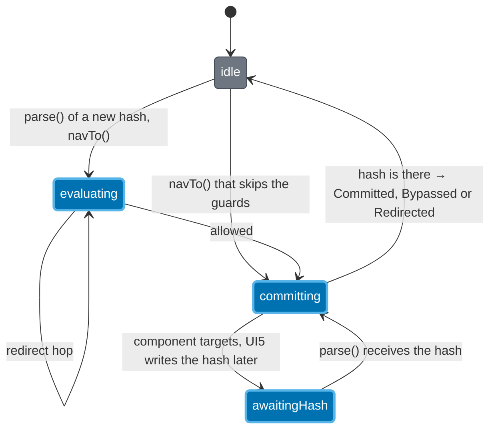

Blue is the library, grey is native UI5 or no action, and light blue is a decision. The outcomes carry a symbol: ✓ commit (green), ↪ redirect (yellow), ✕ block (orange) and ⚠ error (dark purple, dashed border) ([diagram style](../../CONTRIBUTING.md#diagram-style)).

A navigation that does not commit settles as `Blocked`, `Error` or `Redirected` (to the route that is shown): at once if the URL is already right, otherwise once it is back. One that is superseded, or that `stop()` or `destroy()` ends, settles as `Cancelled`; in `restoring` it keeps its result. A hash write that the hash changer refuses settles as `Blocked`.

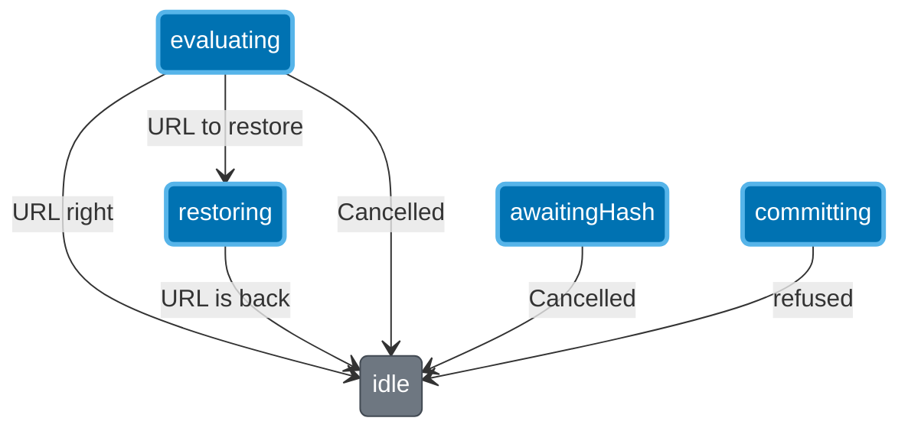

Blue is the library, grey is native UI5 or no action, and light blue is a decision. The outcomes carry a symbol: ✓ commit (green), ↪ redirect (yellow), ✕ block (orange) and ⚠ error (dark purple, dashed border) ([diagram style](../../CONTRIBUTING.md#diagram-style)).

## Monorepo Tooling

```
                    npm workspaces
                         |
           +-------------+-------------+
           |                           |
     packages/lib               packages/demo-app
           |                           |
   ui5 serve (default 8080)    ui5 serve (default 8080)
   ui5-tooling-transpile       ui5-tooling-transpile
   (TS -> JS on the fly)       + transpileDependencies: true
                               + ui5-middleware-livereload
```

- **TypeScript**: strict mode, ES2023 target, composite builds enabled
- **Build**: `ui5-tooling-transpile` compiles TS during `ui5 serve` and `ui5 build`
- **Lint**: `oxlint` with correctness (error), suspicious/perf (warn); typescript, oxc, unicorn, import plugins. Type-aware rules run through `oxlint-tsgolint` (`options.typeAware`), each file with the types of its own tsconfig
- **Type check**: `tsc --noEmit` against the source and test tsconfigs of both packages and against `tsconfig.node.json`
- **Test isolation**: root test scripts assign dedicated ports per lane so standalone, compatibility, and FLP suites can run concurrently without port conflicts

## Test Architecture

```
                          npm test
                             |
              +--------------+--------------+
              |                             |
         test:qunit                    test:e2e
              |                             |
  wdio-qunit-service              wdio + wdi5 service
  headless Chrome                  headless Chrome
              |                             |
  packages/lib/test/qunit/    packages/demo-app/test/e2e/

  Additional lanes (in test:full, not in npm test):

  test:e2e:flp                    test:qunit:compat:120
       |                               |
  packages/demo-app/test/flp/    packages/lib/test/qunit/
  (demo app in the FLP sandbox,  (same suite, OpenUI5 1.120.0)
   SAPUI5 1.154.0)

  test:e2e:flp:151
       |
  packages/demo-app/test/flp/
  (same specs, SAPUI5 1.151.0 through `ui5 serve --framework-version`)

  Local only:
  - test:mutation: Stryker mutates packages/lib/src one file at a time
    and runs the QUnit suite once per mutant (report: reports/mutation/)
```

The QUnit tests run against the library in isolation, with programmatic Router instances and
fixture components. They are grouped by topic below `packages/lib/test/qunit/`. A folder is one
test page: `testsuite.qunit.ts` registers it with its files, `loadPage.ts` loads the files in
that order, and `wdio-qunit.conf.ts` takes the pages from the test suite.

```
  unit/                modules without a router: GuardPipeline, GuardConfig, GuardModules,
                       PatternTree, RouteMeta
  router/guards/       guard API, enter guards, leave guards, greedy routes
  router/lifecycle/    initialize, stop, destroy, router options
  router/navigation/   hash changes, navTo preflight, redirects, guards on redirect targets
  router/async/        async guards, concurrent navigations, AbortSignal
  router/settlement/   navigationSettled(), its event, errors, navigating from handlers
  router/meta/         route metadata, inheritance, pattern ancestry
  router/manifest/     guards declared in the manifest
  router/history/      browser back and forward               (page of its own)
  parity/native/       the same steps on a native and a guard router
  parity/nested/       a component displayed as a routing target  (page of its own)
  parity/guarded/      guard decisions and their native equivalents  (page of its own)
  parity/entries/      history entries of guard decisions, same comparison  (page of its own)
  parity/steps/        redirected browser back and forward, same comparison  (page of its own)
  upstream-parity/     vendored OpenUI5 router tests
  fixtures/            components, manifests and guard modules the tests load
  testHelpers.ts       helpers shared by all folders
```

The five pages "of their own" step through the browser history. Chrome ignores a history
step on a page that changed the hash about 200 times within ten seconds, so no other tests
are added to them. For the parity folders see [upstream-parity.md](./upstream-parity.md).

E2E tests run against the demo app served by `ui5 serve`, exercising real browser navigation,
hash changes, and the full UI5 component lifecycle. FLP preview tests run the demo app under
`ui5 serve --config ui5-flp.yaml` (SAPUI5) and verify the ushell integration, the dirty-state
provider, leave guard coexistence and the nested component inside the shell. The spec files are
listed in the [demo README](../../packages/demo-app/README.md#e2e-tests).

## Demo App Integration

The demo app integrates the router as the library README, [Setup](../../packages/lib/README.md#setup),
describes: `routerClass` and the library dependency in `manifest.json`, guards registered in
`Component.ts` before `initialize()`. Its routes and the guards on them are drawn in the
[demo README](../../packages/demo-app/README.md#routes). The component implements
`IAsyncContentCreation`, so the routing config needs no `async: true`.
