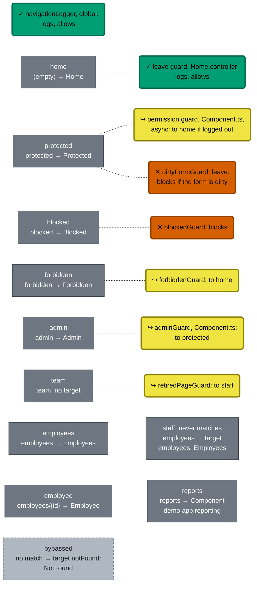
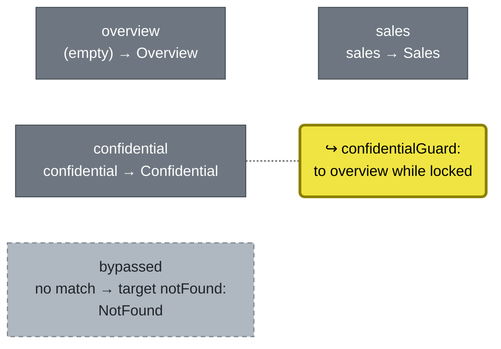

# ui5-lib-guard-router Demo App

Demo app for `ui5.guard.router.Router`: enter, leave and redirect guards, route metadata, and a nested component with a guard router of its own. It runs standalone on OpenUI5 and in a local Fiori launchpad (FLP) preview on SAPUI5.

> [!CAUTION]
> The auth and permission scenarios are UX examples. Keep real authorization and validation on the server.

## Routes

The routes of `demo.app` in manifest order. A box names the route, then its pattern → the view of its target; the target has the name of the route unless the box names another. Right of a route stand its guards.



Grey: a route. Dashed: what a hash without a route gets. A guard says what it does: green ✓ allows, yellow ↪ redirects, orange ✕ blocks. A guard without a file named is declared in the manifest.

The nested component `demo.app.reporting` (target `reports`, hash prefix `reports`) has a guard router of its own:



Same key as above; the guard is declared in the manifest of the component.

The hash of a nested route follows that of the parent route, for example `#/reports&/reports/sales`.

| Route       | Pattern            | Guard behavior                                                                                   |
| ----------- | ------------------ | ------------------------------------------------------------------------------------------------ |
| `home`      | `""`               | Open. Leave: logs and allows (controller-level guard)                                            |
| `protected` | `"protected"`      | Enter: commits when logged in, otherwise redirects to `home`. Leave: blocks if dirty             |
| `blocked`   | `"blocked"`        | Enter: always blocks and stays on the current route                                              |
| `forbidden` | `"forbidden"`      | Always redirects to `home`                                                                       |
| `admin`     | `"admin"`          | Enter: always redirects to `protected` (demonstrates redirect chains)                            |
| `employees` | `"employees"`      | Open, no guard. Displays route metadata and supports runtime metadata updates                    |
| `staff`     | `"employees"`      | Legacy alias of `employees`, never matched: `employees` is listed first                          |
| `team`      | `"team"`           | Retired page, no target. Enter: always redirects to `staff`, which settles on `employees`        |
| `employee`  | `"employees/{id}"` | Open, no guard. Displays inherited metadata via `pattern-tree` inheritance                       |
| `reports`   | `"reports"`        | Open. Displays the nested reporting component, see [Nested component](#nested-component-reports) |
| (bypassed)  | no match           | Shows the Not Found page with a button to return home                                            |

## Guards

The demo registers guards in three ways: in the manifest (modules in `webapp/guards/`), in `Component.ts` (factories in `webapp/guards.ts`) and in a controller.

**Manifest** (`guardRouter.guards`): registered by the router in `initialize()`. With the default `guardLoading: "lazy"`, a module is loaded on the first navigation that needs it.

| Guard module              | Type         | Route       | Description                                  |
| ------------------------- | ------------ | ----------- | -------------------------------------------- |
| `guards.navigationLogger` | Global enter | all (`"*"`) | Logs every navigation with metadata keys     |
| `guards.blockedGuard`     | Route enter  | `blocked`   | Always blocks before navigation commits      |
| `guards.forbiddenGuard`   | Route enter  | `forbidden` | Always redirects to `home`                   |
| `guards.retiredPageGuard` | Route enter  | `team`      | Always redirects to the alias route `staff`  |
| `guards.dirtyFormGuard`   | Route leave  | `protected` | Blocks leaving when form has unsaved changes |

**Programmatic** (`Component.ts`): registered in `init()` for the lifetime of the component. The permission guard closes over the auth model. Manifest guards reach the component through `context.ownerComponent` instead.

| Guard                          | Type        | Route       | Description                                           |
| ------------------------------ | ----------- | ----------- | ----------------------------------------------------- |
| `adminGuard`                   | Route enter | `admin`     | Always redirects to `protected` (redirect chain demo) |
| `createAsyncPermissionGuard()` | Route enter | `protected` | Async login check with `AbortSignal` support          |

**Controller** (`Home.controller.ts`): added in `onInit()`, removed in `onExit()`.

| Guard                     | Type        | Route  | Description                       |
| ------------------------- | ----------- | ------ | --------------------------------- |
| `createHomeLeaveLogger()` | Route leave | `home` | Logs leaving home (always allows) |

**Not registered in the demo**: [Guard Integration Patterns](../../docs/guides/integration-patterns.md) has further factories as inline examples: a [dirty-form leave guard](../../docs/guides/integration-patterns.md#dirty-form-leave-guard) that takes the form model, a synchronous [auth guard](../../docs/guides/integration-patterns.md#authentication-guard), a [redirect that keeps the route parameters](../../docs/guides/integration-patterns.md#redirect-with-parameters), and [guards that throw or reject](../../docs/guides/integration-patterns.md#error-handling-in-guards).

No scenario of the demo settles as `Error`.

## Overlapping routes (`team` and `staff`)

The people list was renamed from `staff` to `employees`. The manifest keeps `staff` as an alias: same pattern `employees`, same target, listed after `employees`. `navTo("staff")` in old code still works, and because UI5 matches the first route in manifest order, the route that matches the hash `employees` is always `employees`.

The retired `team` page has a manifest guard (`guards/retiredPageGuard.ts`) that still redirects to the old name `staff`. Press "Team (retired: redirects to alias "staff")" on Home, or open `#/team` (`#app-preview&/team` in the FLP preview).

**What to observe**

- The Employees page is shown and the hash becomes `#/employees`, without a history entry for `team`: after the button, browser back returns to Home; after opening `#/team` directly, its entry is replaced, so back skips it.
- The settlement panel on the Employees page shows `Redirected` with route `employees`, not `staff`: a redirect settles on the route that matches the hash, the one UI5 displays and fires `routeMatched` for. `getRouteMeta(result.route)` in a `navigationSettled` handler therefore returns the metadata of `employees`.
- The guards of `employees` run on the redirect hop. The demo has none besides the global logger: `requiresAuth` is metadata only, so the result is the same logged in and logged out.

## Nested component (Reports)

The `reports` route displays a second component, `demo.app.reporting` (`webapp/reporting/`), through a routing target of type `Component`. It has its own manifest, its own `ui5.guard.router.Router` and its own manifest guards.

**Wiring**

| Where                                       | What                                                                                                                 |
| ------------------------------------------- | -------------------------------------------------------------------------------------------------------------------- |
| `manifest.json`, `sap.ui5/componentUsages`  | Usage `reports` for `demo.app.reporting`, loaded lazily                                                              |
| `manifest.json`, route `reports`            | `"target": { "name": "reports", "prefix": "reports" }`: the nested router writes its hash under the prefix `reports` |
| `manifest.json`, target `reports`           | `"type": "Component", "usage": "reports", "id": "reportsComponent"`                                                  |
| `reporting/manifest.json`                   | `sap.app/type: "component"`, `embeddedBy: "../"`, own `routing` section with `routerClass` and a `guardRouter` block |
| `reporting/Component.ts`                    | Creates the `access` model and initializes the nested router                                                         |
| `reporting/manifest.json`, `sap.ui5/models` | `i18n` bundle and the `reports` JSON model from `model/reports.json`                                                 |

**Routes of the nested router**

| Route          | Pattern          | Guard behavior                                                                   |
| -------------- | ---------------- | -------------------------------------------------------------------------------- |
| `overview`     | `""`             | Open. Checkbox that unlocks the confidential report                              |
| `sales`        | `"sales"`        | Open                                                                             |
| `confidential` | `"confidential"` | Enter: commits when unlocked, otherwise redirects to `overview`                  |
| (bypassed)     | no match         | Shows the nested component's own Not Found page with a button back to `overview` |

The guard `reporting/guards/confidentialGuard.ts` is declared in the nested component's manifest. It is synchronous and reads the `access` model from `context.ownerComponent`, which is the nested component, not the demo app. The nested component's root view holds a `sap.m.NavContainer`, not a second `sap.m.App`. Its texts are in `reporting/i18n/i18n.properties`, and the figures of the reports come from the `reports` JSON model (`reporting/model/reports.json`).

**How to try it**

Press "Reports (nested component)" on Home, or open one of these hashes directly:

| Standalone (`index.html`)         | FLP preview (`test/flp.html`)                 | Result                                                                                          |
| --------------------------------- | --------------------------------------------- | ----------------------------------------------------------------------------------------------- |
| `#/reports`                       | `#app-preview&/reports`                       | Report overview (nested route `overview`)                                                       |
| `#/reports&/reports/sales`        | `#app-preview&/reports&/reports/sales`        | Sales report                                                                                    |
| `#/reports&/reports/confidential` | `#app-preview&/reports&/reports/confidential` | Locked: redirected to the overview, the hash becomes `#/reports`. Unlocked: confidential report |

The lock lives in the nested component and is locked again after a page reload, so a bookmarked confidential report always redirects on a fresh load.

**What to observe**

- The parent router only sees `reports`. Navigations inside the nested component are settled by the nested router; the settlement panel on Home shows the parent router only.
- A redirect by the nested guard keeps the guarded hash out of the browser history, as with the parent router.
- When the parent leaves the `reports` route, UI5 stops the nested router and removes its part of the hash. Displaying the route again starts it on `overview`.
- The nav buttons of the nested pages go one step back in the browser history. Without a previous entry (deep link), a report page replaces the entry with `overview`, and the overview replaces it with `home` of the parent's router, which it reaches through `Component.getOwnerComponentFor()`.

See [UI5 Internals the Router Relies On](../../docs/reference/architecture.md#ui5-internals-the-router-relies-on) for how the parent route waits for the nested router's guarded first navigation.

## Architecture

### Controllers

All controllers extend `BaseController`, which provides shared helpers: `getRouter()` (typed as `GuardRouter`), `getModel()`, `createScenarioRunner()`, and `navBack()` with the Page nav button handler `onNavBack()`.

**Back navigation.** The nav buttons follow the UI5 routing guidance: with a previous entry of this app in the history (`History.getInstance().getPreviousHash()`), `navBack()` goes one step back with `history.go(-1)`; without one (deep link, fresh load) it replaces the current entry with the route one level up, `navTo(route, {}, true)`. Guards run either way, because the history step reaches the router as a hash change. If a guard blocks the step, the router takes it back and the history stays as it was (see [Browser history](../lib/README.md#browser-history)). `onNavBack()` goes back to `home`; `Employee.controller.ts` overrides it to go back to `employees`.

| File                                 | Purpose                                                                                         |
| ------------------------------------ | ----------------------------------------------------------------------------------------------- |
| `controller/BaseController.ts`       | Abstract base with typed helpers for router, model, scenario runner, and back navigation        |
| `controller/App.controller.ts`       | Root view controller                                                                            |
| `controller/Home.controller.ts`      | Home view: auth toggle, navTo buttons, hash scenarios, leave guard                              |
| `controller/Blocked.controller.ts`   | Blocked view (never rendered, guard always blocks)                                              |
| `controller/Protected.controller.ts` | Protected view: dirty form toggle, clear-and-go-home, nav back                                  |
| `controller/Forbidden.controller.ts` | Forbidden view (never rendered, guard always redirects)                                         |
| `controller/NotFound.controller.ts`  | Not Found page shown for unmatched routes, with a "Go to Home" button                           |
| `controller/Admin.controller.ts`     | Admin view (never rendered, guard always redirects to `protected`)                              |
| `controller/Employees.controller.ts` | Employees list: displays route metadata, supports runtime metadata updates via `setRouteMeta()` |
| `controller/Employee.controller.ts`  | Employee detail: displays inherited metadata from the parent `employees` route via pattern-tree |

### Demo-only helpers

These files drive the runtime panels and the scenario buttons. The library does not use them.

| File                         | Purpose                                                                                                                                                                               |
| ---------------------------- | ------------------------------------------------------------------------------------------------------------------------------------------------------------------------------------- |
| `demo/RuntimeCoordinator.ts` | Orchestrator: records each `navigationSettled` and the hash it ends on in the runtime model, registers the FLP dirty-state provider lazily and deregisters it while the app is hidden |
| `demo/ScenarioRunner.ts`     | Drives hash-based scenarios (direct navigation, rapid sequence) and records the last action as a text of the i18n bundle in the runtime model                                         |
| `routing/hashNavigation.ts`  | Wrapper around the global `HashChanger` for the scenario buttons; like the address bar, it replaces the whole hash, including the nested part                                         |
| `model/runtime.ts`           | Creates and syncs the `runtime` JSONModel (hash, FLP status, last action, last navigation settlement details and the route metadata the Employees pages show): values only, no texts  |
| `flp/ContainerAdapter.ts`    | Adapter for `sap.ushell.Container`: detects FLP presence and registers/deregisters the dirty-state provider                                                                           |

### Models

| Name      | Source                 | Contents                                                                     |
| --------- | ---------------------- | ---------------------------------------------------------------------------- |
| `auth`    | `model/auth.json`      | `{ isLoggedIn: false }`, toggled by the UI                                   |
| `form`    | Created in `Component` | `{ isDirty: false }`, used by the leave guard                                |
| `runtime` | `model/runtime.ts`     | Hash, ushell status, dirty provider, last action, and settlement outcome     |
| `i18n`    | `i18n/i18n.properties` | All texts of the root component, declared as `ResourceModel` in the manifest |

The nested component has its own `access`, `i18n` and `reports` models, see [Nested component](#nested-component-reports).

### Texts (i18n)

The root component and the nested reporting component each have their own bundle (`i18n/i18n.properties`, `reporting/i18n/i18n.properties`), declared in their manifest under `sap.app/i18n` and as the `i18n` model. Both support the default bundle only (`supportedLocales: [""]`, `fallbackLocale: ""`), so UI5 requests no language variants.

- Views bind texts with `{i18n>key}`. A text that depends on a value is chosen in an expression binding (`{= ${auth>/isLoggedIn} ? ${i18n>authLoggedIn} : ${i18n>authLoggedOut}}`); a text with a placeholder is filled with `sap/base/strings/formatMessage`, and the text of the settlement status, one per `NavigationOutcome`, is chosen by the `formatSettlementStatus` formatter of `BaseController` (see `view/SettlementPanel.fragment.xml`).
- The manifest uses `{{appTitle}}` and `{{appDescription}}`, also for the title of the FLP inbound.
- The `runtime` model holds values only. The views supply the texts: for the settlement status (the model holds the `NavigationOutcome`, such as `committed`) and for empty values, such as "(empty hash)" or "Not settled yet".
- Code that needs a text awaits the bundle, because the model loads it asynchronously: `ScenarioRunner.recordAction(key, args)` for the last action.
- Not translated on purpose: route names, hashes and the route metadata JSON are technical values and shown as they are. Log messages are for developers.

## FLP preview

`npm run start:flp` opens a local FLP sandbox at `/test/flp.html#app-preview`. The page is virtual: the `fiori-tools-preview` middleware generates it.

- **CDM mode.** `enhancedHomePage: true` starts the shell through CDM (`container.init('cdm')`) instead of `sandbox.js`. That brings the `ShellNavigationHashChanger`, the `Navigation` service and the dirty-state handling of a production launchpad. It needs UI5 1.123.0 or later.
- **SAPUI5.** The sandbox needs `sap.ushell`, which OpenUI5 lacks. `ui5-flp.yaml` uses SAPUI5 (with `sap.ushell` and `sap.tnt`), `ui5.yaml` uses OpenUI5, both at 1.144.0. The root view has no `sap.m.Shell`; in the FLP the launchpad provides it.
- **Typings.** The demo compiles against `@sapui5/types`, so `flp/ContainerAdapter.ts` uses the `sap/ushell/Container` types. It looks the container up at runtime with `sap.ui.require` instead of importing it, because the standalone app has no `sap.ushell`. The library compiles against `@openui5/types`.

> [!NOTE]
> `Container.registerDirtyStateProvider` is deprecated since UI5 1.146 in favor of `sap/ushell/navigation/DirtyState`. The demo targets 1.144, where `DirtyState` does not exist yet, so it keeps the Container API. Switch to `DirtyState` once the minimum version is 1.146 or later.

**In the FLP:**

- The runtime panel shows "FLP Preview" as launch mode and "sap.ushell.Container available".
- The dirty-state provider is registered with `sap.ushell.Container.registerDirtyStateProvider`.
- A cross-app navigation shows the launchpad's dirty-state popup. The router's leave guard does not run for it, so the user is asked once.
- `crossNavigation.inbounds` in `manifest.json` defines the tile's semantic object `guarddemo` and action `display`.

**Keep-alive.** Both manifests, of the app and of the nested component, declare `sap.ui5/keepAlive/supported`; UI5 keeps an app alive only if every nested component supports it. With `?sap-keep-alive=true` the launchpad hides the app instead of destroying it. UI5 stops the router and calls `Component.onDeactivate()`, which deregisters the dirty-state provider through `RuntimeCoordinator.deactivate()`. When the app is shown again, UI5 calls `router.initialize()`, which runs the guards for the hash, and `onActivate()` registers the provider again. An intent without an inner route starts on the default route. See [Keep-alive apps](../lib/README.md#keep-alive-apps) in the library README.

## Running

`npm start` and `npm run start:flp` work from the monorepo root and from this directory. In this directory:

```bash
npm start         # dev server with livereload, opens http://localhost:8080/index.html
npm run start:flp # opens http://localhost:8080/test/flp.html#app-preview
npm run serve     # dev server without opening a browser (used by the E2E tests)
npm run serve:flp # FLP preview without opening a browser (used by the FLP tests)
npm run build
npm run typecheck
npm run clean     # remove dist and the .ui5 cache
```

## E2E tests

From the monorepo root:

```bash
npm run test:e2e
npm run test:e2e:flp
npm run test:e2e:flp:149 # the FLP tests on SAPUI5 1.149.0
```

`test:e2e:flp:149` serves the same `ui5-flp.yaml` with `--framework-version 1.149.0`. In 1.149 the launchpad keeps its dirty state in `sap/ushell/navigation/DirtyState` (see [flp-dirty-state.md](../../docs/research/flp-dirty-state.md)), so this lane tests the shell integration against the newer code. Both FLP lanes run every spec file of `test/flp/` with one wdio configuration, `test/wdio-flp.conf.ts`. CI runs both.

Each command starts and stops its own server on its own port.

Test files are in `test/e2e/`:

| File                      | Coverage                                                                                                                                                                                                      |
| ------------------------- | ------------------------------------------------------------------------------------------------------------------------------------------------------------------------------------------------------------- |
| `routing-basic.e2e.ts`    | What the app shows on load, in a fresh browser session: Home at the empty hash, logged out, standalone                                                                                                        |
| `guards.e2e.ts`           | One navigation per guard decision: allowed after login, blocked by an enter guard, redirected from Forbidden, redirected while logged out                                                                     |
| `nav-button.e2e.ts`       | Page nav button: one step back in the history, re-navigation, replace with the parent route after a deep link                                                                                                 |
| `multi-route.e2e.ts`      | Multi-step sequences, mid-session logout                                                                                                                                                                      |
| `browser-back.e2e.ts`     | Browser back/forward with guard state changes                                                                                                                                                                 |
| `direct-url.e2e.ts`       | Direct URL entry, nonexistent routes, rapid hash changes                                                                                                                                                      |
| `leave-guard.e2e.ts`      | Dirty form leave guard: allow clean, block dirty, the button that clears the state and goes home, blocked browser back leaves the history as it was, nav button after a block                                 |
| `base-controller.e2e.ts`  | `BaseController.getModel` throws for a model that is not set                                                                                                                                                  |
| `navto-preflight.e2e.ts`  | Preflight history guarantees: no history entry on block/redirect                                                                                                                                              |
| `redirect-chain.e2e.ts`   | Redirect chain: admin -> protected -> home (logged out), with the log of the permission check of the hop in between, and stop points                                                                          |
| `redirect-alias.e2e.ts`   | Redirect to an alias route name and `navTo()` to the alias settle on the route that matches the hash; browser back after a redirect returns to Home, a directly entered `#/team` is replaced                  |
| `route-metadata.e2e.ts`   | Route metadata display, pattern-tree inheritance, runtime updates                                                                                                                                             |
| `awaiting-hash.e2e.ts`    | A `navTo()` with component targets that waits for its hash (isolated: the nested component fails to load): after a browser back to the committed hash, a redirected browser forward is taken back as one step |
| `nested-component.e2e.ts` | Nested component: prefixed hash, sales figures of the reports model, guarded nested route, back navigation with and without a previous entry, deep links, fresh page load                                     |

Tests reference controls only through `test/shared/controls.ts`: each entry is the view ID from the manifest routing target plus the control ID from the XML view. The host-assigned component prefix (`container-…` standalone, `application-…` in FLP) never appears in tests; the component is found by its `sap.app/id`.

Helpers of the standalone suite are in `test/e2e/helpers/`: `wait.ts` waits for a state of the app (`waitForPage`, `expectHashToBe`, `waitForRuntimeSettlement`), `browser.ts` acts on the browser or a control directly (`fireEvent`, `setBrowserHash`), `scenarios.ts` holds steps that several specs repeat (`startAtHome`, `toggleLogin`, `loginAndGoToProtected`, `expectKeptOnHome`, `navBackToHome`). Both suites share `test/shared/`: `controls.ts` (control references, `press`, `waitForComponent(appId)`, `isPageDisplayed`), `models.ts` (`setDirtyState`, `getDirtyState`, `getRuntimeSettlementRevision`), `history.ts` (`getHistoryLength`, `getHistoryEntryIndex`) and `reports.ts` for the nested component (`setConfidentialUnlocked`, `settleReportsNavigation`; wait for it with `waitForComponent(REPORTS_APP_ID)`).

The E2E configuration (`test/wdio.conf.ts`) loads the app with `sap-ui-language=en`, because the expected texts and number formats are those of English.

FLP tests are in `test/flp/`:

| File                           | Purpose                                                                                                                                                                                                                                                                                                                                                                                      |
| ------------------------------ | -------------------------------------------------------------------------------------------------------------------------------------------------------------------------------------------------------------------------------------------------------------------------------------------------------------------------------------------------------------------------------------------- |
| `flp-dirty-state.e2e.ts`       | FLP runtime state on launch; the leave guard and the FLP dirty-state provider on the same dirty state: in-app navigation blocked without an FLP prompt, the FLP prompt on cross-app navigation, the leave guard after a cancelled cross-app navigation (router stopped and resumed), a hash change that a leave or enter guard blocks after such a cancel                                    |
| `flp-guards.e2e.ts`            | Guards under CDM: enter and leave guards, redirects, redirect to an alias route, browser back and forward                                                                                                                                                                                                                                                                                    |
| `flp-route-meta.e2e.ts`        | Route metadata under FLP: inherited metadata, cache invalidation after `setRouteMeta()`                                                                                                                                                                                                                                                                                                      |
| `flp-keep-alive.e2e.ts`        | `sap-keep-alive=true`: the hidden app keeps its component and unsaved data; the launchpad asks about them only when the demo app is the one that is left                                                                                                                                                                                                                                     |
| `flp-cross-app.e2e.ts`         | Dirty cross-app navigation through the `Navigation` service's `navigate()`: user confirms, navigation completes                                                                                                                                                                                                                                                                              |
| `flp-clean-cross-app.e2e.ts`   | Clean cross-app navigation through the `Navigation` service's `navigate()`: no dirty prompt, navigation completes                                                                                                                                                                                                                                                                            |
| `flp-nested.e2e.ts`            | Nested component inside the shell: nested hash behind the shell intent, guarded nested route, browser back, re-display                                                                                                                                                                                                                                                                       |
| `flp-native-parity.e2e.ts`     | The same app with the native and with the guard router (isolated): deep link, navigation, cancelled cross-app navigation, keep-alive; the two must leave the same record                                                                                                                                                                                                                     |
| `flp-iframe-keep-alive.e2e.ts` | The demo app in an iframe (isolated, launchpad page of its own), `sap-keep-alive=true`: router stopped while hidden, the kept component with its unsaved data shown again on its default route, guards run once afterwards; the app runtime asks about unsaved data with the context of the iframe: on the first `navTo()` after showing, not on a cross-app navigation the app starts later |

The cross-app, clean cross-app and keep-alive specs end on Shell-home, from which the sandbox does not recover, so each is a spec file of its own. The native-parity and iframe specs are isolated for the reasons below. wdio starts a browser session per spec file, so the order does not matter.

`flp-keep-alive.e2e.ts` needs a second app to navigate to: `test/flp/peer/` holds a minimal component (`demo.peer`), which `ui5-flp.yaml` serves under the intent `peer-display`. Unlike the launchpad home, navigating to it keeps the demo app alive.

`flp-native-parity.e2e.ts` compares the guard router with the native one in the launchpad: `test/flp/parity/native/` and `test/flp/parity/guard/` hold the same component with routing, once with `sap.m.routing.Router` and once with `ui5.guard.router.Router` (intents `paritynative-display` and `parityguard-display`). The spec is isolated as well: each run loads the launchpad with `sap-keep-alive=true`.

`flp-iframe-keep-alive.e2e.ts` needs a launchpad that runs the demo app in an iframe, which the preview cannot declare: it writes every app of its site as a component embedded in the launchpad page. `test/flp/iframe/webapp/` holds a launchpad page with a site of its own (`flp.html`, `config.js`, `init.js`, `site.json`) and the page of the iframe (`ui5appruntime.html`), which starts the UI5 app runtime of `sap.ushell`. `ui5-flp.yaml` serves the folder at `/iframe`; its manifest has the type `component`, so the preview adds no app for it. In the site the demo app has the intent `guardiframe-display` and a URL template that points to `ui5appruntime.html`; the peer app is embedded. To drive it by hand: `npm run start:flp`, then open `http://localhost:8080/iframe/flp.html?sap-keep-alive=true#guardiframe-display` (the other app is `#peer-display`). See [Keep-alive in an iframe](../../docs/reference/architecture.md#keep-alive-in-an-iframe).

## Framework

- OpenUI5 1.144.0 (standalone) / SAPUI5 1.144.0 (FLP preview)
- TypeScript via `ui5-tooling-transpile`
- `ui5-middleware-livereload` for dev server
- `fiori-tools-preview` for local FLP sandbox (`@sap/ux-ui5-tooling`)
- wdio v9 + `wdio-ui5-service` v3 for E2E tests
