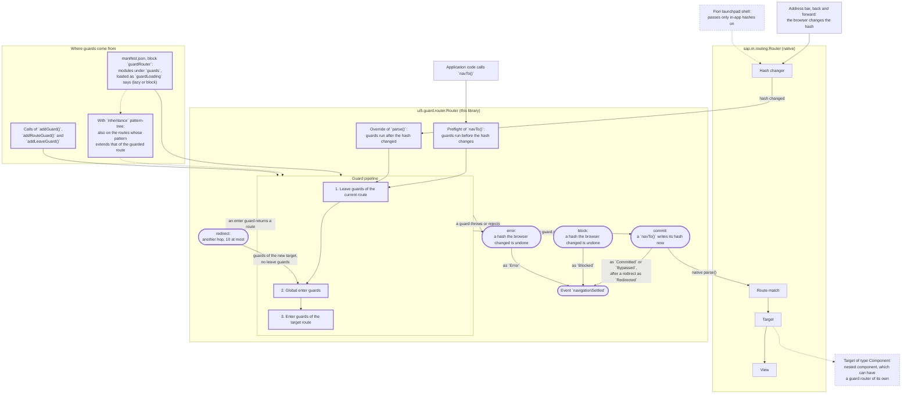
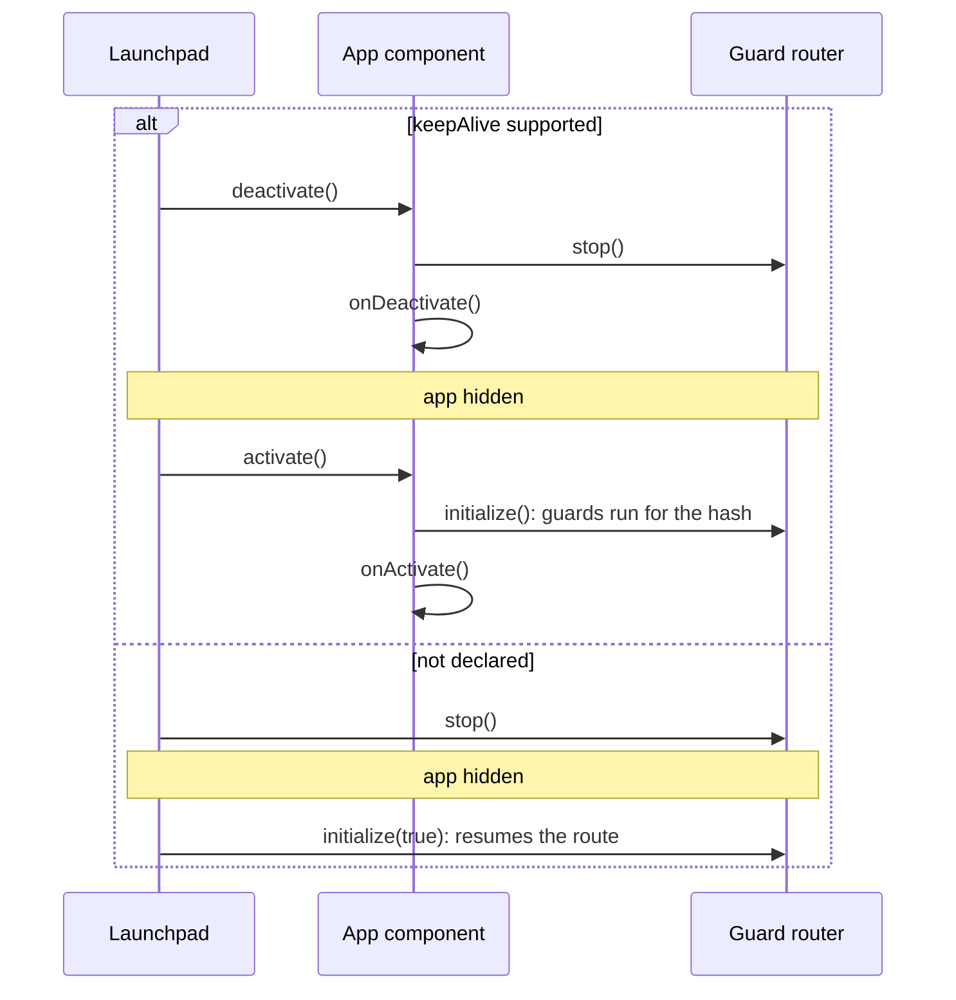
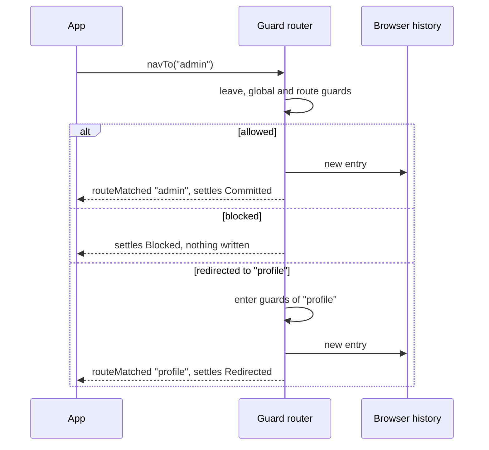
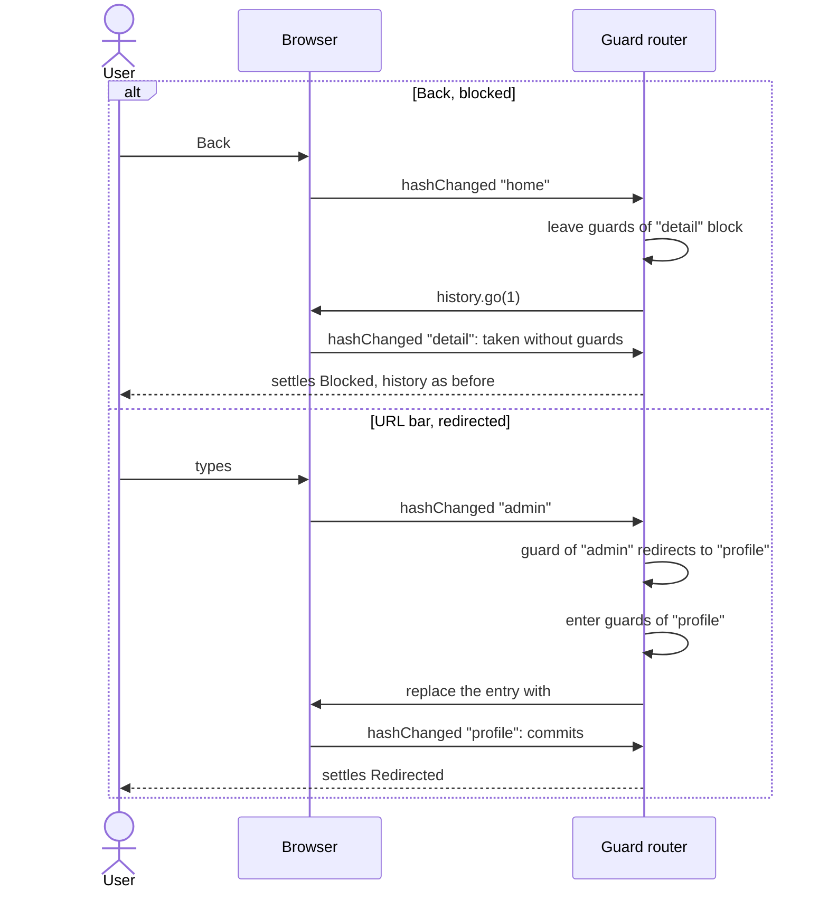
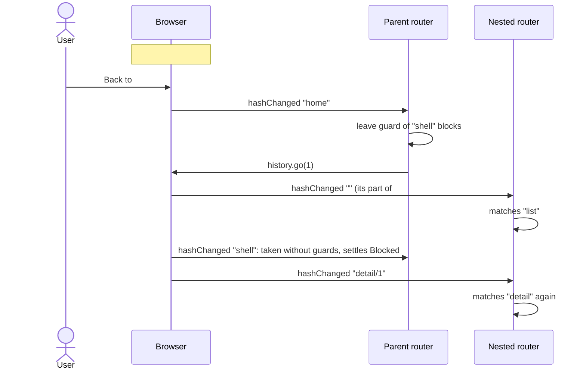

# ui5-lib-guard-router

Drop-in replacement for `sap.m.routing.Router` that intercepts navigation **before** route matching, target loading, or view creation, preventing flashes of unauthorized content and polluted browser history.

> Born from [UI5/openui5#3411](https://github.com/UI5/openui5/issues/3411), an open request for native navigation guard support in UI5.
>
> **Related resources**:
>
> - [Stack Overflow: Preventing router from navigating](https://stackoverflow.com/questions/29165700/preventing-router-from-navigating/29167292#29167292) (native NavContainer `navigate` event, sync-only, fires after route match)
> - [Research: Native NavContainer navigate event](../../docs/research/native-router-navigate-event.md) (detailed comparison with this library)

> [!WARNING]
> This library is **experimental**. It is not battle-tested in production environments, and the API may change without notice. If you choose to consume it, you do so at your own risk. Make sure to pin your version and review changes before upgrading.

> [!CAUTION]
> Navigation guards are a UX layer, not a security boundary. They can prevent unauthorized content flashes and steer client-side navigation, but they do **not** replace server-side authorization, backend validation, or service-level access control.

## Why

UI5's router has no way to block or redirect navigation before views render. The usual workaround, guard logic in each controller's `attachPatternMatched` callback, flashes unauthorized content, pollutes the browser history and spreads the checks across controllers.

This library solves all three by intercepting at the router level, before any route matching begins.

## Install

```bash
npm install ui5-lib-guard-router
```

> [!NOTE]
> The npm package is ~190 KB compressed (~810 KB unpacked) because it ships both pre-built distributables (`dist/`) and TypeScript sources (`src/`) to support multiple [serving options](#serving-the-library). At runtime, the browser loads only the `library-preload.js` bundle (~29 KB).

### TypeScript

Add the library to `compilerOptions.types` so TypeScript can resolve the type declarations. If your app does not already depend on UI5 typings, install them too (`@sapui5/types` works as well):

```bash
npm install -D @openui5/types
```

Add both packages to `compilerOptions.types`:

```json
{
	"compilerOptions": {
		"types": ["@openui5/types", "ui5-lib-guard-router"]
	}
}
```

Then import types from the UI5 module path as needed:

```typescript
// Core: router interface and guard function signatures
import type { GuardRouter, GuardFn, LeaveGuardFn } from "ui5/guard/router/types";

// Guard pipeline: context passed to guards, and the result union they return
import type { GuardContext, GuardResult } from "ui5/guard/router/types";

// Settlement: outcome of a navigation after the guard pipeline finishes
import type { NavigationResult } from "ui5/guard/router/types";
import NavigationOutcome from "ui5/guard/router/NavigationOutcome";

// Advanced: object form for redirect-with-parameters and enter+leave registration
import type { GuardRedirect, RouteGuardConfig } from "ui5/guard/router/types";
```

### Serving the library

The npm package ships both pre-built distributables (`dist/`) and TypeScript sources (`src/`). There are three ways to serve the library in your app:

#### Option A: Pre-built (recommended)

The package includes a [UI5 build manifest](https://github.com/SAP/ui5-tooling/blob/main/rfcs/0006-local-dependency-resolution.md) (`dist/.ui5/build-manifest.json`). UI5 Tooling v4+ detects it automatically and serves the pre-built JavaScript from `dist/` with no extra configuration:

```bash
npm install ui5-lib-guard-router
# That's it. `ui5 serve` picks up the build manifest.
```

No transpile tooling, no middleware, no additional `ui5.yaml` changes.

#### Option B: Transpile from source

If you prefer to serve from TypeScript sources (e.g. for debugging with source maps), install [`ui5-tooling-transpile`](https://github.com/ui5-community/ui5-ecosystem-showcase/tree/main/packages/ui5-tooling-transpile) and enable `transpileDependencies` in your app's `ui5.yaml`:

```bash
npm install -D ui5-tooling-transpile
```

```yaml
# ui5.yaml
server:
    customMiddleware:
        - name: ui5-tooling-transpile-middleware
          afterMiddleware: compression
          configuration:
              transpileDependencies: true
```

This transpiles the library's `.ts` sources on the fly during `ui5 serve`.

#### Option C: Static serving (workaround)

If neither option works for your setup, you can mount the pre-built resources manually using [`ui5-middleware-servestatic`](https://github.com/ui5-community/ui5-ecosystem-showcase/tree/main/packages/ui5-middleware-servestatic) (or a similar community middleware) and point it at the `dist/resources` folder in `node_modules`:

```bash
npm install -D ui5-middleware-servestatic
```

```yaml
# ui5.yaml
server:
    customMiddleware:
        - name: ui5-middleware-servestatic
          afterMiddleware: compression
          mountPath: /resources
          configuration:
              rootPath: node_modules/ui5-lib-guard-router/dist/resources
```

## Setup

**1. Add the library dependency and set the router class in your `manifest.json`:**

```json
{
	"sap.ui5": {
		"dependencies": {
			"libs": {
				"ui5.guard.router": {}
			}
		},
		"routing": {
			"config": {
				"routerClass": "ui5.guard.router.Router"
			}
		}
	}
}
```

All existing routes, targets, and navigation calls continue to work unchanged.

**2. Register guards in your Component:**

```typescript
import UIComponent from "sap/ui/core/UIComponent";
import type { GuardRouter } from "ui5/guard/router/types";

export default class Component extends UIComponent {
	static metadata = {
		manifest: "json",
		interfaces: ["sap.ui.core.IAsyncContentCreation"],
	};

	init(): void {
		super.init();
		const router = this.getRouter() as GuardRouter;

		// Route-specific guard: redirect when not logged in
		router.addRouteGuard("protected", (context) => {
			return isLoggedIn() ? true : "home";
		});

		// Global guard: runs for every navigation
		router.addGuard((context) => {
			if (context.toRoute === "admin" && !isAdmin()) {
				return "home";
			}
			return true;
		});

		router.initialize();
	}
}
```

## How it works

The native chain of `sap.m.routing.Router` stays as it is; the library adds the parts with the thick border. The dashed parts are optional surroundings.



A navigation that another one supersedes, or that `stop()` or `destroy()` ends, settles as `Cancelled`. The detailed diagrams of each step are in the [architecture reference](../../docs/reference/architecture.md#two-entry-point-model-navto-preflight--parse-fallback).

The library extends [`sap.m.routing.Router`](https://sdk.openui5.org/#/api/sap.m.routing.Router) and intercepts navigation through two entry points:

- **`navTo()` preflight**: For programmatic navigation (`router.navTo()`), guards run _before_ any hash change occurs. A blocked `navTo()` writes no hash; a redirected one writes only its final target.
- **`parse()` fallback**: For browser-initiated navigation (back/forward buttons, URL bar entry, direct hash changes), guards run inside the `parse()` override after the browser has already changed the hash. If a guard blocks, the router undoes the hash change. A redirect replaces the history entry of the hash change with the target.

[Browser history](#browser-history) describes what each case leaves in the history.

Both entry points feed the same guard pipeline. There is no separate configuration. The same guard functions registered via `addGuard()`, `addRouteGuard()`, and `addLeaveGuard()` protect all navigation paths.

Because it extends the mobile router directly, `sap.m.routing.Router` behavior (Targets, route events, `navTo`, back navigation) is unchanged where no guard intervenes, see [Compatibility with `sap.m.routing.Router`](#compatibility-with-sapmroutingrouter).

The guard pipeline stays **synchronous when all guards return plain values** and only becomes async when a guard returns a Promise. From that guard on, the rest of that navigation runs async; the next navigation starts synchronous again. A generation counter discards stale async results when navigations overlap, and an `AbortSignal` is passed to each guard so async work (like `fetch`) can be cancelled early.

## API

All guard registration and removal methods return `this` for chaining. `navigationSettled()` returns a `Promise<NavigationResult>`.

### Guard registration

| Method                                                     | Description                                    |
| ---------------------------------------------------------- | ---------------------------------------------- |
| `addGuard(fn)`                                             | Global enter guard (runs for every navigation) |
| `addRouteGuard(routeName, fn)`                             | Enter guard for a specific route               |
| `addRouteGuard(routeName, { beforeEnter?, beforeLeave? })` | Enter and/or leave guards via object form      |
| `addLeaveGuard(routeName, fn)`                             | Leave guard (runs when leaving the route)      |

### Guard removal

| Method                                                        | Description                                      |
| ------------------------------------------------------------- | ------------------------------------------------ |
| `removeGuard(fn)`                                             | Remove a global enter guard                      |
| `removeRouteGuard(routeName, fn)`                             | Remove an enter guard                            |
| `removeRouteGuard(routeName, { beforeEnter?, beforeLeave? })` | Remove enter and/or leave guards via object form |
| `removeLeaveGuard(routeName, fn)`                             | Remove a leave guard                             |

### Route metadata

| Method                          | Description                                                           |
| ------------------------------- | --------------------------------------------------------------------- |
| `getRouteMeta(routeName)`       | Get resolved metadata (manifest defaults merged with runtime)         |
| `setRouteMeta(routeName, meta)` | Set runtime metadata for a route (replaces previous runtime metadata) |

### Unknown routes during registration

With the default `unknownRouteRegistration: "warn"`, `addRouteGuard()`, `addLeaveGuard()` and `setRouteMeta()` warn when the route name is unknown at registration time, but they still register. This is intentional so applications can attach guards before dynamic `addRoute()` calls or before route definitions are finalized. `"ignore"` registers without a warning. `"throw"` makes these calls throw and registers nothing. A manifest guard on an unknown route cannot throw to a caller: with `"throw"` it is skipped and logged as `guardRouter.guards: failed to register "<module path>"`, and the router still starts.

### GuardContext

Every guard receives a `GuardContext` object:

| Property         | Type                                               | Description                                                             |
| ---------------- | -------------------------------------------------- | ----------------------------------------------------------------------- |
| `toRoute`        | `string`                                           | Target route name (empty if no match)                                   |
| `toHash`         | `string`                                           | Raw hash being navigated to                                             |
| `toArguments`    | `Record<string, string \| Record<string, string>>` | Parsed route parameters                                                 |
| `fromRoute`      | `string`                                           | Current route name (empty on first navigation)                          |
| `fromHash`       | `string`                                           | Current hash                                                            |
| `signal`         | `AbortSignal`                                      | Aborted when navigation is superseded, or on `stop()`/`destroy()`       |
| `bag`            | `Map<string, unknown>`                             | Shared mutable store for inter-guard data passing within one navigation |
| `toMeta`         | `Readonly<Record<string, unknown>>`                | Resolved metadata for the target route (manifest + runtime, frozen)     |
| `fromMeta`       | `Readonly<Record<string, unknown>>`                | Resolved metadata for the current route (manifest + runtime, frozen)    |
| `ownerComponent` | `UIComponent \| undefined`                         | Component that owns the router; `undefined` for routers without owner   |

### Return values (`GuardResult`)

Enter guards return `GuardResult`, covering four behaviors:

```
GuardResult = boolean | string | GuardRedirect
```

| Return                                         | Type            | When to use                                             | Effect                                                                                                           |
| ---------------------------------------------- | --------------- | ------------------------------------------------------- | ---------------------------------------------------------------------------------------------------------------- |
| `true`                                         | `boolean`       | Guard condition passes                                  | Allow navigation                                                                                                 |
| `false`                                        | `boolean`       | Guard condition fails, no specific destination          | Stay on current route. The URL and the history stay as they were, see [Browser history](#browser-history)        |
| `"routeName"`                                  | `string`        | Redirect to a fixed route (no parameters needed)        | Navigate to target route. The guarded hash does not stay in the history, see [Browser history](#browser-history) |
| `{ route, parameters?, componentTargetInfo? }` | `GuardRedirect` | Redirect and pass route parameters or component targets | Same as string redirect, with parameters                                                                         |

`toArguments` holds the route's parameters as UI5's `Route#getURL()` expects them back. A query parameter of the pattern (`products{?query}` or `products:?query:`) arrives under the key `"?query"` as an object, `{ "?query": { tab: "notes" } }`; an optional parameter that the hash leaves out is `undefined`. Pass the same shape in `GuardRedirect.parameters`.

`GuardRedirect` is the object form of a redirect. Use it when you need to pass route parameters (`parameters`) or nested component targets (`componentTargetInfo`). For simple redirects without parameters, the string shorthand (`return "home"`) is equivalent and shorter.

Any other value (`null`, `undefined`, `0`, etc.) is treated as a block. Only strict `true` allows navigation; there is no truthy coercion.

On first load, blocking a non-empty hash restores `""` and continues with the app's default route. Blocking the default route itself stays blocked. If you need a specific denied-first-load destination such as `login`, return a redirect instead of `false`.

A `navTo()` issued while a browser-initiated navigation is still waiting for an async guard supersedes that navigation. If the `navTo()` is then blocked, fails, or targets the current route, the router also restores the previous hash, so the URL does not stay on a hash that never committed.

**Leave guards** (`addLeaveGuard`) return `boolean` only:

| Return                            | Effect                          |
| --------------------------------- | ------------------------------- |
| `true`                            | Allow leaving the current route |
| `false` (or any non-`true` value) | Block                           |

Leave guards answer "can I leave?" and cannot redirect. For redirection logic, use enter guards on the target route.

### Lifecycle

| Method             | Behavior                                                                                                                                                |
| ------------------ | ------------------------------------------------------------------------------------------------------------------------------------------------------- |
| `initialize()`     | Starts the router and parses the current hash through the guards, as the native router does                                                             |
| `initialize(true)` | Starts the router without parsing the hash. After `stop()`, it resumes the route that was current, so its leave guards keep working                     |
| `stop()`           | Cancels a pending navigation (settles as `Cancelled`, aborts the `AbortSignal`) and resets the current route, hash and last settlement; guards are kept |
| `destroy()`        | Clears all guards, cancels a pending navigation, then calls `super.destroy()`. A second call does nothing                                               |

Before `initialize()`, while `guardLoading: "block"` modules load, and after `stop()`, the router does not listen to hash changes. `navTo()` then behaves like the native router: it only sets the hash, or does nothing on a stopped router. No guard runs and nothing settles; the guards run when the router starts and parses the hash.

With `guardLoading: "block"`, the router starts once the manifest guard modules have loaded. Until then `isInitialized()` is `false`, a second `initialize()` changes nothing, and `stop()` cancels the pending start until `initialize()` is called again. Guard modules that finish loading after `destroy()` register nothing.

The Fiori launchpad stops the app router when the user leaves the app and calls `initialize(true)` when it puts the app back after the data-loss prompt: the router resumes the route the app was on. For apps the launchpad keeps alive, see [Keep-alive apps](#keep-alive-apps).

### Navigation settlement

`navigationSettled()` returns a Promise that resolves when the guard pipeline finishes. The returned `NavigationResult` contains the outcome as a `NavigationOutcome` enum value, the route name, and the hash determined by the guard pipeline.

```typescript
import type { NavigationResult } from "ui5/guard/router/types";
import NavigationOutcome from "ui5/guard/router/NavigationOutcome";

const result: NavigationResult = await router.navigationSettled();
```

| `result.status`                | Meaning                                                                                                 |
| ------------------------------ | ------------------------------------------------------------------------------------------------------- |
| `NavigationOutcome.Committed`  | Guards allowed the navigation; target route is active                                                   |
| `NavigationOutcome.Bypassed`   | Guards allowed the navigation, but no route matched; UI5 continued with `bypassed` / not-found handling |
| `NavigationOutcome.Blocked`    | A guard blocked navigation; previous route stays active                                                 |
| `NavigationOutcome.Redirected` | A guard redirected navigation to a different route, or to the route that is shown                       |
| `NavigationOutcome.Cancelled`  | Navigation was cancelled before settling (superseded, stopped, or destroyed)                            |
| `NavigationOutcome.Error`      | A guard threw or rejected; previous route stays active. `result.error` holds the thrown value           |

A guard redirect to a route that does not exist settles as `Blocked` because no route change commits; the router logs the target name to help diagnose it. A redirect whose target hash cannot be built (a mandatory route parameter is missing) is a guard failure: the navigation settles as `Error` with the error in `result.error`, whether the guard is sync or async and whether the navigation came from `navTo()` or from a hash change. `navTo()` does not throw for it, and a hash change is restored. The router logs the target name.

An accepted unmatched hash settles as `Bypassed` with `route === ""` and the attempted hash preserved in `hash`. Idle `navigationSettled()` calls replay that `Bypassed` result until another navigation settles, matching the existing replay behavior for the other outcomes.

If no navigation is in flight, `navigationSettled()` resolves immediately with the most recent settlement result. That makes it safe to call right after `navTo()`, even when guards settle synchronously. On a fresh router, this defaults to `Committed` with the instance's current route/hash state. After `stop()`, those fields are reset, so idle calls resolve with empty strings until the next navigation settles or `initialize(true)` resumes the route. Multiple callers waiting on the same pending navigation all receive the same result.

**App code: busy indicator during async guards**

```typescript
router.addRouteGuard("dashboard", async (context) => {
	app.setBusy(true);
	try {
		const res = await fetch(`/api/access/${context.toRoute}`, { signal: context.signal });
		return (await res.json()).allowed ? true : "home";
	} finally {
		app.setBusy(false);
	}
});

// Show a global busy while the guard pipeline runs
router.navTo("dashboard");
const result = await router.navigationSettled();
switch (result.status) {
	case NavigationOutcome.Committed:
		break; // navigation succeeded
	case NavigationOutcome.Bypassed:
		MessageToast.show("No route matched; showing not-found flow");
		break;
	case NavigationOutcome.Blocked:
		MessageToast.show("Access denied");
		break;
	case NavigationOutcome.Redirected:
		MessageToast.show(`Redirected to ${result.route}`);
		break;
	case NavigationOutcome.Error:
		MessageBox.error("Navigation failed: " + String(result.error));
		break;
	case NavigationOutcome.Cancelled:
		break; // superseded by a newer navigation
}
```

**Test code: wait for guards deterministically**

```typescript
router.navTo("protected");
const result = await router.navigationSettled();
assert.strictEqual(result.status, NavigationOutcome.Blocked, "Navigation was blocked");
assert.strictEqual(result.route, "home", "User stays on home");
```

**Event-based: observe every navigation outcome**

`attachNavigationSettled` fires synchronously after every guard pipeline settlement. Unlike the one-shot `navigationSettled()` Promise, the event fires for every navigation without re-registration:

```typescript
router.attachNavigationSettled((event) => {
	const status = event.getParameter("status"); // NavigationOutcome
	const route = event.getParameter("route");
	const hash = event.getParameter("hash");
	console.log(`Navigation settled: ${status} on ${route}`);
});
```

A handler may call `navTo()`: the router is idle when the event fires, also for `Cancelled`, so the call runs its guards like any other. For `Blocked`, `Error` and `Cancelled` the URL has already been restored when the event fires (for a blocked back or forward step, the event waits for that, see [Browser history](#browser-history)), so a handler sees the hash of the route the user is on, and a navigation or hash change it starts is not undone by the restore. (On first load, a blocked non-empty hash settles before the router falls back to the default route.) Two things follow from navigating inside the event:

- A navigation that is left again while it commits (the handler navigates on synchronously for a `Committed` or `Redirected` settlement) is not displayed and fires no `routeMatched`; only the handler's target is.
- When a navigation is `Cancelled` because another one supersedes it, the event fires before the superseding navigation starts. That navigation continues after the handler returns and supersedes what the handler started: a navigation that already committed is navigated away from, one whose guards are still pending is dropped without a settlement of its own. Only a superseding hash change gives way: it is dropped when the handler's navigation has committed and moved the URL.

Use `detachNavigationSettled(fnFunction, oListener)` to remove the listener. The same function and listener references must match those passed to `attachNavigationSettled`. The event uses UI5's native `EventProvider` mechanism, so the standard `attachEvent` / `detachEvent` pattern also works. A handler that throws does not stop the navigation: the router logs `A navigationSettled handler threw` and completes it.

### Error handling

When a guard throws or its Promise rejects, the navigation settles as `Error` with `result.error` containing the thrown value. The previous route stays active. `Error` indicates an unexpected failure, as opposed to `Blocked` which signals intentional denial.

A guard that calls `navTo()` itself supersedes the navigation it is guarding: that navigation settles as `Cancelled`, and what the guard returns afterwards (`true`, `false` or a redirect) is ignored, for sync and async guards alike. The navigation the guard started decides where the router ends up. To send the user elsewhere from a guard, return a redirect instead.

An error thrown while an allowed navigation is carried out, for example by a `beforeRouteMatched` handler, is not a guard failure. With sync guards it reaches the caller of `navTo()`. After async guards there is no caller, so the router logs it (`Navigation failed after its guards had settled`); a navigation that had already settled as `Committed` keeps that result, one that had not settled yet settles as `Error`.

### Execution order

1. **Leave guards** for the current route (registration order)
2. **Global enter guards** (registration order)
3. **Route-specific enter guards** for the target (registration order)
4. Pipeline **short-circuits** at the first non-`true` result

Each phase short-circuits on the first non-`true` result. If a leave guard blocks, no enter guards run. If a global guard redirects, route-specific guards are skipped.

Leave guards run whenever the hash changes, also when only the parameters of the same route change (`employees/1` to `employees/2`): `fromRoute` and `toRoute` are then equal. A leave guard that should only protect leaving the route compares them.

**Greedy routes.** UI5 matches a route with `greedy: true` even when an earlier route has matched the hash. The guards of such a route run as well:

- The leave guards of every greedy route that matched the current hash run after those of `fromRoute`.
- The route-specific enter guards of every greedy route that matches the target hash run after those of `toRoute`, in the order the routes are defined. This holds for redirect hops too.
- A block or redirect from any of them applies to the whole navigation.
- A greedy route that matches both hashes is left and entered again: its leave guards and its enter guards run, as for a first match whose parameters change. UI5 fires no event for leaving it.

Every guard of a navigation gets the same context: `toRoute`, `toArguments` and `fromRoute` are those of the first route that matches. UI5 has no public API for the arguments of a greedy route that is not the first match; a guard that needs them reads `toHash`.

## Manifest Configuration

Guards can be declared directly in `manifest.json` using the `guardRouter` block inside `sap.ui5.routing.config`. This eliminates boilerplate in `Component.ts` for common guard patterns.

```json
{
	"sap.ui5": {
		"routing": {
			"config": {
				"routerClass": "ui5.guard.router.Router",
				"guardRouter": {
					"unknownRouteRegistration": "warn",
					"navToPreflight": "guard",
					"guardLoading": "lazy",
					"inheritance": "none",
					"guards": {
						"*": ["guards.authGuard"],
						"admin": {
							"enter": ["guards.adminGuard"],
							"leave": ["guards.unsavedChangesGuard"]
						}
					},
					"routeMeta": {
						"admin": { "requiresAuth": true, "roles": ["admin"] },
						"profile": { "requiresAuth": true }
					}
				}
			}
		}
	}
}
```

### Router options

| Option                     | Values                              | Default   | Description                                                                                                                                                                                                                                                                                              |
| -------------------------- | ----------------------------------- | --------- | -------------------------------------------------------------------------------------------------------------------------------------------------------------------------------------------------------------------------------------------------------------------------------------------------------- |
| `unknownRouteRegistration` | `"ignore"` \| `"warn"` \| `"throw"` | `"warn"`  | Policy for guard and metadata registration against unknown route names, see [Unknown routes during registration](#unknown-routes-during-registration)                                                                                                                                                    |
| `navToPreflight`           | `"guard"` \| `"bypass"` \| `"off"`  | `"guard"` | Whether `navTo()` calls run through the guard pipeline (`"guard"`), skip guards (`"bypass"`), or leave them to `parse()` after the hash has changed (`"off"`), which also supersedes a pending navigation there                                                                                          |
| `guardLoading`             | `"block"` \| `"lazy"`               | `"lazy"`  | `"lazy"`: `initialize()` starts the router at once; a module that is not loaded yet is loaded on the first navigation that needs it (a failed load settles that navigation as `Error`). `"block"`: the router starts once all modules have loaded; a module that fails to load is skipped with a warning |
| `inheritance`              | `"none"` \| `"pattern-tree"`        | `"none"`  | `"none"`: guards and metadata apply only to their declared route. `"pattern-tree"`: guards propagate to all routes whose URL pattern extends the declared route's pattern; metadata propagates via shallow merge (child values override ancestor values on conflict).                                    |

The `guardRouter` block also accepts `guards` (see [Declarative guards](#declarative-guards)) and `routeMeta` (see [Route metadata](#route-metadata)).

When constructing the router in code rather than from the manifest, the config argument is typed as `GuardRouterConfig` (since 1.7.0): the standard router config plus `guardRouter`, so `new Router(routes, { async: true, guardRouter: { navToPreflight: "bypass" } })` type-checks without casts.

### Declarative guards

The `guards` map wires guard modules to routes without writing code in `Component.ts`.

**Global guards** run on every navigation and are declared under the `"*"` key:

```json
"guards": {
	"*": ["guards.authGuard"]
}
```

**Per-route guards** use the route name as the key. The shorthand array form registers enter guards only:

```json
"guards": {
	"admin": ["guards.adminGuard"]
}
```

The full object form with `enter` and `leave` keys registers both enter and leave guards:

```json
"guards": {
	"admin": {
		"enter": ["guards.adminGuard"],
		"leave": ["guards.unsavedChangesGuard"]
	}
}
```

Keys other than `enter` and `leave`, and an `enter` or `leave` value that is not an array, are logged as warnings and skipped. Under `"*"` only `enter` applies; `leave` is skipped with a warning, because there are no global leave guards.

**Module paths** use dot notation and are resolved relative to `sap.app.id`. Given `sap.app.id = "com.example.app"`, the path `"guards.authGuard"` resolves to `"com/example/app/guards/authGuard"`.

To use an absolute module path, prefix it with `"module:"`. Dot notation is used for consistency with relative paths; slash notation (`module:com/shared/guards/authGuard`) is also accepted:

```json
"*": ["module:com.shared.guards.authGuard"]
```

### Complete example

manifest.json:

```json
{
	"sap.ui5": {
		"routing": {
			"config": {
				"routerClass": "ui5.guard.router.Router",
				"guardRouter": {
					"guards": {
						"*": ["guards.authGuard"],
						"admin": { "enter": ["guards.roleGuard"], "leave": ["guards.unsavedGuard"] }
					}
				}
			}
		}
	}
}
```

guards/authGuard.ts:

```typescript
import type { GuardContext, GuardResult } from "ui5/guard/router/types";

export default function authGuard(context: GuardContext): GuardResult {
	if (!isAuthenticated()) return "login";
	return true;
}
```

The router loads `guards.authGuard` relative to `sap.app.id`. For `sap.app.id = "com.example.app"`, this resolves to `com/example/app/guards/authGuard`.

Manifest guards have no closure over the component. To read component-scoped state such as models, use `context.ownerComponent` instead of module-level singletons or `ComponentRegistry` lookups, so each component instance sees its own state:

```typescript
export default function dirtyFormGuard(context: GuardContext): boolean {
	return context.ownerComponent?.getModel("form")?.getProperty("/isDirty") !== true;
}
```

### Guard module format

Each entry in the guard array is a module. The router reads it as the value the module returns to UI5's loader, which for a transpiled ES module is its default export. That value is one of three shapes:

**Shape 1: Function (single guard)**

```typescript
// guards/auth.ts
import type { GuardContext, GuardResult } from "ui5/guard/router/types";

export default function authGuard(context: GuardContext): GuardResult {
	return isAuthenticated() ? true : "login";
}
```

**Shape 2: Array (ordered guards)**

```typescript
// guards/checks.ts (registered as "checks#0", "checks#1")
import type { GuardContext, GuardResult } from "ui5/guard/router/types";

export default [
	function checkAuth(context: GuardContext): GuardResult {
		return true;
	},
	function checkRole(context: GuardContext): GuardResult {
		return false;
	},
];
```

**Shape 3: Plain Object (named guards)**

```typescript
// guards/security.ts (registered as "checkAuth", "checkRole")
import type { GuardContext, GuardResult } from "ui5/guard/router/types";

export default {
	checkAuth(context: GuardContext): GuardResult {
		/* ... */ return true;
	},
	checkRole(context: GuardContext): GuardResult {
		/* ... */ return false;
	},
};
```

Detection: function produces a single guard, `Array` produces ordered guards, and a plain object produces named guards in key order. A module with only named exports (`export function checkAuth`) counts as such an object, with its exports in the order they are written. Named exports next to a default export become properties of the default export, because the UI5 transpiler (`babel-plugin-transform-modules-ui5`) collapses them onto it: next to a default function only `#name` reaches them (see [Cherry-pick syntax](#cherry-pick-syntax)), next to a default object they are further entries of it. Non-function entries in arrays and objects are warned and skipped. Empty arrays and objects are warned and produce no guards.

> [!NOTE]
> When a module path appears in a `"leave"` array, the exported function acts as a `LeaveGuardFn` and must return `boolean`. Returning a string or `GuardRedirect` from a leave guard is not an error, but any non-`true` value is treated as a block. Redirects from leave guards are not supported. Use enter guards for redirection.

### Cherry-pick syntax

When a module exports multiple guards, you can register a subset using `#` to select by name or index:

```json
{
	"guards": {
		"admin": ["guards.security#checkAuth", "guards.security#checkRole"],
		"dashboard": ["guards.security"],
		"settings": ["guards.checks#1"],
		"*": ["guards.logging"]
	}
}
```

| Syntax                               | Behavior                                      |
| ------------------------------------ | --------------------------------------------- |
| `"guards.security"`                  | Register all exports (key/array order)        |
| `"guards.security#checkAuth"`        | Register only that named export               |
| `"guards.security#1"`                | Register by index (array or object key order) |
| `"module:some.lib.guards#checkAuth"` | `module:` prefix composes with `#`            |

Only a plain non-negative integer (`#0`, `#12`) selects by index. Every other key is a name: `#2faGuard` selects the export named `2faGuard` and is skipped with a warning if the module has none.

When `#` is used on a single-function module, the key selects a function among the module's own properties, which is what a named export next to the default function becomes. Without such a property the export key is ignored with a debug message and the function is still registered.

### Guard context `bag`

Guards can share data through `context.bag`, a `Map<string, unknown>` that is created fresh for each navigation and shared across all guards in that navigation, including across redirect chain hops:

```typescript
export default function firstGuard(context: GuardContext): GuardResult {
	context.bag.set("userId", getCurrentUserId());
	return true;
}

export default function secondGuard(context: GuardContext): GuardResult {
	const userId = context.bag.get("userId") as string | undefined;
	if (!userId) return "login";
	return true;
}
```

The bag is typed as `Map<string, unknown>`, so consumers cast on `.get()`. This matches how UI5 handles untyped model data (`getProperty()` returns `any`) and avoids generic complexity that can't flow through UI5's class system.

This is useful for avoiding repeated work (such as fetching the current user) when multiple guards need the same data in a single navigation.

### Route metadata

Per-route metadata can be declared in the manifest under `guardRouter.routeMeta`. Keys are route names, values are arbitrary objects. The router stores but never interprets the metadata. Guards read it from `context.toMeta` and `context.fromMeta`.

```json
"guardRouter": {
	"routeMeta": {
		"admin": { "requiresAuth": true, "roles": ["admin"] },
		"profile": { "requiresAuth": true },
		"home": { "public": true }
	}
}
```

A single global guard can then implement policy-driven access control:

```typescript
router.addGuard((context) => {
	if (context.toMeta.requiresAuth && !isLoggedIn()) return "login";
	if (context.toMeta.roles && !hasAnyRole(context.toMeta.roles as string[])) return "forbidden";
	return true;
});
```

Runtime metadata can be set programmatically via `setRouteMeta()`. When read via `getRouteMeta()`, runtime values take precedence over manifest defaults:

```typescript
router.setRouteMeta("betaFeature", { enabled: featureToggle.isActive("beta") });
```

`getRouteMeta()` returns a frozen object with manifest defaults merged with runtime overrides. When `inheritance: "pattern-tree"` is enabled, the result also includes metadata inherited from ancestor routes (see [Guard and metadata inheritance](#guard-and-metadata-inheritance)). For unconfigured routes, it returns an empty frozen object.

### `skipGuards` option

Pass `{ skipGuards: true }` as the options argument of `navTo()` to bypass all guards for a single call. The options follow `bReplace`, or take its place when `bReplace` is left out. Use this for internal redirects or navigations that should not be subject to guard logic:

```typescript
router.navTo("settings", {}, false, { skipGuards: true });
router.navTo("settings", {}, undefined, { skipGuards: true });
router.navTo("settings", {}, componentTargetInfo, false, { skipGuards: true });
```

A `skipGuards` navigation does not wait for guards that are still pending for the same target: it cancels that navigation and commits.

### Guard and metadata inheritance

When `inheritance` is set to `"pattern-tree"`, guards declared on a route automatically apply to all routes whose URL pattern extends that route's pattern:

```json
"guardRouter": {
	"inheritance": "pattern-tree",
	"guards": {
		"employees": ["guards.authGuard"]
	}
}
```

With routes `employees`, `employees/{id}`, and `employees/{id}/resume`, the auth guard runs for all three. Ancestor guards run before descendant guards, in whatever order the routes appear under `guards`; guards of the same route keep their declared order.

With the same `inheritance: "pattern-tree"` setting, route metadata also propagates. Inheritance is determined by URL patterns. Assuming the route-to-pattern mapping `"employees"` -> `employees`, `"employee"` -> `employees/{id}`, `"employeeResume"` -> `employees/{id}/resume`:

```json
"guardRouter": {
	"inheritance": "pattern-tree",
	"routeMeta": {
		"employees": { "section": "hr", "requiresAuth": true },
		"employee": { "clearance": "manager" }
	}
}
```

`getRouteMeta("employeeResume")` returns `{ section: "hr", requiresAuth: true, clearance: "manager" }` (inherited from both `employees` and `employee`). `getRouteMeta("employee")` returns `{ section: "hr", requiresAuth: true, clearance: "manager" }` (merged, own values win).

Defaults to `"none"` for backward compatibility.

**Root-pattern route (`""`) is a universal ancestor.** A route with an empty pattern (typically "home") is considered an ancestor of every other route in the router. With `pattern-tree` inheritance enabled, metadata or guards declared on the root-pattern route propagate to all routes:

```json
"guardRouter": {
	"inheritance": "pattern-tree",
	"routeMeta": {
		"home": { "requiresAuth": true }
	}
}
```

Every route in the app inherits `requiresAuth: true` from "home" unless it declares its own override. This is useful for app-wide defaults but requires care. Setting `{ "requiresAuth": false }` on the root route with `pattern-tree` inheritance would make every route public unless explicitly overridden.

Metadata is resolved lazily on first access via `getRouteMeta()` and cached until `setRouteMeta()` or `addRoute()` invalidates the cache. Only manifest guards are inherited; guards added with `addRouteGuard()` or `addLeaveGuard()` apply only to their own route. Guard inheritance is resolved at `initialize()` time; routes added dynamically via `addRoute()` are integrated into the pattern tree on the fly (inherited guards are registered, in front of the manifest guards of deeper routes, and the metadata cache is cleared).

Runtime metadata set via `setRouteMeta()` participates in inheritance. Child routes see updated ancestor metadata after cache invalidation.

### Mixing declarative and programmatic guards

Manifest guards and programmatic guards coexist on the same pipeline. Manifest guards are registered during `initialize()` (before the first navigation), and programmatic guards are added whenever `addGuard()` / `addRouteGuard()` / `addLeaveGuard()` is called.

**Execution order:** within each phase, guards run in registration order. Manifest guards are registered in declaration order when `initialize()` runs, so they run after programmatic guards added before `initialize()` and before guards added after it. In `"block"` mode they are registered only once all modules have loaded, so a guard added after `initialize()` but before loading finishes runs before them. For the same route, both sets execute. They are additive, not exclusive.

A common pattern is to declare static guards in the manifest and add context-dependent guards programmatically:

- **Manifest:** guards that don't need component state (simple blocks, redirects, logging)
- **Programmatic:** guards that close over models, services, or runtime state
- **Controller-level:** guards tied to a specific view's lifecycle (registered in `onInit`, removed in `onExit`)

## Examples

### Async guard with AbortSignal

```typescript
import type { GuardContext, GuardResult } from "ui5/guard/router/types";

router.addRouteGuard("dashboard", async (context: GuardContext): Promise<GuardResult> => {
	const res = await fetch(`/api/access/${context.toRoute}`, {
		signal: context.signal, // cancelled when a newer navigation supersedes this one
	});
	const { allowed } = await res.json();
	return allowed ? true : "forbidden";
});
```

### Redirect with parameters (GuardRedirect)

```typescript
import type { GuardRedirect } from "ui5/guard/router/types";

router.addGuard((context): GuardRedirect | true => {
	if (context.toRoute === "old-detail") {
		return {
			route: "detail",
			parameters: { id: context.toArguments.id },
		};
	}
	return true;
});
```

[Guard Integration Patterns](../../docs/guides/integration-patterns.md#redirect-with-parameters) has this guard as a factory for any target route. The demo app registers none, because none of its routes was renamed to a route with the same parameters.

### Guard factories

A factory closes over what its guard depends on. The demo app keeps the factories it registers in `packages/demo-app/webapp/guards.ts`: the async `createAsyncPermissionGuard()` is its `"protected"` enter guard. Its `"protected"` leave guard is the manifest-declared `guards/dirtyFormGuard.ts` module, so the two factories below are examples that the demo does not have.

```typescript
import type JSONModel from "sap/ui/model/json/JSONModel";
import type { GuardFn, LeaveGuardFn, GuardContext, GuardResult } from "ui5/guard/router/types";

export function createAuthGuard(authModel: JSONModel): GuardFn {
	return (context: GuardContext): GuardResult => {
		return authModel.getProperty("/isLoggedIn") ? true : "home";
	};
}

export function createDirtyFormGuard(formModel: JSONModel): LeaveGuardFn {
	return (context: GuardContext): boolean => {
		return !formModel.getProperty("/isDirty");
	};
}
```

### Object form with RouteGuardConfig

The object form is useful when registering both enter and leave guards for the same route in a single call:

```typescript
import type { RouteGuardConfig } from "ui5/guard/router/types";

const protectedGuards: RouteGuardConfig = {
	beforeEnter: createAuthGuard(authModel),
	beforeLeave: createDirtyFormGuard(formModel),
};

router.addRouteGuard("protected", protectedGuards);
// later: router.removeRouteGuard("protected", protectedGuards);
```

### Dynamic guard registration

Guards can be added or removed at any point during the router's lifetime:

```typescript
const logGuard: GuardFn = (ctx) => {
	console.log(`Navigation: ${ctx.fromRoute} → ${ctx.toRoute}`);
	return true;
};

router.addGuard(logGuard);
// later...
router.removeGuard(logGuard);
```

### Leave guard with controller lifecycle

The demo app shows the same lifecycle pattern in `packages/demo-app/webapp/controller/Home.controller.ts`, registering `createHomeLeaveLogger()` on the `home` route and removing it again in `onExit()`.

```typescript
import type { LeaveGuardFn } from "ui5/guard/router/types";
import BaseController from "./BaseController";
import { createHomeLeaveLogger } from "../guards";

export default class HomeController extends BaseController {
	private _leaveGuard: LeaveGuardFn | null = null;

	onInit(): void {
		const router = this.getRouter();
		this._leaveGuard = createHomeLeaveLogger();
		router.addLeaveGuard("home", this._leaveGuard);
	}

	onExit(): void {
		if (this._leaveGuard) {
			const router = this.getRouter();
			router.removeLeaveGuard("home", this._leaveGuard);
			this._leaveGuard = null;
		}
	}
}
```

> [!TIP]
> **User feedback on blocked navigation**: When a leave guard blocks, the router stays on the current route without any feedback to the user. There is no built-in confirmation dialog. Show a `sap.m.MessageBox.confirm()` inside your leave guard (returning the user's choice as a `Promise<boolean>`) to make the block visible.

> [!NOTE]
> **Guard cleanup and lifecycle**
>
> **Component level**: The router's `destroy()` method automatically clears all registered guards when the component is destroyed (including during FLP navigation).
>
> **Controller level**: UI5's routing caches views indefinitely, so `onExit` is called only when the component is destroyed, not on every navigation away. Controller-registered guards therefore persist across in-app navigations. This is typically the desired behavior for route-specific guards tied to view state.
>
> In FLP apps with `sap-keep-alive`, the component and its guards stay while the app is hidden, see [Keep-alive apps](#keep-alive-apps).

### Native alternative for leave guards: Fiori Launchpad data loss prevention

If your app runs inside SAP Fiori Launchpad (FLP), the shell provides built-in data loss protection through two public APIs on `sap.ushell.Container`:

**`setDirtyFlag(bDirty)`** (since 1.27.0): A simple boolean flag. When set to `true`, FLP shows a browser `confirm()` dialog on every hash change, in-app ones included, and the browser's leave-page dialog on refresh/close. An in-app `navTo()` that the shell holds back for the dialog settles as `Blocked`; if the user confirms, the shell sets the hash again and the router runs the guards for it:

```typescript
import Container from "sap/ushell/Container";

Container.setDirtyFlag(true); // mark unsaved changes
Container.setDirtyFlag(false); // clear after save
```

**`registerDirtyStateProvider(fn)`** (since 1.31.0): Registers a callback that FLP calls during navigation to dynamically determine dirty state. The callback receives a `NavigationContext` with `isCrossAppNavigation` (boolean) and `innerAppRoute` (string), allowing the provider to distinguish between cross-app and in-app navigation:

```typescript
import Container from "sap/ushell/Container";

const dirtyProvider = (navigationContext) => {
	if (navigationContext?.isCrossAppNavigation === false) {
		return false; // let in-app routing handle it
	}
	return formModel.getProperty("/isDirty") === true;
};
Container.registerDirtyStateProvider(dirtyProvider);

// Clean up (since 1.67.0)
Container.deregisterDirtyStateProvider(dirtyProvider);
```

> **Note**: `getDirtyFlag()` is deprecated since UI5 1.120. It still returns the flag combined with all registered providers.

#### Combining leave guards with FLP dirty-state protection

When you use both a route leave guard and `registerDirtyStateProvider`, the two handle separate scopes and do not need to coordinate in application code:

- **Leave guard** protects **in-app** navigation (route to route within your app)
- **Dirty-state provider** protects **cross-app** navigation (shell home, other tiles, browser close)

`ShellNavigationHashChanger` never passes a cross-app hash to the app router, so the leave guard never runs for it. The provider returns `false` for in-app navigation, so the shell does not prompt for it. The two mechanisms never overlap:

```typescript
import Container from "sap/ushell/Container";

// 1. Leave guard: blocks in-app navigation when dirty
router.addRouteGuard("editOrder", {
	beforeLeave: () => formModel.getProperty("/isDirty") !== true,
});

// 2. Dirty-state provider: tells FLP about unsaved changes for cross-app
const dirtyProvider = (navigationContext) => {
	if (navigationContext?.isCrossAppNavigation === false) {
		return false; // in-app navigation handled by leave guard
	}
	return formModel.getProperty("/isDirty") === true;
};
Container.registerDirtyStateProvider(dirtyProvider);
```

In an app the launchpad keeps alive, deregister the provider while the app is hidden ([Keep-alive apps](#keep-alive-apps)). No `toRoute` check or FLP detection is needed in the leave guard. Cross-app navigation (the shell's `Navigation` service, the home button, other tiles) is handled by the shell in both production and the FLP sandbox.

> [!TIP]
> **Testing with the FLP preview**: The `fiori-tools-preview` middleware supports `enhancedHomePage: true` (UI5 >= 1.123.0), which uses CDM-based bootstrap for a more complete UShell service layer. This is recommended for testing dirty-state provider integration, as it provides `ShellNavigationHashChanger` and `Navigation` service behavior closer to production FLP.

See the [FLP Dirty State Research](../../docs/research/flp-dirty-state.md) for a detailed analysis of the FLP internals.

#### Keep-alive apps

With `sap-keep-alive=true` the launchpad keeps an app that the user leaves for another app, hides it, and shows it again when the user returns. With `sap-keep-alive=restricted` it also destroys kept apps when the user reaches the launchpad home. Returning from the home through a hash with an inner route (browser back, bookmark) creates a new component.

What happens to the router depends on whether the manifest declares keep-alive support:

```json
{
	"sap.ui5": {
		"keepAlive": { "supported": true }
	}
}
```

|              | Hidden                                                                       | Shown again                                                                                                                                                                                                             |
| ------------ | ---------------------------------------------------------------------------- | ----------------------------------------------------------------------------------------------------------------------------------------------------------------------------------------------------------------------- |
| Declared     | UI5's `Component#deactivate()` stops the router, then calls `onDeactivate()` | `Component#activate()` calls `initialize()`, which runs the guards for the hash the URL shows, then `onActivate()`. No leave guard runs. Returning through an intent without an inner route starts on the default route |
| Not declared | The launchpad calls `stop()`                                                 | The launchpad calls `initialize(true)`: the router resumes the route the app was on, and its leave guards keep working                                                                                                  |



Guards stay registered while the app is hidden, and so do dirty-state providers: the launchpad asks every registered provider on each navigation, also the provider of a hidden app embedded in the launchpad page, so the user is asked about unsaved data of an app they are not in. Deregister the provider while the app is hidden. The example needs `"keepAlive": { "supported": true }` in the manifest (the Declared row): without it, UI5 does not call `onDeactivate()` and `onActivate()`, and the provider stays registered.

```typescript
import UIComponent from "sap/ui/core/UIComponent";
import Container from "sap/ushell/Container";
import type JSONModel from "sap/ui/model/json/JSONModel";

type DirtyStateProvider = (context?: { isCrossAppNavigation?: boolean }) => boolean;

export default class Component extends UIComponent {
	public static metadata = { manifest: "json" };

	// No initializer: it would run after init(), which the UIComponent constructor calls.
	private _dirtyProvider?: DirtyStateProvider;

	override init(): void {
		super.init();
		const form = this.getModel("form") as JSONModel;
		this._dirtyProvider = (context) =>
			context?.isCrossAppNavigation !== false && form.getProperty("/isDirty") === true;
		this.onActivate();
		this.getRouter().initialize();
	}

	// Hidden: the launchpad would still ask the provider when the user navigates between other apps.
	override onDeactivate(): void {
		if (this._dirtyProvider) Container.deregisterDirtyStateProvider(this._dirtyProvider);
	}

	override onActivate(): void {
		if (this._dirtyProvider) Container.registerDirtyStateProvider(this._dirtyProvider);
	}

	override exit(): void {
		this.onDeactivate();
	}
}
```

> [!WARNING]
> `UIComponent` calls `init()` from its constructor. TypeScript class field initializers run after that constructor and overwrite what `init()` stored: with `private _dirtyProvider: DirtyStateProvider | null = null`, `onDeactivate()` and `exit()` find nothing to deregister. The same applies to guards that `init()` registers and `exit()` removes. Declare such fields without an initializer: `ui5-tooling-transpile` (Babel 7, `allowDeclareFields: false`) emits nothing for them. tsc with `useDefineForClassFields` (the default from target ES2022) and Babel with `allowDeclareFields: true` still emit them as `undefined`; there, write `declare private _dirtyProvider: DirtyStateProvider | undefined;`, which Babel 7 with its default options rejects.

The launchpad internals are in [FLP Integration](../../docs/reference/architecture.md#keep-alive). An app that the launchpad runs in an iframe is hidden and shown the same way, but its provider is asked by the app runtime inside the iframe and not by the shell, see [Keep-alive in an iframe](../../docs/reference/architecture.md#keep-alive-in-an-iframe). `flp-iframe-keep-alive.e2e.ts` runs the demo app that way.

## Redirect chains

When a guard redirects navigation from route A to route B, the router evaluates route B's guards before committing. If route B also redirects, the chain continues. Leave guards are skipped on redirect hops (they only run on the first navigation), but global and route-specific enter guards run on every hop.

```
User navigates to "dashboard"
  → dashboard guard checks permissions, returns "profile"
  → profile guard checks onboarding status, returns "onboarding" ← this guard RUNS
  → onboarding guard allows → onboarding view renders
```

Two safeguards prevent infinite redirect loops:

- **Visited-set detection**: The router tracks every hash evaluated in the current chain. Revisiting a hash is treated as a loop and blocks the navigation.
- **Depth cap** (10 hops): Chains that exceed 10 redirect hops are blocked, even if every hash is unique. This guards against unbounded chains with parameterized routes.

Both safeguards log an error and settle the navigation as `Blocked`.

## Browser history

The router keeps the browser history as the user left it: a hash that a guard refused does not stay in the history, and Back returns to the page the navigation started from.

| Navigation                                                     | Blocked (or `Error`)                                                                                   | Redirected                                                                                                                                                   |
| -------------------------------------------------------------- | ------------------------------------------------------------------------------------------------------ | ------------------------------------------------------------------------------------------------------------------------------------------------------------ |
| `navTo()`                                                      | No hash is written                                                                                     | Only the final target is written, the way the call asked: a new entry, or with `bReplace` the current entry replaced. Back returns to the page it started on |
| Back or forward (a step through the history)                   | The router takes the step back with `history.go()`. The history is as it was, forward entries included | The entry the step arrived at is replaced with the target                                                                                                    |
| Any other hash change (URL bar, link, `HashChanger.setHash()`) | The new entry is replaced with the previous hash                                                       | The new entry is replaced with the target                                                                                                                    |

A redirect chain writes once, its final target. A redirect to the route that is shown settles as `Redirected` without matching that route again (no `routeMatched`) and writes no hash: after a `navTo()` the URL stays as it is, a hash change is undone as if it were blocked. A `parse()` call with the current hash still matches the route again, as it does with the native router.

The history in three cases, starting on `home` (the current entry in bold):

| Case                                                     | Before               | While the guards run | After                 |
| -------------------------------------------------------- | -------------------- | -------------------- | --------------------- |
| `navTo("admin")`, redirected to `profile`                | **`home`**           | **`home`**           | `home`, **`profile`** |
| `#admin` typed into the URL bar, redirected to `profile` | **`home`**           | `home`, **`admin`**  | `home`, **`profile`** |
| Back from `detail` to `home`, blocked by a leave guard   | `home`, **`detail`** | **`home`**, `detail` | `home`, **`detail`**  |

`navTo()` runs the guards before any hash is written:



A hash change from the browser arrives after the URL has changed, so the router puts it back or replaces it:



**Settlement of a blocked step.** The browser takes a step asynchronously. A navigation that the router undoes with a step settles once the URL is back: `navigationSettled()` resolves, and the `navigationSettled` event fires, after the `hashChanged` event that started the navigation has returned.

**How a step is recognized.** The router reads the length and direction of a step from the browser's [Navigation API](https://developer.mozilla.org/en-US/docs/Web/API/Navigation_API) (Chrome and Edge 102+, Firefox 147+, Safari 26.2+). Without it, a blocked back or forward step is handled like any other hash change: its entry is replaced with the previous hash. The page the step went to is then gone from the history, and the current page has two entries.

The cases that leave the history different from before are listed under [Limitations](#browser-history-after-a-refused-hash-change).

## Nested components

A component that a parent router displays through a routing target of type `Component` can have its own guard router: set `routerClass` to `ui5.guard.router.Router` in the nested component's manifest and declare its guards there or in its `Component.ts`. Each router guards only its own routes:

- The nested router's guards see the nested part of the hash. `context.ownerComponent` is the nested component, so manifest guards read its models, not the parent's.
- A redirect names a route of the same router. To leave the nested component, navigate with the parent's router (`Component.getOwnerComponentFor(component).getRouter()`), not from a guard.
- On the first display, the parent route waits until the nested router's first navigation has passed its guards and matched, as with the native router. If a nested guard blocks that navigation, the parent route is still displayed and the nested component shows no view. If it redirects, the parent waits for the redirect target.
- When the parent leaves the route, UI5 stops the nested router and removes its part of the hash. To keep the user in the nested component, register a leave guard on the parent's route.
- A `navTo()` of the parent, or a guard redirect, with `componentTargetInfo` commits and settles when UI5 has loaded the nested components and written the hash, not within the call. Until then the navigation is pending, and a navigation that supersedes it, `stop()` or `destroy()` settles it as `Cancelled`. That is also how a navigation ends whose hash UI5 never writes, because a nested component failed to load or the router is not async.
- Navigate with `navTo()` of the respective router or with the router's own hash changer (`router.getHashChanger()`). The global `HashChanger.getInstance()` replaces the whole browser hash, including the part of the other router ([Enabling Routing in Nested Components](https://sdk.openui5.org/#/topic/fb19f501b16e4e4991eb6a017770945b)).

When the parent refuses a hash change, it puts the whole URL back, the nested part included. UI5 reports every hash change to the nested router whatever the parent decides, so the nested router first matches its part of the refused hash and then its previous route, and fires the events of both:



With `propagateTitle` set on the component target or in the routing config, titles propagate from the nested router to the parent as with the native router. `titleChanged` fires only for navigations that commit; while a navigation waits for async guards, UI5 defers it to the next `routeMatched`.

The router relies on two UI5 internals for this, see [Compatibility](#compatibility).

## Compatibility with `sap.m.routing.Router`

Without guards the router behaves like `sap.m.routing.Router`. With guards it differs only where a guard blocks, redirects or makes a navigation wait. Differential tests prove this: they run the same steps on a native router and on a guard router and compare what each records (hashes, history entries, routing events, titles, displayed views, log lines). Tests in `NativeCompat`, `NativeCompatTraces`, `NestedRouterParity`, `GuardedNavigationParity`, `GuardedEntryParity`, `flp-native-parity` and the vendored OpenUI5 router tests compare with the native router; a test from another file pins a behavior that differs on purpose. Where a guard blocks or redirects, the guard router is compared with the native navigation that the decision stands for: none for a block, a navigation to the target for a redirect. CI runs the QUnit tests on OpenUI5 1.144.0 and 1.120.0, the launchpad test on SAPUI5 1.144.0 and 1.149.0. How the comparison works: [Upstream Parity](../../docs/reference/upstream-parity.md).

File names in "Proven by" are those of test files below `packages/lib/test/qunit/`; an `.e2e.ts` file is below `packages/demo-app/test/`.

| Behavior                                                                                                 | Native router                                                                                                                       | Guard router without guards    | Guard router with guards                                                                                                                                                                                                                                   | Proven by                                                                                                                                                                                                                                                                                                                                                                                                                                                                                                                                                                                                                                                                                                                                                                                                                                                                                                                                                                                                                                                        |
| -------------------------------------------------------------------------------------------------------- | ----------------------------------------------------------------------------------------------------------------------------------- | ------------------------------ | ---------------------------------------------------------------------------------------------------------------------------------------------------------------------------------------------------------------------------------------------------------- | ---------------------------------------------------------------------------------------------------------------------------------------------------------------------------------------------------------------------------------------------------------------------------------------------------------------------------------------------------------------------------------------------------------------------------------------------------------------------------------------------------------------------------------------------------------------------------------------------------------------------------------------------------------------------------------------------------------------------------------------------------------------------------------------------------------------------------------------------------------------------------------------------------------------------------------------------------------------------------------------------------------------------------------------------------------------- |
| Class and API                                                                                            | `sap.m.routing.Router`                                                                                                              | Same class, plus the guard API | Same                                                                                                                                                                                                                                                       | `NativeCompat.qunit.ts: Both routers are instances of sap.m.routing.Router`<br>`NativeCompat.qunit.ts: ext router has additional guard methods`                                                                                                                                                                                                                                                                                                                                                                                                                                                                                                                                                                                                                                                                                                                                                                                                                                                                                                                  |
| Route matching, `getRouteInfoByHash()`, `getURL()`                                                       | The first route whose pattern matches                                                                                               | Same                           | Same; guards get the first match as `toRoute`                                                                                                                                                                                                              | `NativeCompat.qunit.ts: match() returns identical results for known hashes`<br>`NativeCompat.qunit.ts: match() returns identical results for unknown hashes`<br>`NativeCompat.qunit.ts: getRouteInfoByHash returns identical info`<br>`NativeCompatTraces.qunit.ts: a hash that several routes could match resolves to the same route`<br>`NativeCompat.qunit.ts: getURL generates identical URLs for routes without parameters`<br>`NativeCompat.qunit.ts: getURL generates identical URLs for routes with parameters`<br>`NativeCompat.qunit.ts: getURL generates identical URLs for nested routes`<br>`NativeCompat.qunit.ts: getURL returns undefined for unknown routes`                                                                                                                                                                                                                                                                                                                                                                                    |
| Events: `beforeRouteMatched`, `routeMatched`, `routePatternMatched`, `bypassed`, the events of a `Route` | Fire for every hash                                                                                                                 | Same, in the same order        | Fire once the guards allow; none for a blocked navigation; only those of the target for a redirect                                                                                                                                                         | `NativeCompatTraces.qunit.ts: a sequence of navigations fires the same events in the same order`<br>`NativeCompat.qunit.ts: bypassed event fires identically for unknown routes`<br>`NativeCompat.qunit.ts: Direct hash changes fire events identically`<br>`NativeCompatTraces.qunit.ts: a redirected navTo() behaves like a native navTo() to the target`<br>`GuardedNavigationParity.qunit.ts: a blocked browser back leaves the history, the titles and the pages as they were`                                                                                                                                                                                                                                                                                                                                                                                                                                                                                                                                                                              |
| Titles: `titleChanged`, `propagateTitle`                                                                 | Change with every route match                                                                                                       | Same                           | Change only for navigations that commit. The target of a redirected hash change gets the title entry that the redirected hash would have got                                                                                                               | `NestedRouterParity.qunit.ts: the child navigates with navTo, with and without a history entry`<br>`GuardedNavigationParity.qunit.ts: a redirected navTo() leaves the history and the titles of a native navTo() to the target`<br>`GuardedEntryParity.qunit.ts: a redirected address bar entry leaves the history, the titles and the pages of a native address bar entry of the target`                                                                                                                                                                                                                                                                                                                                                                                                                                                                                                                                                                                                                                                                        |
| Views and `NavContainer` transitions                                                                     | Targets display views, view levels choose the animation direction                                                                   | Same                           | Same, once the guards allow                                                                                                                                                                                                                                | `Router.qunit.ts: forward navigation on NavContainer matches the upstream contract`<br>`Router.qunit.ts: viewLevel back navigation with multiple targets matches the upstream contract`                                                                                                                                                                                                                                                                                                                                                                                                                                                                                                                                                                                                                                                                                                                                                                                                                                                                          |
| `navTo()` with and without `bReplace`                                                                    | Writes the hash: a new entry, or the current one replaced                                                                           | Same                           | Blocked: writes nothing. Redirected: writes only the final target, the way the call asked                                                                                                                                                                  | `NativeCompat.qunit.ts: navTo with replace=true updates hash without history entry`<br>`NativeCompat.qunit.ts: navTo with replace=false creates history entry (default)`<br>`NativeCompatTraces.qunit.ts: navTo with a route or parameters that do not resolve behaves the same`<br>`NativeCompatTraces.qunit.ts: a redirected navTo() behaves like a native navTo() to the target`<br>`GuardedNavigationParity.qunit.ts: a redirected navTo() leaves the history and the titles of a native navTo() to the target`<br>`GuardedEntryParity.qunit.ts: a blocked navTo() leaves the history, the titles and the pages of a native router that is not asked to navigate`                                                                                                                                                                                                                                                                                                                                                                                            |
| `navTo()` to the route that is shown, `componentTargetInfo`                                              | Sets or resets the hashes of nested components; with `componentTargetInfo` the route matches once UI5 has written the combined hash | Same                           | Same, no guard runs. A redirect to the route that is shown changes nothing, with `componentTargetInfo` it sets the nested hashes                                                                                                                           | `NestedRouterParity.qunit.ts: navTo to the route that is already shown`<br>`NestedRouterParity.qunit.ts: the parent navigates to a route of the child with componentTargetInfo`<br>`NativeCompatTraces.qunit.ts: a navTo() that is redirected to the route that is shown changes nothing, as if the router had not been asked`<br>`GuardedEntryParity.qunit.ts: a redirect to the route that is shown with componentTargetInfo behaves like a native navTo() to that route with componentTargetInfo`                                                                                                                                                                                                                                                                                                                                                                                                                                                                                                                                                             |
| `parse()` with the current hash                                                                          | The route matches again                                                                                                             | Same                           | Same, without guards                                                                                                                                                                                                                                       | `NativeCompatTraces.qunit.ts: a hash that is parsed again matches its route again`                                                                                                                                                                                                                                                                                                                                                                                                                                                                                                                                                                                                                                                                                                                                                                                                                                                                                                                                                                               |
| `Targets#display()` without a route                                                                      | Displays the target, no hash change; the route shown before matches again when its hash is reported                                 | Same                           | Same; no guard runs for the display                                                                                                                                                                                                                        | `NestedRouterParity.qunit.ts: a target displayed without a route`<br>`NestedRouterParity.qunit.ts: a route matches again when its hash is reported after a target was displayed without it`<br>`GuardedEntryParity.qunit.ts: Targets#display() displays the target as with the native router although every guard blocks, and runs no guard`                                                                                                                                                                                                                                                                                                                                                                                                                                                                                                                                                                                                                                                                                                                     |
| Back, forward and the address bar                                                                        | Every hash that matches a route is displayed                                                                                        | Same                           | A blocked step is taken back with `history.go()`, the history is as it was. A redirected hash change has its entry replaced with the target. See [Browser history](#browser-history)                                                                       | `NestedRouterParity.qunit.ts: browser back and forward across the child's and the parent's routes`<br>`NestedRouterParity.qunit.ts: the address bar navigates into the child and inside of it`<br>`NativeCompat.qunit.ts: replaceHash behaves identically`<br>`GuardedNavigationParity.qunit.ts: a blocked browser back leaves the history, the titles and the pages as they were`<br>`History.qunit.ts: a history step that is redirected has its entry replaced with the target`<br>`RedirectedStepParity.qunit.ts: a redirected browser back leaves the history, the titles and the pages of a native browser back followed by a native navTo() to the target that replaces the entry`<br>`RedirectedStepParity.qunit.ts: a redirected browser forward leaves the history, the titles and the pages of a native browser forward followed by a native navTo() to the target that replaces the entry`<br>`GuardedEntryParity.qunit.ts: a redirected address bar entry leaves the history, the titles and the pages of a native address bar entry of the target` |
| Nested components (routing target of type `Component`)                                                   | Each nested router has a hash changer of its own and matches its part of the hash                                                   | Same                           | Same with guards that allow. A parent that blocks puts the whole URL back; the nested router matches the refused part first. The parent route waits for a nested first navigation that waits for async guards. See [Nested components](#nested-components) | `NestedRouterParity.qunit.ts: the parent displays the child component for the first time`<br>`NestedRouterParity.qunit.ts: the app starts on a hash that the child does not know`<br>`NestedRouterParity.qunit.ts: the app starts on a hash that the parent does not know`<br>`NestedRouterParity.qunit.ts: the app starts on a deep link to a route of the child`<br>`NestedRouterParity.qunit.ts: the parent leaves the child's route and displays the child again`<br>`NestedRouterParity.qunit.ts: the first page of a nested NavContainer logs the same 'current page' warning with both routers`<br>`GuardedNavigationParity.qunit.ts: a history step that the parent and the nested component block leaves both as they were`<br>`GuardedNavigationParity.qunit.ts: a history step that only the parent blocks brings the nested component back to its route`<br>`Instantiation.qunit.ts: a parent route matches although an async guard blocks a nested component's first navigation`                                                                    |
| `stop()`, `initialize()`, `initialize(true)`                                                             | `initialize()` parses the hash, `initialize(true)` keeps the current route; a stopped router ignores hash changes and `navTo()`     | Same                           | `initialize()` runs the guards for the hash. After `stop()`, `initialize(true)` resumes the route, so its leave guards run on the next navigation                                                                                                          | `NativeCompat.qunit.ts: initialize/stop behavior matches`<br>`NativeCompat.qunit.ts: stop + initialize fires routeMatched identically`<br>`NativeCompatTraces.qunit.ts: stop and initialize cycles fire the same events`<br>`NativeCompatTraces.qunit.ts: a router that starts with initialize(true) fires the same events`<br>`NativeCompatTraces.qunit.ts: after stop() and initialize(true), the leave guard runs for the route that the native router switches from`                                                                                                                                                                                                                                                                                                                                                                                                                                                                                                                                                                                         |
| Greedy routes (`greedy: true`)                                                                           | Match in addition to the first match                                                                                                | Same                           | Same with guards that allow. Their guards run too; a greedy route that still matches is left and entered again                                                                                                                                             | `NativeCompatTraces.qunit.ts: greedy routes match and fire their events as with the native router`<br>`NativeCompatTraces.qunit.ts: leave and enter guards run for the routes that the native router matched before and matches after a navigation, a greedy route that still matches included`                                                                                                                                                                                                                                                                                                                                                                                                                                                                                                                                                                                                                                                                                                                                                                  |
| Two routers on one hash changer                                                                          | Each parses every hash it is told about, also a redirected hash that UI5 reports after the target                                   | Same                           | A guard router drops the stale report. A native router next to it still parses it. See [Limitations](#routers-that-share-a-hash-changer)                                                                                                                   | `NativeCompatTraces.qunit.ts: two guard routers without guards behave like two native routers`<br>`NativeCompatTraces.qunit.ts: a hash change that the first router redirects is not parsed by the second router after the target`<br>`NativeCompatTraces.qunit.ts: a hash change that the first router blocks is parsed by the second router, which follows the URL back`                                                                                                                                                                                                                                                                                                                                                                                                                                                                                                                                                                                                                                                                                       |
| Fiori launchpad: shell stops and restarts the router, keep-alive                                         | Stopped on a cross-app change, `initialize(true)` or `initialize()` on return                                                       | Same                           | Same calls; a blocked hash change after a cancelled cross-app navigation returns to the URL the browser showed. See [Keep-alive apps](#keep-alive-apps)                                                                                                    | `flp-native-parity.e2e.ts: the guard router goes through the same as the native router, a blocked hash change counting as no navigation`                                                                                                                                                                                                                                                                                                                                                                                                                                                                                                                                                                                                                                                                                                                                                                                                                                                                                                                         |

## Limitations

### Routers that share a hash changer

A component's router gets a hash changer of its own only when the component is displayed by a routing target of type `Component`. The routers of all other components with routing (in a `ComponentContainer`, or created with `Component.create()` outside routing) share the root one, as the root routers of all apps in the Fiori launchpad do. When one router redirects a hash change, UI5 reports the redirected hash to the routers after it only after the target. A guard router ignores that stale report. A native `sap.m.routing.Router` displays its route, although the URL shows the target, as it does next to another native router. Use the guard router for every router on a shared hash changer, or display the component through a routing target.

### Targets displayed without a route

`getTargets().display()` displays a target without a hash change and without route matching, so no guard runs. Guard the code path that calls it instead.

### `sap.f.routing.Router` is not supported

The router extends `sap.m.routing.Router`. Apps whose root control is `sap.f.FlexibleColumnLayout` and that need `sap.f.routing.Router` (route `layout` property) cannot use it.

### Optional and query segments in pattern-tree inheritance

With `inheritance: "pattern-tree"`, ancestry is decided by the mandatory segments of a pattern. Optional (`:id:`), rest (`:all*:`) and query segments are ignored, so a route whose pattern has only such segments is an ancestor of no route.

### Browser history after a refused hash change

The router puts the URL back after every hash change it refuses, see [Browser history](#browser-history). In these cases the history still differs from what it was:

- **A hash change that is not a step through the history** (URL bar, link, `HashChanger.setHash()`) has added an entry and dropped the forward entries. The router replaces the new entry with the previous hash, so the current page has two entries, and the dropped forward entries are not recovered.
- **Browsers without the Navigation API** (Firefox before 147, Safari before 26.2) handle a blocked back or forward step the same way.
- **`navTo()` while a blocked step is taken back.** The blocked navigation settles first, then the `navTo()` runs. Its new entry drops the entry that the browser was stepping back to.
- **Nested components.** When the parent router blocks a hash change, or redirects it to the route it shows, the nested router matches its part of the refused hash before it returns to its previous route, and fires the events of both ([Nested components](#nested-components)).

### URL bar shows target hash during async guards (browser-initiated only)

For browser-initiated navigation (back/forward, URL bar entry, direct hash changes), the URL bar shows the target hash while an async guard resolves. If the guard blocks or redirects, the router puts the URL back or replaces it with the target (see [Browser history](#browser-history)). There is a brief window where the displayed URL does not match the active route.

This does **not** apply to programmatic `navTo()` calls, where the hash does not change until guards approve. It also does not affect sync guards on the `parse()` path, which resolve in the same tick as the hash change.

**Why the parse() path cannot prevent this**: UI5's `HashChanger` updates the URL and fires `hashChanged` before `parse()` runs. The router cannot prevent the URL change; it can only react to it. Frameworks like Vue Router and Angular Router avoid this by controlling the URL update themselves (calling `history.pushState` only after guards resolve), but UI5's architecture does not allow this without intercepting at the HashChanger level, which is globally scoped and fragile.

```
Browser-initiated navigation (back/forward, URL bar, setHash):
  HashChanger updates browser URL    ← URL changes HERE
          ↓
  HashChanger fires hashChanged
          ↓
  Router.parse() called              ← guards run HERE
          ↓
     ┌────┴────┐
  allowed    blocked
     ↓          ↓
  views      router undoes
  load       the hash change

Programmatic navigation (navTo):
  navTo() called                     ← guards run HERE
          ↓
     ┌────┴────┐
  allowed    blocked
     ↓          ↓
  super.navTo()  return
  hash changes   (no hash change)
```

For the `parse()` path, show a busy indicator while async guards resolve. This communicates that navigation is in progress, making the URL bar state a non-issue:

```typescript
router.addRouteGuard("dashboard", async (context) => {
	const app = rootView.byId("app") as App;
	app.setBusy(true);
	try {
		const res = await fetch(`/api/access/${context.toRoute}`, {
			signal: context.signal,
		});
		const { allowed } = await res.json();
		return allowed ? true : "home";
	} finally {
		app.setBusy(false);
	}
});
```

This follows the same pattern as [TanStack Router's `pendingComponent`](https://tanstack.com/router/latest/docs/framework/react/guide/navigation-blocking#handling-blocked-navigations): the URL reflects the intent while a loading state signals that the navigation hasn't committed yet.

## Debugging and Troubleshooting

### Enabling guard logs

The router logs configuration and registration problems, invalid guard results, guard errors, redirect loops, and discarded async results through UI5's `Log` API under the component name `ui5.guard.router.Router`. Plain allow and block decisions are not logged. When a manifest guard throws, the error log names it, e.g. `Enter guard [1] "checks#1" on route "admin" threw, navigation failed`.

Enable debug-level output programmatically:

```typescript
import Log from "sap/base/Log";
Log.setLevel(Log.Level.DEBUG, "ui5.guard.router.Router");
```

Or set the global log level via URL parameter (per-component filtering is only available through the programmatic API above):

```
?sap-ui-log-level=DEBUG
```

> **Note**: UI5 1.120+ uses kebab-case URL parameters (`sap-ui-log-level`). Older versions use camelCase (`sap-ui-logLevel`).

### Common issues

**Guards not running**: Verify the route name passed to `addRouteGuard()` matches the route name in `manifest.json`, not the pattern or target name. Guards on redirect targets do run; if a redirect chain is blocked by loop detection, check the error log for details. See [Redirect chains](#redirect-chains).

**Navigation blocked unexpectedly**: Only a strict `true` return value allows navigation. Returning `undefined`, `null`, or omitting a return statement blocks and logs the warning `Guard returned invalid value, treating as block`. A plain `false` is not logged, so add logging to your guards to find the one that returned it.

**Redirect treated as blocked**: The redirect target route does not exist. The router logs the target name (`Guard redirect target "<name>" is not a known route, treating as blocked`) so you can verify it. A redirect to the route that is shown is not treated as blocked; it settles as `Redirected`, and the route does not match again.

**Async guard hangs indefinitely**: `context.signal` only aborts on supersede or router stop/destroy, not on "too slow." If a guard's `fetch` targets a dead endpoint, the navigation stays in the evaluating phase forever. Combine `context.signal` with `AbortSignal.timeout()` to enforce a hard deadline: `signal: AbortSignal.any([context.signal, AbortSignal.timeout(10_000)])`. See the [async guard timeout pattern](../../docs/guides/integration-patterns.md#async-guard-timeout) for the full example and a compatibility fallback for older browsers.

**Async guard result discarded**: A newer navigation started before the async guard resolved. The router uses a generation counter to discard stale results. This is expected behavior during rapid sequential navigations. The debug log confirms when this occurs.

**URL bar shows target hash, then reverts**: This is expected for async guards. The `HashChanger` updates the URL before `parse()` runs. See [URL bar shows target hash during async guards](#url-bar-shows-target-hash-during-async-guards-browser-initiated-only) for the architectural explanation and the busy-indicator pattern.

## Compatibility

> [!IMPORTANT]
> **Shipped UI5 baseline: 1.144.0**
>
> The published package declares `minUI5Version: 1.144.0`, and the full CI suite runs on that version. CI also runs the library QUnit suite, the parity tests included, against OpenUI5 `1.120.0`, the oldest version that has `DataType.registerEnum` (used for the `NavigationOutcome` enum). How the router compares with the native one: [Compatibility with `sap.m.routing.Router`](#compatibility-with-sapmroutingrouter).

The router uses public and protected API of `sap.m.routing.Router`, with four exceptions. Two are for [nested components](#nested-components): it mirrors the UI5-private flag `_bMatchingProcessStarted`, and it recognizes the Promise resolve function by which a component target waits for the nested router's `routeMatched`. The other two keep the title history right after a redirected hash change: the router clears the UI5-private flag `_bLastHashReplaced`, and after a redirected step back it removes an entry from the array that `getTitleHistory()` returns. All four are verified against OpenUI5 1.144.0 and 1.120.0, and tests on both versions fail if a UI5 upgrade changes them. See [UI5 Internals the Router Relies On](../../docs/reference/architecture.md#ui5-internals-the-router-relies-on).

To run the QUnit suite on both versions from the monorepo root:

```bash
npm run test:qunit
npm run test:qunit:compat:120
```

## License

[MIT](LICENSE)
