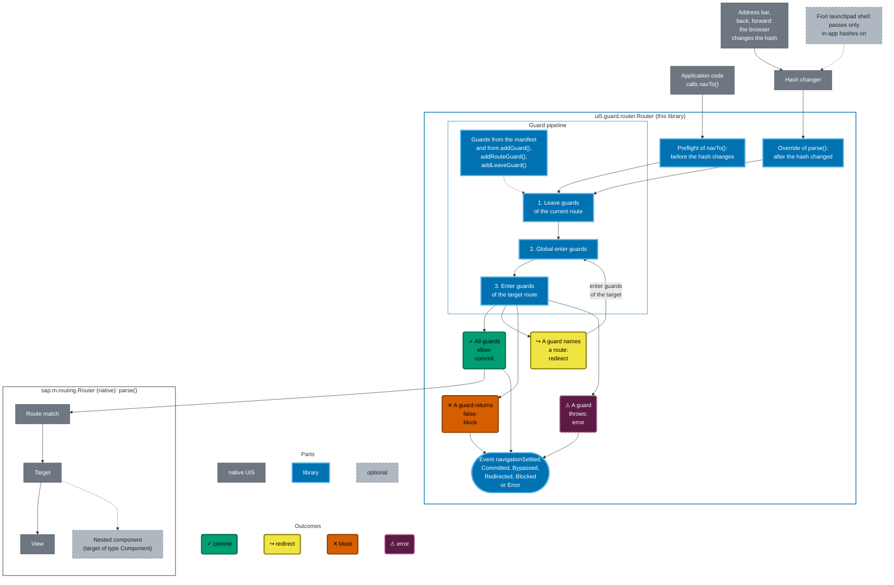
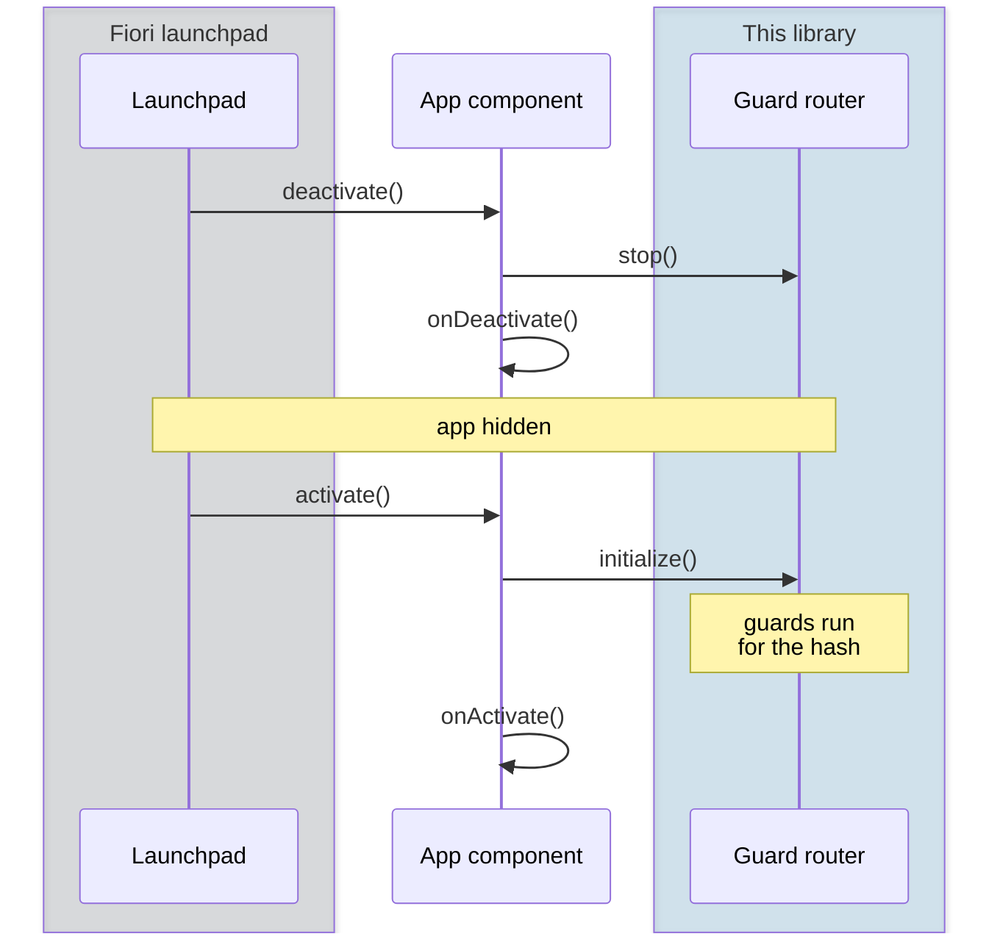
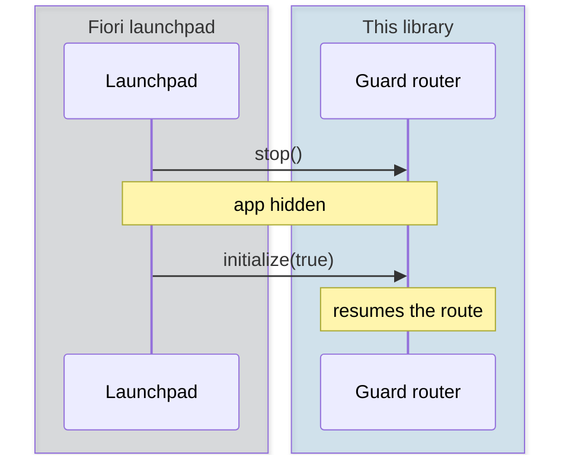
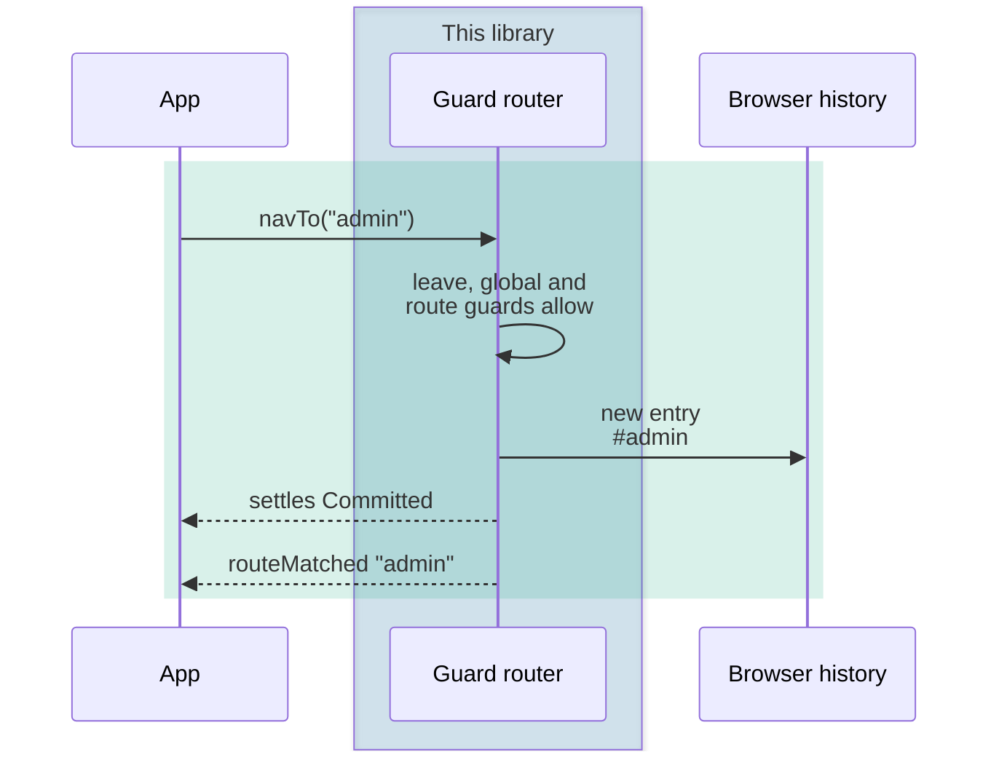
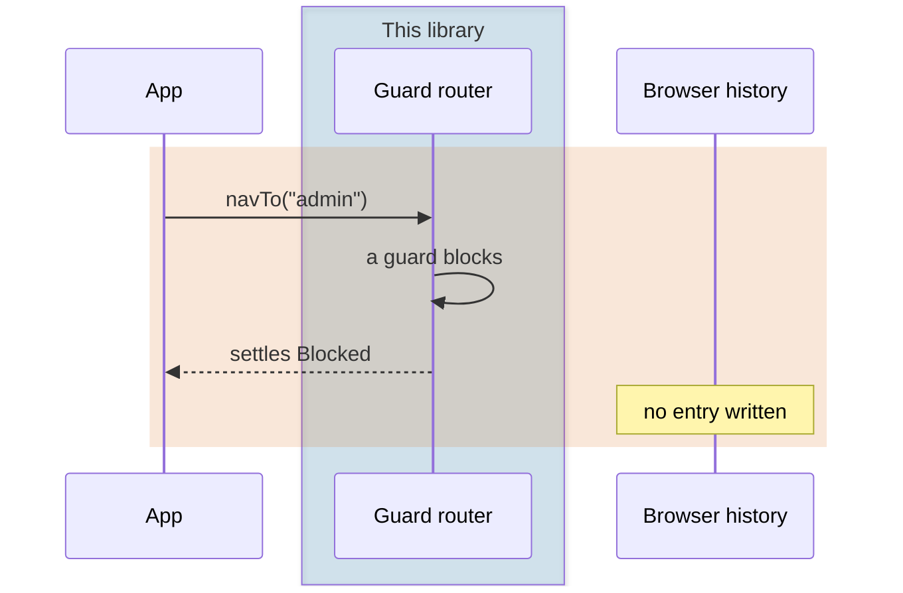
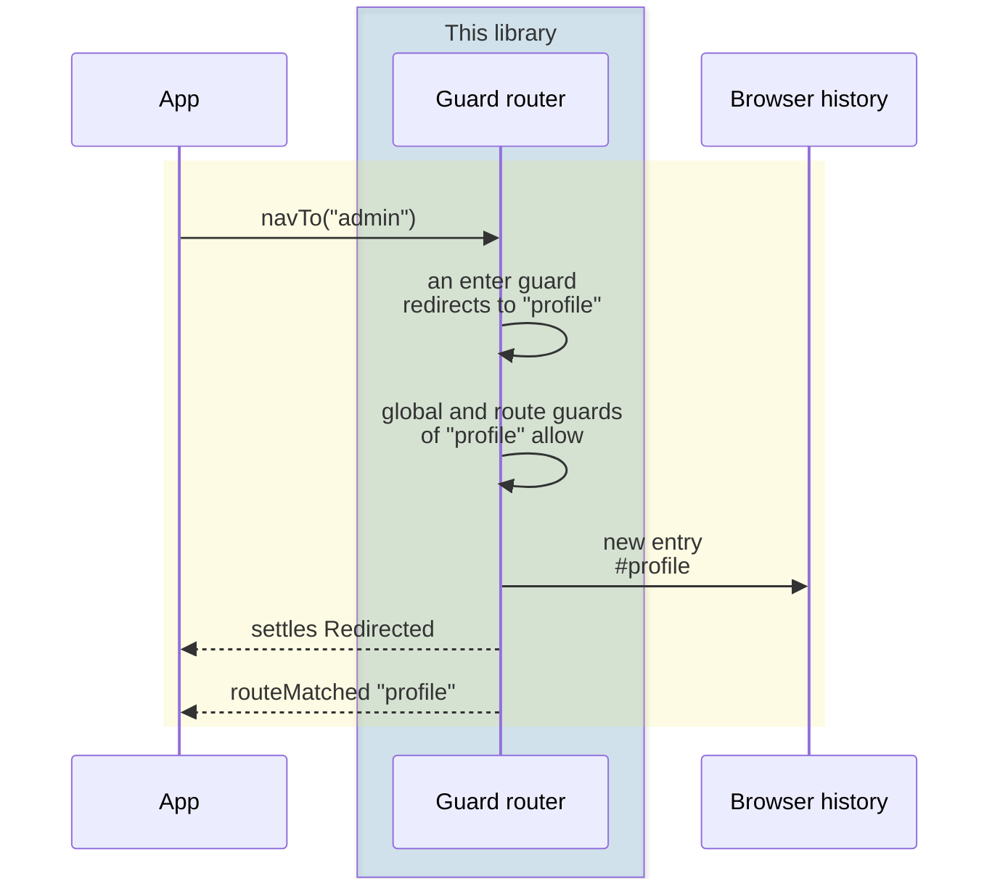
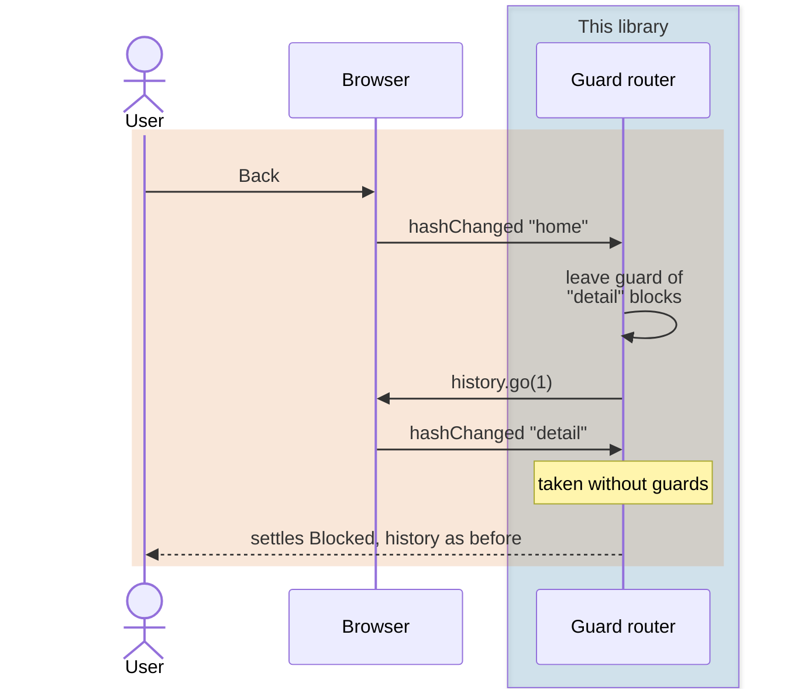
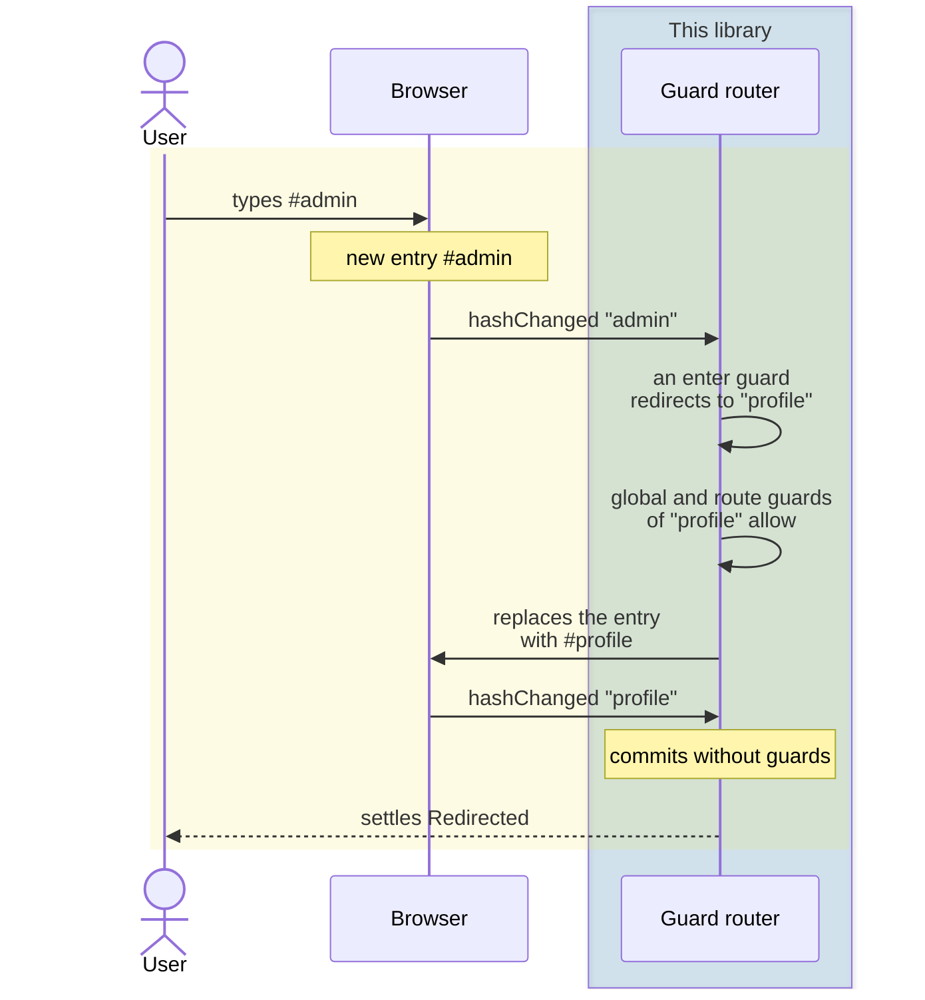
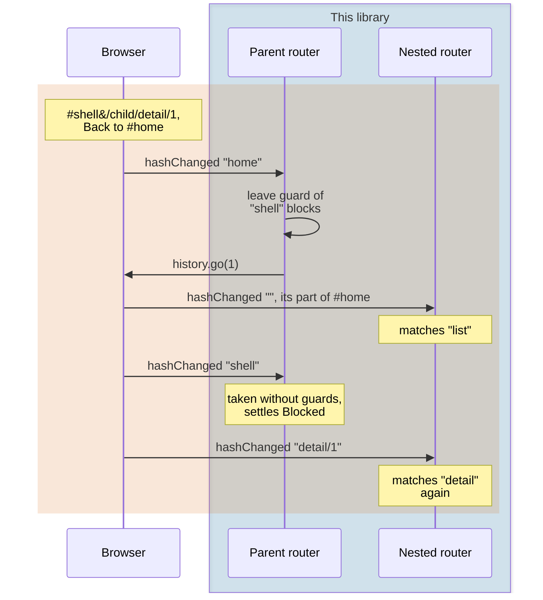

# ui5-lib-guard-router

Drop-in replacement for `sap.m.routing.Router` that intercepts navigation **before** route matching, target loading, or view creation, preventing flashes of unauthorized content and polluted browser history.

> Born from [UI5/openui5#3411](https://github.com/UI5/openui5/issues/3411), an open request for native navigation guard support in UI5. The native alternative, the `NavContainer` `navigate` event, is sync-only and fires after the route match ([comparison](../../docs/research/native-router-navigate-event.md)).

> [!WARNING]
> This library is **experimental**. It is not battle-tested in production environments, and the API may change without notice. Pin your version and review changes before upgrading.

> [!CAUTION]
> Navigation guards are a UX layer, not a security boundary. They do **not** replace server-side authorization, backend validation, or service-level access control.

## Why

UI5's router cannot block or redirect a navigation before views render. The usual workaround, guard logic in each controller's `attachPatternMatched` callback, flashes unauthorized content, pollutes the browser history and spreads the checks across controllers. This library runs the guards at the router level, before route matching. [Migrating from attachPatternMatched guards](../../docs/guides/migration-from-pattern-matched.md) shows the switch.

## Install

```bash
npm install ui5-lib-guard-router
```

> [!NOTE]
> The npm package is ~280 KB compressed (~1.1 MB unpacked) because it ships the pre-built library (`dist/`) with its source maps and type declarations, and the TypeScript sources (`src/`) that the declaration maps point to. At runtime, the browser loads only the `library-preload.js` bundle (~36 KB, ~10 KB gzipped).

### TypeScript

If your app does not already depend on UI5 typings, install them (`@sapui5/types` works as well):

```bash
npm install -D @openui5/types
```

Add both packages to `compilerOptions.types`:

```json
{
	"compilerOptions": {
		"types": ["@openui5/types", "ui5-lib-guard-router"]
	}
}
```

Import types from the UI5 module path:

```typescript
// Core: router interface and guard function signatures
import type { GuardRouter, GuardFn, LeaveGuardFn } from "ui5/guard/router/types";

// Guard pipeline: context passed to guards, and the result union they return
import type { GuardContext, GuardResult } from "ui5/guard/router/types";

// Settlement: outcome of a navigation after the guard pipeline finishes
import type { NavigationResult } from "ui5/guard/router/types";
import NavigationOutcome from "ui5/guard/router/NavigationOutcome";

// Advanced: object form for redirect-with-parameters and enter+leave registration
import type { GuardRedirect, RouteGuardConfig } from "ui5/guard/router/types";
```

### Serving the library

`ui5 serve` (UI5 CLI v4 or later) serves the library from `node_modules` without configuration. The package carries a UI5 build manifest (`.ui5/build-manifest.json`) that tells UI5 Tooling to use the pre-built files in `dist/` as they are. `ui5 tree` lists `ui5.guard.router` among the dependencies. The source maps contain the TypeScript sources, so the browser debugger shows those.

When another middleware answers `/resources` before UI5 Tooling does, serve the files statically ahead of it. `fiori-tools-proxy` in Fiori tools projects, for example, forwards `/resources` to the UI5 CDN. With `fiori-tools-servestatic`, which Fiori tools projects already have:

```yaml
# ui5.yaml
server:
    customMiddleware:
        - name: fiori-tools-servestatic
          beforeMiddleware: fiori-tools-proxy
          configuration:
              paths:
                  - path: /resources/ui5/guard/router
                    src: node_modules/ui5-lib-guard-router/dist/resources/ui5/guard/router
```

Outside Fiori tools, [`ui5-middleware-servestatic`](https://github.com/ui5-community/ui5-ecosystem-showcase/tree/main/packages/ui5-middleware-servestatic) does the same with `mountPath: /resources/ui5/guard/router` and `rootPath: node_modules/ui5-lib-guard-router/dist/resources/ui5/guard/router`.

### Building and deploying

`ui5 build` builds the app without its dependencies. Choose where the library lives at runtime:

| Setup                                                  | Library at runtime                            | Fits                                         |
| ------------------------------------------------------ | --------------------------------------------- | -------------------------------------------- |
| [Deployed with the app](#deployed-with-the-app)        | `resources/ui5/guard/router/` next to the app | Launchpad, SAP Build Work Zone, standalone   |
| [In the app's preload](#in-the-apps-component-preload) | Inside `Component-preload.js`                 | The same, with one request less              |
| [Self-contained](#self-contained-app)                  | Inside `sap-ui-custom.js`, together with UI5  | Standalone apps that ship their own UI5      |
| [Deployed on its own](#deployed-as-a-reuse-library)    | A reuse library that several apps share       | One library version for all apps on a system |

The first three keep each app on the library version it was built with, so updating the library means redeploying each app. The fourth updates in one place, at the cost of deployment configuration for the library.

#### Deployed with the app

Include the library in the build, in the `ui5.yaml` the build uses (or `ui5 build --include-dependency=ui5.guard.router`):

```yaml
builder:
    settings:
        includeDependency:
            - ui5.guard.router
```

The build writes the library, with its `library-preload.js`, to `dist/resources/ui5/guard/router/`. When UI5 itself comes from somewhere else (a CDN, the launchpad), map the namespace to that folder in the app's `manifest.json`:

```json
{
	"sap.ui5": {
		"resourceRoots": {
			"ui5.guard.router": "./resources/ui5/guard/router"
		}
	}
}
```

On SAP BTP, add the library to the archive with `includeDependencies: [ui5.guard.router]` in the `ui5-task-zipper` configuration. If `xs-app.json` routes `/resources` to the UI5 CDN, add a route before it that serves `^/resources/ui5/guard/router/(.*)$` from `html5-apps-repo-rt`. [Simplifying UI5 Library Use on BTP by Bundling Libraries at Build Time](https://community.sap.com/t5/technology-blog-posts-by-members/simplifying-ui5-library-use-on-btp-by-bundling-libraries-at-build-time/ba-p/14304012) walks through the complete setup.

#### In the app's Component-preload

A custom bundle that replaces `Component-preload.js` takes the library modules in with the app's. The app then needs neither `includeDependency` nor `resourceRoots`:

```yaml
builder:
    bundles:
        - bundleDefinition:
              name: my/app/Component-preload.js
              sections:
                  - mode: preload
                    filters:
                        - my/app/
                        - my/app/**/manifest.json
                        - ui5/guard/router/
                    resolve: false
          bundleOptions:
              optimize: true
```

Replace `my/app` with the namespace of the app. The filters replace those of the default component preload, so add any the app relied on.

#### Self-contained app

`ui5 build self-contained --all` bundles UI5, the app and the library into `resources/sap-ui-custom.js`. This is for apps that ship their own UI5, not for the launchpad.

#### Deployed as a reuse library

Build the library from its own `ui5.yaml` project, or deploy `node_modules/ui5-lib-guard-router/dist/resources/ui5/guard/router` as it is. Deploy it to the system once, as a reuse library: to the SAPUI5 ABAP repository, or to the HTML5 application repository on SAP BTP. Apps keep only the `libs` dependency in their manifest, and the launchpad resolves the library from where it is deployed. On SAP BTP, that takes a destination or a CDM content provider for the library; [the blog above](https://community.sap.com/t5/technology-blog-posts-by-members/simplifying-ui5-library-use-on-btp-by-bundling-libraries-at-build-time/ba-p/14304012) links the guides for both.

## Setup

**1. Add the library dependency and set the router class in your `manifest.json`:**

```json
{
	"sap.ui5": {
		"dependencies": {
			"libs": {
				"ui5.guard.router": {}
			}
		},
		"routing": {
			"config": {
				"routerClass": "ui5.guard.router.Router"
			}
		}
	}
}
```

All existing routes, targets, and navigation calls continue to work unchanged.

**2. Register guards in your Component:**

```typescript
import UIComponent from "sap/ui/core/UIComponent";
import type { GuardRouter } from "ui5/guard/router/types";

export default class Component extends UIComponent {
	static metadata = {
		manifest: "json",
		interfaces: ["sap.ui.core.IAsyncContentCreation"],
	};

	init(): void {
		super.init();
		const router = this.getRouter() as GuardRouter;

		// Route-specific guard: redirect when not logged in
		router.addRouteGuard("protected", (context) => {
			return isLoggedIn() ? true : "home";
		});

		// Global guard: runs for every navigation
		router.addGuard((context) => {
			if (context.toRoute === "admin" && !isAdmin()) {
				return "home";
			}
			return true;
		});

		router.initialize();
	}
}
```

## How it works

The native chain of `sap.m.routing.Router` stays as it is; the library puts its guards in front of it.



A commit lets a `navTo()` write its hash and hands the hash to the native `parse()`. A block or an error undoes a hash that the browser changed. A redirect runs the enter guards of its target, without leave guards, for at most 10 hops. The guards of the manifest are the modules under `guards` in the `guardRouter` block.

A navigation that another one supersedes, or that `stop()` or `destroy()` ends, settles as `Cancelled`.

The two entry points run the same guards:

- **`navTo()` preflight**: guards run before the hash changes. A blocked `navTo()` writes no hash; a redirected one writes only its final target.
- **`parse()` fallback**: for back/forward, URL bar entries and direct hash changes, guards run after the browser has changed the hash. The router undoes a blocked hash change and replaces the entry of a redirected one with the target, see [Browser history](#browser-history).

Where no guard intervenes, `sap.m.routing.Router` behavior (targets, route events, `navTo`, back navigation) is unchanged, see [Compatibility with `sap.m.routing.Router`](#compatibility-with-sapmroutingrouter).

The pipeline stays **synchronous while guards return plain values**. From the first guard that returns a Promise, the rest of that navigation runs async; the next navigation starts synchronous again. Results of a superseded navigation are discarded, and each guard gets an `AbortSignal` to cancel async work such as `fetch`. The diagrams of each step are in the [architecture reference](../../docs/reference/architecture.md#two-entry-point-model-navto-preflight--parse-fallback).

## API

All guard registration and removal methods return `this` for chaining. `navigationSettled()` returns a `Promise<NavigationResult>`.

### Guard registration

| Method                                                     | Description                                    |
| ---------------------------------------------------------- | ---------------------------------------------- |
| `addGuard(fn)`                                             | Global enter guard (runs for every navigation) |
| `addRouteGuard(routeName, fn)`                             | Enter guard for a specific route               |
| `addRouteGuard(routeName, { beforeEnter?, beforeLeave? })` | Enter and/or leave guards via object form      |
| `addLeaveGuard(routeName, fn)`                             | Leave guard (runs when leaving the route)      |

### Guard removal

| Method                                                        | Description                                      |
| ------------------------------------------------------------- | ------------------------------------------------ |
| `removeGuard(fn)`                                             | Remove a global enter guard                      |
| `removeRouteGuard(routeName, fn)`                             | Remove an enter guard                            |
| `removeRouteGuard(routeName, { beforeEnter?, beforeLeave? })` | Remove enter and/or leave guards via object form |
| `removeLeaveGuard(routeName, fn)`                             | Remove a leave guard                             |

### Route metadata

| Method                          | Description                                                           |
| ------------------------------- | --------------------------------------------------------------------- |
| `getRouteMeta(routeName)`       | Get resolved metadata (manifest defaults merged with runtime)         |
| `setRouteMeta(routeName, meta)` | Set runtime metadata for a route (replaces previous runtime metadata) |

### Unknown routes during registration

With the default `unknownRouteRegistration: "warn"`, `addRouteGuard()`, `addLeaveGuard()` and `setRouteMeta()` warn when the route name is unknown at registration time, but still register, so guards can be attached before a dynamic `addRoute()`. `"ignore"` registers without a warning. `"throw"` makes these calls throw and registers nothing. A manifest guard on an unknown route cannot throw to a caller: with `"throw"` it is skipped and logged as `guardRouter.guards: failed to register "<module path>"`, and the router still starts.

### GuardContext

Every guard receives a `GuardContext` object:

| Property         | Type                                               | Description                                                             |
| ---------------- | -------------------------------------------------- | ----------------------------------------------------------------------- |
| `toRoute`        | `string`                                           | Target route name (empty if no match)                                   |
| `toHash`         | `string`                                           | Raw hash being navigated to                                             |
| `toArguments`    | `Record<string, string \| Record<string, string>>` | Parsed route parameters                                                 |
| `fromRoute`      | `string`                                           | Current route name (empty on first navigation)                          |
| `fromHash`       | `string`                                           | Current hash                                                            |
| `signal`         | `AbortSignal`                                      | Aborted when navigation is superseded, or on `stop()`/`destroy()`       |
| `bag`            | `Map<string, unknown>`                             | Shared mutable store for inter-guard data passing within one navigation |
| `toMeta`         | `Readonly<Record<string, unknown>>`                | Resolved metadata for the target route (manifest + runtime, frozen)     |
| `fromMeta`       | `Readonly<Record<string, unknown>>`                | Resolved metadata for the current route (manifest + runtime, frozen)    |
| `ownerComponent` | `UIComponent \| undefined`                         | Component that owns the router; `undefined` for routers without owner   |

### Return values (`GuardResult`)

Enter guards return a `GuardResult`:

```
GuardResult = boolean | string | GuardRedirect
```

| Return                                         | Type            | When to use                                             | Effect                                                                                                           |
| ---------------------------------------------- | --------------- | ------------------------------------------------------- | ---------------------------------------------------------------------------------------------------------------- |
| `true`                                         | `boolean`       | Guard condition passes                                  | Allow navigation                                                                                                 |
| `false`                                        | `boolean`       | Guard condition fails, no specific destination          | Stay on current route. The URL and the history stay as they were, see [Browser history](#browser-history)        |
| `"routeName"`                                  | `string`        | Redirect to a fixed route (no parameters needed)        | Navigate to target route. The guarded hash does not stay in the history, see [Browser history](#browser-history) |
| `{ route, parameters?, componentTargetInfo? }` | `GuardRedirect` | Redirect and pass route parameters or component targets | Same as string redirect, with parameters                                                                         |

`toArguments` holds the route's parameters as UI5's `Route#getURL()` expects them back. A query parameter of the pattern (`products{?query}` or `products:?query:`) arrives under the key `"?query"` as an object, `{ "?query": { tab: "notes" } }`; an optional parameter that the hash leaves out is `undefined`. Pass the same shape in `GuardRedirect.parameters`.

Without parameters or component targets, the string form (`return "home"`) is equivalent to `GuardRedirect`.

Any other value (`null`, `undefined`, `0`, etc.) blocks. Only strict `true` allows navigation; there is no truthy coercion.

On first load, blocking a non-empty hash restores `""` and continues with the app's default route. Blocking the default route itself leaves the app without a view. For a specific destination such as `login`, return a redirect instead of `false`.

A `navTo()` issued while a browser-initiated navigation is still waiting for an async guard supersedes that navigation. If the `navTo()` is then blocked, fails, or targets the current route, the router also restores the previous hash, so the URL does not stay on a hash that never committed.

**Leave guards** (`addLeaveGuard`) return `boolean` only:

| Return                            | Effect                          |
| --------------------------------- | ------------------------------- |
| `true`                            | Allow leaving the current route |
| `false` (or any non-`true` value) | Block                           |

Leave guards cannot redirect. Redirect from an enter guard of the target route.

### Lifecycle

| Method             | Behavior                                                                                                                                                |
| ------------------ | ------------------------------------------------------------------------------------------------------------------------------------------------------- |
| `initialize()`     | Starts the router and parses the current hash through the guards, as the native router does                                                             |
| `initialize(true)` | Starts the router without parsing the hash. After `stop()`, it resumes the route that was current, so its leave guards keep working                     |
| `stop()`           | Cancels a pending navigation (settles as `Cancelled`, aborts the `AbortSignal`) and resets the current route, hash and last settlement; guards are kept |
| `destroy()`        | Clears all guards, cancels a pending navigation, then calls `super.destroy()`. A second call does nothing                                               |

Before `initialize()`, while `guardLoading: "block"` modules load, and after `stop()`, the router does not listen to hash changes. `navTo()` then behaves like the native router: it only sets the hash, or does nothing on a stopped router. No guard runs and nothing settles; the guards run when the router starts and parses the hash.

With `guardLoading: "block"`, the router starts once the manifest guard modules have loaded. Until then `isInitialized()` is `false`, a second `initialize()` changes nothing, and `stop()` cancels the pending start until `initialize()` is called again. Guard modules that finish loading after `destroy()` register nothing.

The Fiori launchpad stops the app router when the user leaves the app and calls `initialize(true)` when it puts the app back after the data-loss prompt: the router resumes the route the app was on. For apps the launchpad keeps alive, see [Keep-alive apps](#keep-alive-apps).

### Navigation settlement

`navigationSettled()` returns a Promise that resolves when the guard pipeline finishes. The `NavigationResult` holds the outcome (`status`, a `NavigationOutcome` value), the `route` and the `hash`.

```typescript
import type { NavigationResult } from "ui5/guard/router/types";
import NavigationOutcome from "ui5/guard/router/NavigationOutcome";

const result: NavigationResult = await router.navigationSettled();
```

| `result.status`                | Meaning                                                                                                 |
| ------------------------------ | ------------------------------------------------------------------------------------------------------- |
| `NavigationOutcome.Committed`  | Guards allowed the navigation; target route is active                                                   |
| `NavigationOutcome.Bypassed`   | Guards allowed the navigation, but no route matched; UI5 continued with `bypassed` / not-found handling |
| `NavigationOutcome.Blocked`    | A guard blocked navigation; previous route stays active                                                 |
| `NavigationOutcome.Redirected` | A guard redirected navigation to a different route, or to the route that is shown                       |
| `NavigationOutcome.Cancelled`  | Navigation was cancelled before settling (superseded, stopped, or destroyed)                            |
| `NavigationOutcome.Error`      | A guard threw or rejected; previous route stays active. `result.error` holds the thrown value           |

A guard redirect to a route that does not exist settles as `Blocked` because no route change commits; the router logs the target name to help diagnose it. A redirect whose target hash cannot be built (a mandatory route parameter is missing) is a guard failure: the navigation settles as `Error` with the error in `result.error`, whether the guard is sync or async and whether the navigation came from `navTo()` or from a hash change. `navTo()` does not throw for it, and a hash change is restored. The router logs the target name.

An accepted unmatched hash settles as `Bypassed` with `route === ""` and the attempted hash in `hash`.

If no navigation is in flight, `navigationSettled()` resolves immediately with the most recent result, so it is safe to call right after `navTo()`, even when guards settle synchronously. On a fresh router this is `Committed` with the current route and hash. After `stop()`, route and hash are empty strings until the next navigation settles or `initialize(true)` resumes the route. All callers waiting on the same navigation receive the same result.

**App code: busy indicator during async guards**

```typescript
import MessageBox from "sap/m/MessageBox";
import MessageToast from "sap/m/MessageToast";
import type App from "sap/m/App";
import NavigationOutcome from "ui5/guard/router/NavigationOutcome";

// In the root view controller, with an sap.m.App of id "app"
const app = this.byId("app") as App;

router.addRouteGuard("dashboard", async (context) => {
	app.setBusy(true);
	try {
		const res = await fetch(`/api/access/${context.toRoute}`, { signal: context.signal });
		return (await res.json()).allowed ? true : "home";
	} finally {
		app.setBusy(false);
	}
});

// React to the outcome once the guards have decided
router.navTo("dashboard");
const result = await router.navigationSettled();
switch (result.status) {
	case NavigationOutcome.Committed:
		break; // navigation succeeded
	case NavigationOutcome.Bypassed:
		MessageToast.show("No route matched; showing not-found flow");
		break;
	case NavigationOutcome.Blocked:
		MessageToast.show("Access denied");
		break;
	case NavigationOutcome.Redirected:
		MessageToast.show(`Redirected to ${result.route}`);
		break;
	case NavigationOutcome.Error:
		MessageBox.error("Navigation failed: " + String(result.error));
		break;
	case NavigationOutcome.Cancelled:
		break; // superseded by a newer navigation
}
```

**Test code: wait for guards deterministically**

```typescript
router.navTo("protected");
const result = await router.navigationSettled();
assert.strictEqual(result.status, NavigationOutcome.Blocked, "Navigation was blocked");
assert.strictEqual(result.route, "home", "User stays on home");
```

**Event-based: observe every navigation outcome**

The `navigationSettled` event fires synchronously after every settlement:

```typescript
router.attachNavigationSettled((event) => {
	const status = event.getParameter("status"); // NavigationOutcome
	const route = event.getParameter("route");
	const hash = event.getParameter("hash");
	console.log(`Navigation settled: ${status} on ${route}`);
});
```

A handler may call `navTo()`: the router is idle when the event fires, also for `Cancelled`, so the call runs its guards like any other. For `Blocked`, `Error` and `Cancelled` the URL is already restored when the event fires (a blocked back or forward step waits for that, see [Browser history](#browser-history)), so the restore does not undo what a handler starts. On first load, a blocked non-empty hash settles before the router falls back to the default route. Navigating inside the handler has two effects:

- A `Committed` or `Redirected` navigation that the handler leaves synchronously is not displayed and fires no `routeMatched`; only the handler's target is.
- For a navigation `Cancelled` by a newer one, the event fires before the newer navigation starts. The newer navigation then supersedes what the handler started: a committed one is navigated away from, a pending one is dropped without a settlement. Only a superseding hash change gives way: it is dropped when the handler's navigation has committed and moved the URL.

`detachNavigationSettled(fnFunction, oListener)` removes the listener; pass the same function and listener as to `attachNavigationSettled`. The standard `attachEvent` / `detachEvent` also work. A handler that throws does not stop the navigation: the router logs `A navigationSettled handler threw` and completes it.

### Error handling

When a guard throws or its Promise rejects, the navigation settles as `Error` with the thrown value in `result.error`, and the previous route stays active. `Blocked` is an intended denial, `Error` an unexpected failure.

A guard that calls `navTo()` itself supersedes the navigation it is guarding: that navigation settles as `Cancelled`, and what the guard returns afterwards (`true`, `false` or a redirect) is ignored, for sync and async guards alike. The navigation the guard started decides where the router ends up. To send the user elsewhere from a guard, return a redirect instead.

An error thrown while an allowed navigation is carried out, for example by a `beforeRouteMatched` handler, is not a guard failure. With sync guards it reaches the caller of `navTo()`. After async guards there is no caller, so the router logs it (`Navigation failed after its guards had settled`); a navigation that had already settled as `Committed` keeps that result, one that had not settled yet settles as `Error`.

### Execution order

1. **Leave guards** for the current route (registration order)
2. **Global enter guards** (registration order)
3. **Route-specific enter guards** for the target (registration order)

The pipeline stops at the first non-`true` result: if a leave guard blocks, no enter guard runs; if a global guard redirects, the route-specific guards are skipped.

Leave guards run on every hash change, also when only the parameters of the same route change (`employees/1` to `employees/2`); `fromRoute` and `toRoute` are then equal. A leave guard that should only protect leaving the route compares them.

**Greedy routes.** UI5 matches a route with `greedy: true` even when an earlier route has matched the hash. The guards of such a route run as well:

- The leave guards of every greedy route that matched the current hash run after those of `fromRoute`.
- The route-specific enter guards of every greedy route that matches the target hash run after those of `toRoute`, in the order the routes are defined. This holds for redirect hops too.
- A block or redirect from any of them applies to the whole navigation.
- A greedy route that matches both hashes is left and entered again: its leave guards and its enter guards run, as for a first match whose parameters change. UI5 fires no event for leaving it.

Every guard of a navigation gets the same context: `toRoute`, `toArguments` and `fromRoute` are those of the first route that matches. UI5 has no public API for the arguments of a greedy route that is not the first match; a guard that needs them reads `toHash`.

## Manifest Configuration

Guards, route metadata and router options can be declared in the `guardRouter` block inside `sap.ui5.routing.config` of `manifest.json`.

```json
{
	"sap.ui5": {
		"routing": {
			"config": {
				"routerClass": "ui5.guard.router.Router",
				"guardRouter": {
					"unknownRouteRegistration": "warn",
					"navToPreflight": "guard",
					"guardLoading": "lazy",
					"inheritance": "none",
					"guards": {
						"*": ["guards.authGuard"],
						"admin": {
							"enter": ["guards.adminGuard"],
							"leave": ["guards.unsavedChangesGuard"]
						}
					},
					"routeMeta": {
						"admin": { "requiresAuth": true, "roles": ["admin"] },
						"profile": { "requiresAuth": true }
					}
				}
			}
		}
	}
}
```

### Router options

| Option                     | Values                              | Default   | Description                                                                                                                                                                                                                                                                                              |
| -------------------------- | ----------------------------------- | --------- | -------------------------------------------------------------------------------------------------------------------------------------------------------------------------------------------------------------------------------------------------------------------------------------------------------- |
| `unknownRouteRegistration` | `"ignore"` \| `"warn"` \| `"throw"` | `"warn"`  | Policy for guard and metadata registration against unknown route names, see [Unknown routes during registration](#unknown-routes-during-registration)                                                                                                                                                    |
| `navToPreflight`           | `"guard"` \| `"bypass"` \| `"off"`  | `"guard"` | Whether `navTo()` calls run through the guard pipeline (`"guard"`), skip guards (`"bypass"`), or leave them to `parse()` after the hash has changed (`"off"`), which also supersedes a pending navigation there                                                                                          |
| `guardLoading`             | `"block"` \| `"lazy"`               | `"lazy"`  | `"lazy"`: `initialize()` starts the router at once; a module that is not loaded yet is loaded on the first navigation that needs it (a failed load settles that navigation as `Error`). `"block"`: the router starts once all modules have loaded; a module that fails to load is skipped with a warning |
| `inheritance`              | `"none"` \| `"pattern-tree"`        | `"none"`  | `"none"`: guards and metadata apply only to their declared route. `"pattern-tree"`: guards propagate to all routes whose URL pattern extends the declared route's pattern; metadata propagates via shallow merge (child values override ancestor values on conflict).                                    |

The `guardRouter` block also accepts `guards` (see [Declarative guards](#declarative-guards)) and `routeMeta` (see [Route metadata](#route-metadata)).

When constructing the router in code rather than from the manifest, the config argument is typed as `GuardRouterConfig` (since 1.7.0): the standard router config plus `guardRouter`, so `new Router(routes, { async: true, guardRouter: { navToPreflight: "bypass" } })` (`import Router from "ui5/guard/router/Router"`) type-checks without casts.

### Declarative guards

The `guards` map wires guard modules to routes.

**Global guards** run on every navigation and are declared under the `"*"` key:

```json
"guards": {
	"*": ["guards.authGuard"]
}
```

**Per-route guards** use the route name as the key. The shorthand array form registers enter guards only:

```json
"guards": {
	"admin": ["guards.adminGuard"]
}
```

The object form registers enter and leave guards:

```json
"guards": {
	"admin": {
		"enter": ["guards.adminGuard"],
		"leave": ["guards.unsavedChangesGuard"]
	}
}
```

Keys other than `enter` and `leave`, and an `enter` or `leave` value that is not an array, are logged as warnings and skipped. Under `"*"` only `enter` applies; `leave` is skipped with a warning, because there are no global leave guards.

**Module paths** use dot notation and are resolved relative to `sap.app.id`. Given `sap.app.id = "com.example.app"`, the path `"guards.authGuard"` resolves to `"com/example/app/guards/authGuard"`.

For an absolute module path, prefix it with `"module:"`. Slash notation (`module:com/shared/guards/authGuard`) is accepted as well:

```json
"*": ["module:com.shared.guards.authGuard"]
```

### Complete example

manifest.json:

```json
{
	"sap.ui5": {
		"routing": {
			"config": {
				"routerClass": "ui5.guard.router.Router",
				"guardRouter": {
					"guards": {
						"*": ["guards.authGuard"],
						"admin": { "enter": ["guards.roleGuard"], "leave": ["guards.unsavedGuard"] }
					}
				}
			}
		}
	}
}
```

guards/authGuard.ts:

```typescript
import type { GuardContext, GuardResult } from "ui5/guard/router/types";

export default function authGuard(context: GuardContext): GuardResult {
	if (!isAuthenticated()) return "login";
	return true;
}
```

Manifest guards have no closure over the component. Read component state such as models through `context.ownerComponent`, not module-level singletons or `ComponentRegistry` lookups, so each component instance sees its own state:

```typescript
export default function dirtyFormGuard(context: GuardContext): boolean {
	return context.ownerComponent?.getModel("form")?.getProperty("/isDirty") !== true;
}
```

### Guard module format

Each entry in a guard array is a module. The router uses the value the module returns to UI5's loader, for a transpiled ES module its default export. That value has one of three shapes:

**Shape 1: Function (single guard)**

```typescript
// guards/auth.ts
import type { GuardContext, GuardResult } from "ui5/guard/router/types";

export default function authGuard(context: GuardContext): GuardResult {
	return isAuthenticated() ? true : "login";
}
```

**Shape 2: Array (ordered guards)**

```typescript
// guards/checks.ts (registered as "checks#0", "checks#1")
import type { GuardContext, GuardResult } from "ui5/guard/router/types";

export default [
	function checkAuth(context: GuardContext): GuardResult {
		return true;
	},
	function checkRole(context: GuardContext): GuardResult {
		return false;
	},
];
```

**Shape 3: Plain Object (named guards)**

```typescript
// guards/security.ts (registered as "checkAuth", "checkRole")
import type { GuardContext, GuardResult } from "ui5/guard/router/types";

export default {
	checkAuth(context: GuardContext): GuardResult {
		/* ... */ return true;
	},
	checkRole(context: GuardContext): GuardResult {
		/* ... */ return false;
	},
};
```

A plain object produces named guards in key order. A module with only named exports (`export function checkAuth`) counts as such an object, with its exports in the order they are written. Named exports next to a default export become properties of the default export, because the UI5 transpiler (`babel-plugin-transform-modules-ui5`) collapses them onto it: next to a default function only `#name` reaches them (see [Cherry-pick syntax](#cherry-pick-syntax)), next to a default object they are further entries of it. Non-function entries in arrays and objects are warned and skipped. Empty arrays and objects are warned and produce no guards.

> [!NOTE]
> A module in a `"leave"` array is a `LeaveGuardFn` and returns `boolean`. A string or `GuardRedirect` from a leave guard is not an error, but like any non-`true` value it blocks.

### Cherry-pick syntax

`#` selects one guard of a module by name or index:

```json
{
	"guards": {
		"admin": ["guards.security#checkAuth", "guards.security#checkRole"],
		"dashboard": ["guards.security"],
		"settings": ["guards.checks#1"],
		"*": ["guards.logging"]
	}
}
```

| Syntax                               | Behavior                                      |
| ------------------------------------ | --------------------------------------------- |
| `"guards.security"`                  | Register all exports (key/array order)        |
| `"guards.security#checkAuth"`        | Register only that named export               |
| `"guards.security#1"`                | Register by index (array or object key order) |
| `"module:some.lib.guards#checkAuth"` | `module:` prefix composes with `#`            |

Only a plain non-negative integer (`#0`, `#12`) selects by index. Every other key is a name: `#2faGuard` selects the export named `2faGuard` and is skipped with a warning if the module has none.

When `#` is used on a single-function module, the key selects a function among the module's own properties, which is what a named export next to the default function becomes. Without such a property the export key is ignored with a debug message and the function is still registered.

### Guard context `bag`

`context.bag` is a `Map<string, unknown>` created for each navigation and shared by all its guards, across redirect hops too. Use it to fetch data such as the current user once per navigation:

```typescript
// guards/firstGuard.ts
export default function firstGuard(context: GuardContext): GuardResult {
	context.bag.set("userId", getCurrentUserId());
	return true;
}
```

```typescript
// guards/secondGuard.ts
export default function secondGuard(context: GuardContext): GuardResult {
	const userId = context.bag.get("userId") as string | undefined;
	if (!userId) return "login";
	return true;
}
```

Values are `unknown`, so cast on `.get()`.

### Route metadata

`guardRouter.routeMeta` maps route names to arbitrary objects. The router stores the metadata and never interprets it. Guards read it from `context.toMeta` and `context.fromMeta`.

```json
"guardRouter": {
	"routeMeta": {
		"admin": { "requiresAuth": true, "roles": ["admin"] },
		"profile": { "requiresAuth": true },
		"home": { "public": true }
	}
}
```

One global guard can then enforce it:

```typescript
router.addGuard((context) => {
	if (context.toMeta.requiresAuth && !isLoggedIn()) return "login";
	if (context.toMeta.roles && !hasAnyRole(context.toMeta.roles as string[])) return "forbidden";
	return true;
});
```

`setRouteMeta()` sets runtime metadata, which takes precedence over the manifest values:

```typescript
router.setRouteMeta("betaFeature", { enabled: featureToggle.isActive("beta") });
```

`getRouteMeta()` returns a frozen object: manifest values merged with runtime values, plus inherited metadata with `inheritance: "pattern-tree"` (see [Guard and metadata inheritance](#guard-and-metadata-inheritance)). For a route without metadata it returns an empty frozen object.

### `skipGuards` option

`{ skipGuards: true }` as the options argument of `navTo()` bypasses all guards for that call. The options follow `bReplace`, or take its place when `bReplace` is left out:

```typescript
router.navTo("settings", {}, false, { skipGuards: true });
router.navTo("settings", {}, undefined, { skipGuards: true });
router.navTo("settings", {}, componentTargetInfo, false, { skipGuards: true });
```

A `skipGuards` navigation does not wait for guards that are still pending for the same target: it cancels that navigation and commits.

### Guard and metadata inheritance

With `inheritance: "pattern-tree"`, guards declared on a route apply to all routes whose URL pattern extends that route's pattern:

```json
"guardRouter": {
	"inheritance": "pattern-tree",
	"guards": {
		"employees": ["guards.authGuard"]
	}
}
```

With routes `employees`, `employees/{id}`, and `employees/{id}/resume`, the auth guard runs for all three. Ancestor guards run before descendant guards, in whatever order the routes appear under `guards`; guards of the same route keep their declared order.

Route metadata propagates the same way. With the route-to-pattern mapping `"employees"` -> `employees`, `"employee"` -> `employees/{id}`, `"employeeResume"` -> `employees/{id}/resume`:

```json
"guardRouter": {
	"inheritance": "pattern-tree",
	"routeMeta": {
		"employees": { "section": "hr", "requiresAuth": true },
		"employee": { "clearance": "manager" }
	}
}
```

`getRouteMeta("employeeResume")` returns `{ section: "hr", requiresAuth: true, clearance: "manager" }` (inherited from both `employees` and `employee`). `getRouteMeta("employee")` returns the same object (merged, own values win).

**The root-pattern route (`""`) is an ancestor of every route.** Metadata or guards declared on it, typically on "home", propagate to all routes:

```json
"guardRouter": {
	"inheritance": "pattern-tree",
	"routeMeta": {
		"home": { "requiresAuth": true }
	}
}
```

Every route inherits `requiresAuth: true` from "home" unless it overrides it. The reverse holds too: `{ "requiresAuth": false }` on the root route makes every route public unless overridden.

Only manifest guards are inherited; guards added with `addRouteGuard()` or `addLeaveGuard()` apply only to their own route. Guard inheritance is resolved at `initialize()`. A route added later with `addRoute()` joins the pattern tree at once: its inherited guards are registered in front of the manifest guards of deeper routes. Metadata, including runtime metadata from `setRouteMeta()`, is resolved on first access and cached until `setRouteMeta()` or `addRoute()` clears the cache.

### Mixing declarative and programmatic guards

Manifest and programmatic guards of the same route both run. Within each phase, guards run in registration order. Manifest guards are registered in declaration order when `initialize()` runs, so they run after programmatic guards added before `initialize()` and before guards added after it. In `"block"` mode they are registered once all modules have loaded, so a guard added after `initialize()` but before loading finishes runs before them.

Where each kind of guard fits:

- **Manifest:** guards that don't need component state (simple blocks, redirects, logging)
- **Programmatic:** guards that close over models, services, or runtime state
- **Controller-level:** guards tied to a specific view's lifecycle (registered in `onInit`, removed in `onExit`)

## Examples

### Async guard with AbortSignal

```typescript
import type { GuardContext, GuardResult } from "ui5/guard/router/types";

router.addRouteGuard("dashboard", async (context: GuardContext): Promise<GuardResult> => {
	const res = await fetch(`/api/access/${context.toRoute}`, {
		signal: context.signal, // cancelled when a newer navigation supersedes this one
	});
	const { allowed } = await res.json();
	return allowed ? true : "forbidden";
});
```

### Redirect with parameters (GuardRedirect)

```typescript
import type { GuardRedirect } from "ui5/guard/router/types";

router.addGuard((context): GuardRedirect | true => {
	if (context.toRoute === "old-detail") {
		return {
			route: "detail",
			parameters: { id: context.toArguments.id },
		};
	}
	return true;
});
```

[Guard Integration Patterns](../../docs/guides/integration-patterns.md#redirect-with-parameters) has this guard as a factory for any target route.

### Guard factories

A factory closes over what its guard depends on:

```typescript
import type JSONModel from "sap/ui/model/json/JSONModel";
import type { GuardFn, LeaveGuardFn, GuardContext, GuardResult } from "ui5/guard/router/types";

export function createAuthGuard(authModel: JSONModel): GuardFn {
	return (context: GuardContext): GuardResult => {
		return authModel.getProperty("/isLoggedIn") ? true : "home";
	};
}

export function createDirtyFormGuard(formModel: JSONModel): LeaveGuardFn {
	return (context: GuardContext): boolean => {
		return !formModel.getProperty("/isDirty");
	};
}
```

### Object form with RouteGuardConfig

The object form is useful when registering both enter and leave guards for the same route in a single call:

````typescript
import type { RouteGuardConfig } from "ui5/guard/router/types";

const protectedGuards: RouteGuardConfig = {
	beforeEnter: createAuthGuard(authModel),
	beforeLeave: createDirtyFormGuard(formModel),
};

router.addRouteGuard("protected", protectedGuards);
// later: router.removeRouteGuard("protected", protectedGuards);

More patterns are in [Guard Integration Patterns](../../docs/guides/integration-patterns.md).

### Dynamic guard registration

Guards can be added and removed at any time:

```typescript
const logGuard: GuardFn = (ctx) => {
	console.log(`Navigation: ${ctx.fromRoute} → ${ctx.toRoute}`);
	return true;
};

router.addGuard(logGuard);
// later...
router.removeGuard(logGuard);
````

### Leave guard with controller lifecycle

A controller registers its guard in `onInit` and removes the same function in `onExit`:

```typescript
import Controller from "sap/ui/core/mvc/Controller";
import UIComponent from "sap/ui/core/UIComponent";
import type JSONModel from "sap/ui/model/json/JSONModel";
import type { GuardRouter, LeaveGuardFn } from "ui5/guard/router/types";

export default class EditController extends Controller {
	private _leaveGuard?: LeaveGuardFn;

	onInit(): void {
		const form = this.getOwnerComponent()?.getModel("form") as JSONModel;
		this._leaveGuard = () => form.getProperty("/isDirty") !== true;
		(UIComponent.getRouterFor(this) as GuardRouter).addLeaveGuard("edit", this._leaveGuard);
	}

	onExit(): void {
		if (this._leaveGuard) {
			(UIComponent.getRouterFor(this) as GuardRouter).removeLeaveGuard("edit", this._leaveGuard);
		}
	}
}
```

> [!TIP]
> **User feedback on blocked navigation**: A blocked navigation gives the user no feedback, and there is no built-in confirmation dialog. Show a `sap.m.MessageBox.confirm()` in the leave guard and return the user's choice as a `Promise<boolean>`.

> [!NOTE]
> **Guard cleanup and lifecycle**
>
> **Component level**: The router's `destroy()` clears all guards when the component is destroyed, also during FLP navigation.
>
> **Controller level**: UI5's routing [caches views indefinitely](../../docs/research/view-caching-controller-lifecycle.md), so `onExit` is called only when the component is destroyed, not on every navigation away. Guards registered by a controller therefore stay across in-app navigations.
>
> In FLP apps with `sap-keep-alive`, the component and its guards stay while the app is hidden, see [Keep-alive apps](#keep-alive-apps).

## Fiori Launchpad

### Data loss prevention of the launchpad

Inside SAP Fiori Launchpad (FLP), the shell has its own data loss protection on `sap.ushell.Container`:

- **`setDirtyFlag(bDirty)`** (since 1.27.0): while `true`, FLP shows a browser `confirm()` dialog on every hash change, in-app ones included, and the leave-page dialog on refresh or close. An in-app `navTo()` that the shell holds back for the dialog settles as `Blocked`; if the user confirms, the shell sets the hash again and the guards run for it.
- **`registerDirtyStateProvider(fn)`** (since 1.31.0, `deregisterDirtyStateProvider` since 1.67.0): FLP calls the provider on each navigation with a `NavigationContext` (`isCrossAppNavigation`, `innerAppRoute`), so it can tell cross-app from in-app navigation.
- Since 1.146, `setDirtyFlag` and the provider functions are on `sap/ushell/navigation/DirtyState`, and the `Container` methods are deprecated.

```typescript
import Container from "sap/ushell/Container"; // 1.146 and later: the same functions on sap/ushell/navigation/DirtyState

const dirtyProvider = (navigationContext?: { isCrossAppNavigation?: boolean }) => {
	if (navigationContext?.isCrossAppNavigation === false) {
		return false; // in-app navigation: the leave guards handle it
	}
	return formModel.getProperty("/isDirty") === true;
};
Container.registerDirtyStateProvider(dirtyProvider);

// When the form or the app goes away
Container.deregisterDirtyStateProvider(dirtyProvider);
```

`getDirtyFlag()` is deprecated since UI5 1.120. The APIs and the shell internals are in [FLP Dirty State Research](../../docs/research/flp-dirty-state.md).

### Combining leave guards with FLP dirty-state protection

A leave guard and a dirty-state provider cover separate scopes and need no coordination:

- The **leave guard** protects **in-app** navigation (route to route within your app).
- The **dirty-state provider** protects **cross-app** navigation (shell home, other tiles, browser close).

`ShellNavigationHashChanger` never passes a cross-app hash to the app router, so the leave guard never runs for it. The provider returns `false` for in-app navigation, so the shell does not prompt for it:

```typescript
import Container from "sap/ushell/Container";

// 1. Leave guard: blocks in-app navigation when dirty
router.addRouteGuard("editOrder", {
	beforeLeave: () => formModel.getProperty("/isDirty") !== true,
});

// 2. Dirty-state provider: tells FLP about unsaved changes for cross-app
const dirtyProvider = (navigationContext?: { isCrossAppNavigation?: boolean }) => {
	if (navigationContext?.isCrossAppNavigation === false) {
		return false; // in-app navigation handled by leave guard
	}
	return formModel.getProperty("/isDirty") === true;
};
Container.registerDirtyStateProvider(dirtyProvider);
```

The leave guard needs no `toRoute` check or FLP detection: the shell handles cross-app navigation in production and in the FLP sandbox. In an app the launchpad keeps alive, deregister the provider while the app is hidden ([Keep-alive apps](#keep-alive-apps)).

> [!TIP]
> To test a dirty-state provider in the FLP preview, set `useNewSandbox: true` on the `fiori-tools-preview` middleware (SAPUI5 1.151 and later; before that, `enhancedHomePage: true` from 1.123.0). Both start a CDM launchpad, whose `ShellNavigationHashChanger` and `Navigation` service behave like a production FLP.

### Keep-alive apps

With `sap-keep-alive=true` the launchpad hides an app that the user leaves for another app and shows it again when the user returns. With `sap-keep-alive=restricted` it also destroys kept apps when the user reaches the launchpad home; returning from there through a hash with an inner route (browser back, bookmark) creates a new component.

What happens to the router depends on whether the manifest declares keep-alive support:

```json
{
	"sap.ui5": {
		"keepAlive": { "supported": true }
	}
}
```

|              | Hidden                                                                       | Shown again                                                                                                                                                                                                             |
| ------------ | ---------------------------------------------------------------------------- | ----------------------------------------------------------------------------------------------------------------------------------------------------------------------------------------------------------------------- |
| Declared     | UI5's `Component#deactivate()` stops the router, then calls `onDeactivate()` | `Component#activate()` calls `initialize()`, which runs the guards for the hash the URL shows, then `onActivate()`. No leave guard runs. Returning through an intent without an inner route starts on the default route |
| Not declared | The launchpad calls `stop()`                                                 | The launchpad calls `initialize(true)`: the router resumes the route the app was on, and its leave guards keep working                                                                                                  |

Declared: the launchpad goes through the component.



Not declared: the launchpad calls the router itself.



Guards and dirty-state providers stay registered while the app is hidden. The launchpad asks every registered provider on each navigation, also the provider of a hidden app embedded in the launchpad page, so the user is asked about unsaved data of an app they are not in. Deregister the provider in `onDeactivate()` and register it again in `onActivate()`; UI5 calls both only when the manifest declares keep-alive support (the Declared row):

```typescript
import UIComponent from "sap/ui/core/UIComponent";
import Container from "sap/ushell/Container";
import type JSONModel from "sap/ui/model/json/JSONModel";

type DirtyStateProvider = (context?: { isCrossAppNavigation?: boolean }) => boolean;

export default class Component extends UIComponent {
	public static metadata = { manifest: "json" };

	// No initializer: it would run after init(), which the UIComponent constructor calls.
	private _dirtyProvider?: DirtyStateProvider;

	override init(): void {
		super.init();
		const form = this.getModel("form") as JSONModel;
		this._dirtyProvider = (context) =>
			context?.isCrossAppNavigation !== false && form.getProperty("/isDirty") === true;
		this.onActivate();
		this.getRouter().initialize();
	}

	// Hidden: the launchpad would still ask the provider when the user navigates between other apps.
	override onDeactivate(): void {
		if (this._dirtyProvider) Container.deregisterDirtyStateProvider(this._dirtyProvider);
	}

	override onActivate(): void {
		if (this._dirtyProvider) Container.registerDirtyStateProvider(this._dirtyProvider);
	}

	override exit(): void {
		this.onDeactivate();
	}
}
```

> [!WARNING]
> `UIComponent` calls `init()` from its constructor. TypeScript class field initializers run after that constructor and overwrite what `init()` stored: with `private _dirtyProvider: DirtyStateProvider | null = null`, `onDeactivate()` and `exit()` find nothing to deregister. The same applies to guards that `init()` registers and `exit()` removes. Declare such fields without an initializer: `ui5-tooling-transpile` (Babel 7, `allowDeclareFields: false`) emits nothing for them. tsc with `useDefineForClassFields` (the default from target ES2022) and Babel with `allowDeclareFields: true` still emit them as `undefined`; there, write `declare private _dirtyProvider: DirtyStateProvider | undefined;`, which Babel 7 with its default options rejects.

An app that the launchpad runs in an iframe is hidden and shown the same way, but the app runtime inside the iframe asks its provider, see [Keep-alive apps: dirty-state provider](../../docs/guides/flp-keep-alive.md).

## Redirect chains

When a guard redirects from route A to route B, the global and route-specific enter guards of B run before anything commits. If B redirects too, the chain continues. Leave guards run only for the first navigation, not on redirect hops.

```
User navigates to "dashboard"
  → dashboard guard returns "profile"
  → profile guard returns "onboarding"
  → onboarding guard allows → onboarding view renders
```

Two safeguards stop redirect loops. Each logs an error and settles the navigation as `Blocked`:

- **Visited set**: a chain that reaches a hash it has evaluated before is a loop.
- **Depth cap**: a chain longer than 10 hops is blocked, even if every hash is unique.

## Browser history

A hash that a guard refused does not stay in the history, and Back returns to the page the navigation started from.

| Navigation                                                     | Blocked (or `Error`)                                                                                   | Redirected                                                                                                                                                   |
| -------------------------------------------------------------- | ------------------------------------------------------------------------------------------------------ | ------------------------------------------------------------------------------------------------------------------------------------------------------------ |
| `navTo()`                                                      | No hash is written                                                                                     | Only the final target is written, the way the call asked: a new entry, or with `bReplace` the current entry replaced. Back returns to the page it started on |
| Back or forward (a step through the history)                   | The router takes the step back with `history.go()`. The history is as it was, forward entries included | The entry the step arrived at is replaced with the target                                                                                                    |
| Any other hash change (URL bar, link, `HashChanger.setHash()`) | The new entry is replaced with the previous hash                                                       | The new entry is replaced with the target                                                                                                                    |

A redirect chain writes once, its final target. A redirect to the route that is shown settles as `Redirected` without matching that route again (no `routeMatched`) and writes no hash: after a `navTo()` the URL stays as it is, a hash change is undone as if it were blocked. A `parse()` call with the current hash still matches the route again, as it does with the native router.

The history in three cases, starting on `home` (the current entry in bold):

| Case                                                     | Before               | While the guards run | After                 |
| -------------------------------------------------------- | -------------------- | -------------------- | --------------------- |
| `navTo("admin")`, redirected to `profile`                | **`home`**           | **`home`**           | `home`, **`profile`** |
| `#admin` typed into the URL bar, redirected to `profile` | **`home`**           | `home`, **`admin`**  | `home`, **`profile`** |
| Back from `detail` to `home`, blocked by a leave guard   | `home`, **`detail`** | **`home`**, `detail` | `home`, **`detail`**  |

`navTo()` runs the guards before any hash is written:

Allowed: the hash is written once the guards have passed.



Blocked: nothing is written.



Redirected to `profile`: only the final target is written.



A hash change from the browser arrives after the URL has changed, so the router puts it back or replaces it:

Back, blocked by a leave guard: the router takes the step back.



`#admin` typed into the URL bar, redirected: the target replaces the new entry.



**Settlement of a blocked step.** The browser takes a step asynchronously. A navigation that the router undoes with a step settles once the URL is back, after the `hashChanged` event that started it has returned.

**How a step is recognized.** The router reads the length and direction of a step from the browser's [Navigation API](https://developer.mozilla.org/en-US/docs/Web/API/Navigation_API) (Chrome and Edge 102+, Firefox 147+, Safari 26.2+). Without it, a blocked back or forward step is handled like any other hash change: its entry is replaced with the previous hash, the page the step went to is gone from the history, and the current page has two entries.

The cases that leave the history different from before are listed under [Limitations](#browser-history-after-a-refused-hash-change).

## Nested components

A component that a parent router displays through a routing target of type `Component` can have its own guard router: set `routerClass` to `ui5.guard.router.Router` in the nested component's manifest and declare its guards there or in its `Component.ts`. Each router guards only its own routes:

- The nested router's guards see the nested part of the hash. `context.ownerComponent` is the nested component, so manifest guards read its models, not the parent's.
- A redirect names a route of the same router. To leave the nested component, navigate with the parent's router (`Component.getOwnerComponentFor(component).getRouter()`), not from a guard.
- On the first display, the parent route waits until the nested router's first navigation has passed its guards and matched, as with the native router. If a nested guard blocks that navigation, the parent route is still displayed and the nested component shows no view. If it redirects, the parent waits for the redirect target.
- When the parent leaves the route, UI5 stops the nested router and removes its part of the hash. To keep the user in the nested component, register a leave guard on the parent's route.
- A `navTo()` of the parent, or a guard redirect, with `componentTargetInfo` commits and settles when UI5 has loaded the nested components and written the hash, not within the call. Until then the navigation is pending, and a navigation that supersedes it, `stop()` or `destroy()` settles it as `Cancelled`. That is also how a navigation ends whose hash UI5 never writes, because a nested component failed to load or the router is not async.
- Navigate with `navTo()` of the respective router or with the router's own hash changer (`router.getHashChanger()`). The global `HashChanger.getInstance()` replaces the whole browser hash, including the part of the other router ([Enabling Routing in Nested Components](https://sdk.openui5.org/#/topic/fb19f501b16e4e4991eb6a017770945b)).

When the parent refuses a hash change, it puts the whole URL back, the nested part included. UI5 reports every hash change to the nested router whatever the parent decides, so the nested router first matches its part of the refused hash and then its previous route, and fires the events of both:



With `propagateTitle` set on the component target or in the routing config, titles propagate from the nested router to the parent as with the native router. `titleChanged` fires only for navigations that commit; while a navigation waits for async guards, UI5 defers it to the next `routeMatched`.

The router relies on two UI5 internals for this, see [Compatibility](#compatibility).

## Compatibility with `sap.m.routing.Router`

The router is a `sap.m.routing.Router` with the guard API added. Without guards it behaves like the native router in every row below. With guards it differs only where a guard blocks, redirects or makes a navigation wait. Differential tests run the same steps on both routers and compare hashes, history entries, routing events, titles, displayed views and log lines. The test behind each row is listed in [Compatibility evidence](../../docs/guides/native-router-compatibility.md); how the comparison works is in [Upstream Parity](../../docs/reference/upstream-parity.md).

| Behavior                                                                                                 | Native router                                                                                                                       | Guard router with guards                                                                                                                                                                                                                                   |
| -------------------------------------------------------------------------------------------------------- | ----------------------------------------------------------------------------------------------------------------------------------- | ---------------------------------------------------------------------------------------------------------------------------------------------------------------------------------------------------------------------------------------------------------- |
| Route matching, `getRouteInfoByHash()`, `getURL()`                                                       | The first route whose pattern matches                                                                                               | Same; guards get the first match as `toRoute`                                                                                                                                                                                                              |
| Events: `beforeRouteMatched`, `routeMatched`, `routePatternMatched`, `bypassed`, the events of a `Route` | Fire for every hash                                                                                                                 | Fire once the guards allow; none for a blocked navigation; only those of the target for a redirect                                                                                                                                                         |
| Titles: `titleChanged`, `propagateTitle`                                                                 | Change with every route match                                                                                                       | Change only for navigations that commit. The target of a redirected hash change gets the title entry that the redirected hash would have got                                                                                                               |
| Views and `NavContainer` transitions                                                                     | Targets display views, view levels choose the animation direction                                                                   | Same, once the guards allow                                                                                                                                                                                                                                |
| `navTo()` with and without `bReplace`                                                                    | Writes the hash: a new entry, or the current one replaced                                                                           | Blocked: writes nothing. Redirected: writes only the final target, the way the call asked                                                                                                                                                                  |
| `navTo()` to the route that is shown, `componentTargetInfo`                                              | Sets or resets the hashes of nested components; with `componentTargetInfo` the route matches once UI5 has written the combined hash | Same, no guard runs. A redirect to the route that is shown changes nothing, with `componentTargetInfo` it sets the nested hashes                                                                                                                           |
| `parse()` with the current hash                                                                          | The route matches again                                                                                                             | Same, without guards                                                                                                                                                                                                                                       |
| `Targets#display()` without a route                                                                      | Displays the target, no hash change; the route shown before matches again when its hash is reported                                 | Same; no guard runs for the display                                                                                                                                                                                                                        |
| Back, forward and the address bar                                                                        | Every hash that matches a route is displayed                                                                                        | A blocked step is taken back with `history.go()`, the history is as it was. A redirected hash change has its entry replaced with the target. See [Browser history](#browser-history)                                                                       |
| Nested components (routing target of type `Component`)                                                   | Each nested router has a hash changer of its own and matches its part of the hash                                                   | Same with guards that allow. A parent that blocks puts the whole URL back; the nested router matches the refused part first. The parent route waits for a nested first navigation that waits for async guards. See [Nested components](#nested-components) |
| `stop()`, `initialize()`, `initialize(true)`                                                             | `initialize()` parses the hash, `initialize(true)` keeps the current route; a stopped router ignores hash changes and `navTo()`     | `initialize()` runs the guards for the hash. After `stop()`, `initialize(true)` resumes the route, so its leave guards run on the next navigation                                                                                                          |
| Greedy routes (`greedy: true`)                                                                           | Match in addition to the first match                                                                                                | Same with guards that allow. Their guards run too; a greedy route that still matches is left and entered again                                                                                                                                             |
| Two routers on one hash changer                                                                          | Each parses every hash it is told about, also a redirected hash that UI5 reports after the target                                   | A guard router drops the stale report. A native router next to it still parses it. See [Limitations](#routers-that-share-a-hash-changer)                                                                                                                   |
| Fiori launchpad: shell stops and restarts the router, keep-alive                                         | Stopped on a cross-app change, `initialize(true)` or `initialize()` on return                                                       | Same calls; a blocked hash change after a cancelled cross-app navigation returns to the URL the browser showed. See [Keep-alive apps](#keep-alive-apps)                                                                                                    |

## Limitations

### Routers that share a hash changer

A component's router gets a hash changer of its own only when the component is displayed by a routing target of type `Component`. The routers of all other components with routing (in a `ComponentContainer`, or created with `Component.create()` outside routing) share the root one, as the root routers of all apps in the Fiori launchpad do. When one router redirects a hash change, UI5 reports the redirected hash to the routers after it only after the target. A guard router ignores that stale report. A native `sap.m.routing.Router` displays its route, although the URL shows the target, as it does next to another native router. Use the guard router for every router on a shared hash changer, or display the component through a routing target.

### Targets displayed without a route

`getTargets().display()` displays a target without a hash change and without route matching, so no guard runs. Guard the code path that calls it instead.

### `sap.f.routing.Router` is not supported

The router extends `sap.m.routing.Router`. Apps whose root control is `sap.f.FlexibleColumnLayout` and that need `sap.f.routing.Router` (route `layout` property) cannot use it.

### Optional and query segments in pattern-tree inheritance

With `inheritance: "pattern-tree"`, ancestry is decided by the mandatory segments of a pattern. Optional (`:id:`), rest (`:all*:`) and query segments are ignored, so a route whose pattern has only such segments is an ancestor of no route.

### Browser history after a refused hash change

The router puts the URL back after every hash change it refuses, see [Browser history](#browser-history). In these cases the history still differs from what it was:

- **A hash change that is not a step through the history** (URL bar, link, `HashChanger.setHash()`) has added an entry and dropped the forward entries. The router replaces the new entry with the previous hash, so the current page has two entries, and the dropped forward entries are not recovered.
- **Browsers without the Navigation API** (Firefox before 147, Safari before 26.2) handle a blocked back or forward step the same way.
- **`navTo()` while a blocked step is taken back.** The blocked navigation settles first, then the `navTo()` runs. Its new entry drops the entry that the browser was stepping back to.
- **Nested components.** When the parent router blocks a hash change, or redirects it to the route it shows, the nested router matches its part of the refused hash before it returns to its previous route, and fires the events of both ([Nested components](#nested-components)).

### URL bar shows target hash during async guards (browser-initiated only)

For back/forward, URL bar entries and direct hash changes, the URL bar shows the target hash while an async guard resolves. UI5's `HashChanger` changes the URL and fires `hashChanged` before `parse()` runs, so the router can only react. If the guard blocks or redirects, the router puts the URL back or replaces it with the target (see [Browser history](#browser-history)).

This does not apply to `navTo()`, which changes the hash only after the guards allow, nor to sync guards, which decide in the same tick as the hash change. Show a busy indicator while async guards run, as in the [busy indicator example](#navigation-settlement).

## Debugging and Troubleshooting

### Enabling guard logs

The router logs configuration and registration problems, invalid guard results, guard errors, redirect loops, and discarded async results through UI5's `Log` API under the component name `ui5.guard.router.Router`. Plain allow and block decisions are not logged. When a manifest guard throws, the error log names it, e.g. `Enter guard [1] "checks#1" on route "admin" threw, navigation failed`.

Debug output for the router only:

```typescript
import Log from "sap/base/Log";
Log.setLevel(Log.Level.DEBUG, "ui5.guard.router.Router");
```

The URL parameter `?sap-ui-log-level=DEBUG` sets the level for all components.

### Common issues

**Guards not running**: The name passed to `addRouteGuard()` must be the route name in `manifest.json`, not the pattern or target name. If loop detection blocked a redirect chain, the error log says so, see [Redirect chains](#redirect-chains).

**Navigation blocked unexpectedly**: Only a strict `true` allows navigation. Returning `undefined` or `null`, or no return statement, blocks and logs `Guard returned invalid value, treating as block`. A plain `false` is not logged.

**Redirect treated as blocked**: The redirect target route does not exist. The router logs `Guard redirect target "<name>" is not a known route, treating as blocked`. A redirect to the route that is shown is not a block; it settles as `Redirected` and the route does not match again.

**Async guard hangs indefinitely**: `context.signal` aborts only when the navigation is superseded or the router stops or is destroyed, not on a timeout. A `fetch` to a dead endpoint keeps the navigation pending. Set a deadline with `signal: AbortSignal.any([context.signal, AbortSignal.timeout(10_000)])`, see the [async guard timeout pattern](../../docs/guides/integration-patterns.md#async-guard-timeout), which includes a fallback for older browsers.

**Async guard result discarded**: A newer navigation started before the async guard resolved, so its result is stale. The debug log records it.

**URL bar shows target hash, then reverts**: Expected for async guards on back/forward and URL changes, see [URL bar shows target hash during async guards](#url-bar-shows-target-hash-during-async-guards-browser-initiated-only).

## Compatibility

> [!IMPORTANT]
> **Supported UI5 versions: 1.136 and later**
>
> The package declares `minUI5Version: 1.136.0`, the version that manifest version 2 (`_version` 2.0.0) requires. CI runs the full suite on OpenUI5 1.144.0 and the launchpad tests on SAPUI5 1.151.0 and 1.154.0. It also runs the library QUnit suite with the parity tests on OpenUI5 1.120.0, the oldest version with `DataType.registerEnum` (used for the `NavigationOutcome` enum); that lane catches regressions on older versions, but 1.120 to 1.135 are not supported. How the router compares with the native one: [Compatibility with `sap.m.routing.Router`](#compatibility-with-sapmroutingrouter).

The router uses public and protected API of `sap.m.routing.Router`, with four exceptions: two UI5 internals for [nested components](#nested-components) (`_bMatchingProcessStarted` and the component target's wait for the nested `routeMatched`), and two for the title history after a redirected hash change (`_bLastHashReplaced` and the array of `getTitleHistory()`). Tests on OpenUI5 1.144.0 and 1.120.0 fail if a UI5 upgrade changes them. Details: [UI5 Internals the Router Relies On](../../docs/reference/architecture.md#ui5-internals-the-router-relies-on).

## License

[MIT](LICENSE)
